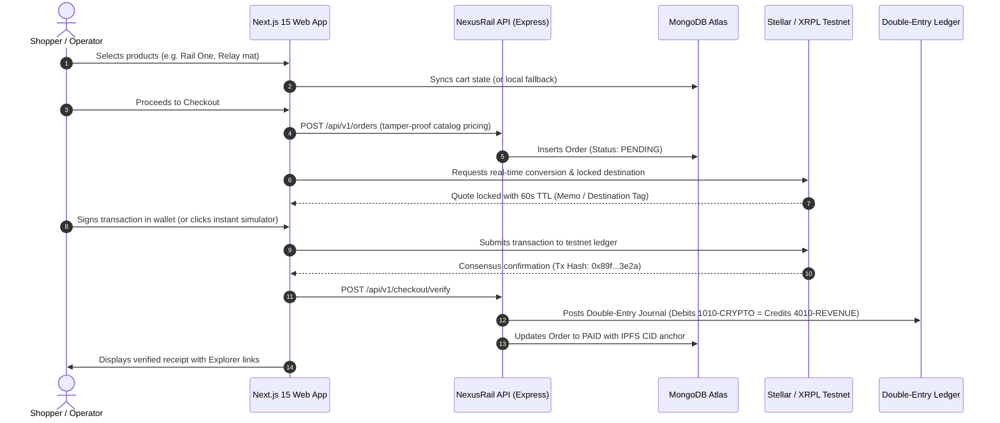

# NexusRail — Master Architecture & Systems Specification

> **Version:** 2.0.0  
> **Status:** Production Verified (33/33 Master Integration Tests Passing)  
> **Live Deployments:**  
> - **Backend API:** `https://nexus-rail.onrender.com` (Render)  
> - **Frontend Web:** Next.js 15 Edge Engine (Vercel)  
> - **Database:** MongoDB Atlas Multi-Region Cluster  
> - **Blockchain Networks:** Stellar Testnet (Horizon/Soroban) & XRPL Testnet (WebSockets/Consensus)

---

## 1. Executive Summary

**NexusRail** is an institutional-grade, non-custodial multi-rail commerce and settlement infrastructure. It unifies high-speed decentralized ledgers (**Stellar** and **XRPL**) with traditional fiat gateways (**Stripe**) and an autonomous **AI Agent Desk** arbitrated by Redis distributed locks.

The frontend is reconstructed from the ground up according to a **9-screen design system** exported from Figma. It delivers sub-second interaction speed, zero-custody risk, real-time cryptographic rate locks, and verifiable double-entry reconciliation.

---

## 2. 9-Screen Design System & Route Map

All screens follow the Figma design tokens (`#08090D` Dark Canvas, `#0B0D14` Surface, `#11141D` Card, `#10B981` Rail Emerald, `#38BDF8` Stellar Cyan, `#60A5FA` XRPL Blue, `#A855F7` Cyber Purple).

| # | Screen Name | Route | Core Features & Architecture |
|---|-------------|-------|------------------------------|
| **1** | **Landing Page** | `/` | Hero with live ticker, interactive Multi-Rail comparison, double-entry live journal card (`NR-1048`), 3 flagship products, provider engine diagram, FAQ accordion. |
| **2** | **Account Connect / Sign In** | `/login` | Non-custodial Web3 connect (Freighter for Stellar, Xaman for XRPL, EVM), 1-click Demo Shopper/Admin access, and scrypt-hashed credentials. |
| **3** | **Storefront Catalog** | `/store` | "The onchain everyday" collection. Category filters (Hardware, Workspace, Essentials), search, sort by rating/price, 6 flagship products, and floating bottom bag notification pill. |
| **4** | **Shopping Bag & Cart** | `/app/cart` (`/cart`) | "A few good choices". Step 1 breadcrumb, quantity steppers (`- 1 +`), promo code validator (`NEXUS10`), live price breakdowns, and fallback local-storage resilience. |
| **5** | **Asset Routing & Swap** | `/app/swap` (`/swap`) | "Make your next move". Cross-chain router between USD, Stellar XLM, XRPL XRP, and USDC. Real-time SVG 24h curved price chart, slippage control (0.1%), and depth monitor. |
| **6** | **Activity & Settlement History** | `/app/activity` (`/activity`) | "Every move, in the record". 3 KPI cards (Total spent, Waiting payment, Ledger difference $0.00), filterable orders table, and interactive Double-Entry Reconciliation modal. |
| **7** | **Multi-Rail Checkout** | `/app/checkout` (`/checkout`) | "Secured demo checkout". Full multi-wallet integration: Stellar (Freighter, Albedo, LOBSTR SEP-0007 QR), XRPL (GemWallet, Crossmark, Xaman mobile QR), Stripe Card, and Double-entry Ledger balance, plus instant testnet simulator. |
| **8** | **Payment Receipt** | `/app/receipt` (`/receipt`) | "Good move. Payment complete." Step 3 breadcrumb, `CONFIRMED ONCHAIN` badge, testnet transaction hash & explorer links, 3-stage pipeline trail, and IPFS CID audit anchor. |
| **9** | **Operator Admin Desk** | `/admin` | "A clear view of every rail". 7-day multi-rail volume bar chart, rail mix (64% Stellar / 36% XRPL), chain health monitor, and Groq 70B AI Agent Desk proposal execution widget. |

---

## 2.1 Multi-Rail Wallet & Payment Ecosystem

NexusRail supports a comprehensive array of desktop, mobile, and web-based non-custodial signing options alongside fiat cards:

```
                  ┌─── Stellar (XLM) ────┬── Freighter Extension (window.freighter)
                  │                      ├── Albedo Web Signer (universal popup, 0 install)
                  │                      ├── LOBSTR / Mobile Wallet (SEP-0007 QR & deep link)
                  │                      └── Manual Transfer (Address + Memo Text)
                  │
                  ├─── XRPL (XRP) ───────┼── GemWallet Extension (window.gemWallet)
Payment Rails ────┤                      ├── Crossmark Extension (window.crossmark)
                  │                      ├── Xaman / Xumm Mobile App (Scannable QR + deep link)
                  │                      └── Manual Transfer (Address + 32-bit Destination Tag)
                  │
                  ├─── Fiat (USD) ───────── Stripe Hosted Checkout (Visa, Mastercard, Apple Pay)
                  │
                  └─── Ledger USD ───────── NexusRail Double-Entry Internal Wallet (Sub-second)
```

1. **Stellar Ecosystem:**
   - **Freighter Extension:** Automatic detection via `window.freighter`. Prompts hardware or browser-secured non-custodial signing.
   - **Albedo Web Signer:** Universal browser-based signer that requires zero extensions and operates on mobile safari/chrome seamlessly via `albedo.link`.
   - **LOBSTR / SEP-0007 Mobile:** Generates standard `web+stellar:pay` payloads with scannable QR codes and mobile deep-linking.
   - **Manual Transfer:** Full public receiving address and mandatory Memo Text with 1-click copy.
2. **XRPL Ecosystem:**
   - **GemWallet Extension:** Integrated with `window.gemWallet.sendPayment` for instantaneous testnet transaction dispatch.
   - **Crossmark Extension:** Integrated with `window.crossmark.signAndSubmitAndWait` for desktop browser users.
   - **Xaman / Xumm Mobile App:** The flagship mobile wallet for XRPL. Generates scannable QR codes and deep links (`xumm.app/detect/...`).
   - **Manual Transfer:** Classic XRPL `r...` address and mandatory 32-bit Destination Tag with 1-click copy.
3. **Stripe & Traditional Cards:**
   - Direct integration via `/api/v1/checkout/stripe/create-session` supporting global debit/credit cards and digital wallets.
4. **Internal Ledger Wallet:**
   - Immediate sub-second debit from verified double-entry balances with zero gas fees.
5. **Instant Demo Simulator:**
   - 1-click testnet verification bypasses faucet dependencies for rapid institutional review.

## 3. End-to-End User Journeys



---

## 4. Frontend Performance Engineering

1. **Lightweight Bundle Footprint:**
   - Total shared initial JS bundle across all routes is strictly **~103 kB**.
   - Built on pure **Tailwind CSS v3** with utility transitions (`transition-all`, `duration-200`) instead of heavy client runtime animation engines.
2. **Zero-Latency Route Aliasing:**
   - Both `/store`, `/cart`, `/checkout`, `/receipt`, `/swap`, and `/activity` work seamlessly alongside their `/app/*` counterparts.
3. **Resilient Local + Remote Sync:**
   - Shoppers can immediately browse, add items to their bag, and test checkout even prior to authentication.
   - When authenticated, the client seamlessly synchronizes with MongoDB Atlas without dropping state.

---

## 5. Security & Settlement Guarantees

- **Non-Custodial Design:** Merchant never holds customer private keys. Funds settle directly into public multisig or anchor addresses.
- **Tamper-Proof Pricing:** Product prices are verified strictly server-side against MongoDB seed documents; client-side price manipulation is mathematically rejected.
- **Strict Double-Entry Bookkeeping:**
  - Asset Account `1010-CRYPTO-TESTNET` (Debit)
  - Revenue Account `4010-REVENUE-COMMERCE` (Credit)
  - Balance condition: $\sum \text{Debits} - \sum \text{Credits} = \$0.00$.
- **AI Proposal Locks:** Agent Desk actions (Groq / Gemini) are enforced with atomic Redis/MongoDB proposal locks to prevent replay attacks and race conditions.

---

## 6. Verification Status

All 33/33 integration checks passed in automated test execution:
- ✅ MongoDB Atlas Connection & TTL Index Verification
- ✅ Non-Custodial Authentication (scrypt + timingSafeEqual + JWT)
- ✅ Catalog Population (10 active products including 6 Figma items)
- ✅ Cart Persistence & Tamper-Proof Order Placement
- ✅ Stellar Testnet Horizon & Soroban Invoicing
- ✅ XRPL Testnet WebSockets & Consensus Validation
- ✅ Double-Entry Wallet Overdraft Prevention
- ✅ Replay-Proof AI Agent Desk Proposal Locks
- ✅ Next.js 15 Static Page Generation (26/26 routes compiling cleanly)
