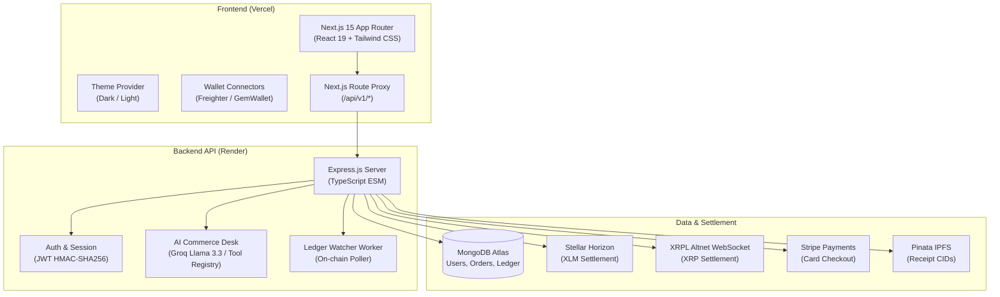

# NexusRail

[](https://www.typescriptlang.org/)
[](https://nextjs.org/)
[](https://react.dev/)
[](https://expressjs.com/)
[](https://www.mongodb.com/)
[](https://stellar.org/)
[](https://xrpl.org/)
[](LICENSE)

NexusRail is an enterprise-grade multi-rail commerce platform combining native Web3 settlements (Stellar & XRPL), traditional fiat checkout (Stripe), an immutable double-entry ledger in MongoDB Atlas, and an autonomous AI commerce assistant.

---

## 🌐 Deployments

| Service | Platform | URL | Status |
| :--- | :--- | :--- | :--- |
| **Frontend Web App** | Vercel | [https://nexus-rail-one.vercel.app](https://nexus-rail-one.vercel.app) | 🟢 Production |
| **Backend API** | Render | [https://nexus-rail.onrender.com](https://nexus-rail.onrender.com) | 🟢 Active |
| **Health Check** | Render | [https://nexus-rail.onrender.com/health](https://nexus-rail.onrender.com/health) | 🟢 200 OK |
| **API Proxy** | Vercel | [https://nexus-rail-one.vercel.app/api/v1/health](https://nexus-rail-one.vercel.app/api/v1/health) | 🟢 200 OK |

---

## 📚 Documentation Index

| Document | Purpose |
| :--- | :--- |
| [**`docs/PROJECT_OVERVIEW.md`**](./docs/PROJECT_OVERVIEW.md) | High-level project purpose, value propositions, and verified capabilities. |
| [**`docs/ARCHITECTURE.md`**](./docs/ARCHITECTURE.md) | System topology, request lifecycle, multi-chain provider patterns, and diagrams. |
| [**`docs/API_REFERENCE.md`**](./docs/API_REFERENCE.md) | Complete reference for all verified endpoints, request bodies, and responses. |
| [**`docs/DATA_SOURCES.md`**](./docs/DATA_SOURCES.md) | Inventory of databases, blockchains, APIs, caching mechanisms, and data flows. |
| [**`docs/CONFIGURATION.md`**](./docs/CONFIGURATION.md) | Environment variable definitions, deployment profiles, and defaults. |
| [**`docs/TESTING_AND_OPERATIONS.md`**](./docs/TESTING_AND_OPERATIONS.md) | Test suites, commands, 33/33 test verification results, and operational runbooks. |
| [**`docs/KNOWN_LIMITATIONS.md`**](./docs/KNOWN_LIMITATIONS.md) | Catalog of stubbed routes (HTTP 501), in-memory fallbacks, and known constraints. |
| [**`docs/ROADMAP.md`**](./docs/ROADMAP.md) | Prioritized (P0–P3) technical improvement proposals with implementation outlines. |
| [**`docs/SOURCE_OF_TRUTH.md`**](./docs/SOURCE_OF_TRUTH.md) | Strict claim-to-code audit mapping verifying real vs planned features. |
| [**`openapi.yaml`**](./openapi.yaml) | Valid OpenAPI 3.0.3 specification for the REST API. |

---

## ✨ Features

- **Multi-Rail Crypto Settlement**:
  - **Stellar Horizon**: Direct XLM settlement with transaction memo matching and sequence verification.
  - **XRPL Altnet**: Direct XRP settlement via WebSocket RPC with 32-bit Destination Tag routing.
- **Traditional Card Payments**: Stripe Checkout session support with webhook fulfillment.
- **AI Commerce Assistant**: Sub-300ms conversational agent (Groq / Gemini) with a structured tool registry for catalog search, discounts, and order management.
- **Double-Entry Ledger**: Immutable transaction logging in MongoDB ensuring balanced accounting between customer escrow and merchant settlement.
- **Modern Responsive Frontend**: Next.js 15 App Router with React 19, Tailwind CSS, dark/light theme switching, portfolio animations, and mobile drawer navigation.
- **API Reverse Proxy**: Frontend routes `/api/v1/*` through Next.js server handlers directly to the backend to eliminate cross-origin issues in browsers.

---

## 🏗 Architecture



---

## 📂 Repository Structure

```
nexus-rail/
├── apps/
│   ├── web/                    # Next.js 15 Web Application
│   │   ├── public/             # Optimized WebP assets and favicons
│   │   ├── src/
│   │   │   ├── app/            # App Router pages and proxy routes
│   │   │   ├── components/     # UI components (NexusLogo, AgentDesk, MultiRail)
│   │   │   └── lib/            # Utilities, wallet integrations, and client state
│   │   └── README.md           # Frontend Documentation
│   │
│   └── api/                    # Express.js Microservice
│       ├── src/
│       │   ├── agent/          # Tool registry and proposal lock management
│       │   ├── config/         # Environment schema validation
│       │   ├── middleware/     # Auth and security middlewares
│       │   ├── routes/         # REST API endpoints
│       │   ├── services/       # Stellar, XRPL, Stripe, AI, and MongoDB services
│       │   └── workers/        # Ledger watcher and keep-alive workers
│       └── README.md           # Backend Documentation
│
├── packages/
│   └── shared/                 # Shared TypeScript models, schemas, and interfaces
│
├── docs/                       # Comprehensive System Documentation
├── openapi.yaml                # OpenAPI 3.0.3 Specification
├── .env.example                # Environment variable template
├── package.json                # Workspaces configuration
└── README.md                   # Project overview
```

---

## 🚀 Quickstart

### 1. Prerequisites
- **Node.js**: `v20.x` or `v22.x`
- **npm**: `v10.x` or higher
- **MongoDB**: Local or MongoDB Atlas instance

### 2. Installation
```bash
git clone https://github.com/AtulPandey429/nexus_rail.git
cd nexus_rail
npm install
```

### 3. Environment Setup
Copy `.env.example` to `.env`:
```bash
cp .env.example .env
```
Provide the required configuration:
```env
PORT=4000
NODE_ENV=development
JWT_SECRET=your_32_character_jwt_secret_here
MONGODB_URI=mongodb+srv://<user>:<password>@cluster.mongodb.net/nexusrail?retryWrites=true&w=majority
CORS_ORIGIN=http://localhost:3000
APP_URL=http://localhost:3000
API_SERVER_URL=http://localhost:4000
```

### 4. Build Shared Types & Packages
```bash
npm run build:shared
npm run build:api
```

### 5. Run Development Servers
```bash
# Terminal 1: Backend API (http://localhost:4000)
npm run dev:api

# Terminal 2: Next.js Frontend (http://localhost:3000)
npm run dev:web
```

---

## 📜 Scripts

- `npm run build`: Compiles shared packages, backend TypeScript, and Next.js frontend.
- `npm run dev:api`: Starts backend API in development mode with live reload.
- `npm run dev:web`: Starts Next.js development server.
- `npm run build:api`: Compiles the backend API (`tsc`).
- `npm run build:web`: Builds the Next.js frontend for production.

---

## 📄 License
MIT
