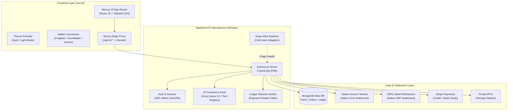

# 🚀 NexusRail — Multi-Rail Commerce & Autonomous AI Agent Desk

[](https://www.typescriptlang.org/)
[](https://nextjs.org/)
[](https://react.dev/)
[](https://expressjs.com/)
[](https://www.mongodb.com/)
[](https://stellar.org/)
[](https://xrpl.org/)
[](LICENSE)

NexusRail is an enterprise-grade, clean-room commerce platform combining **native Web3 multi-rail crypto payments** (Stellar & XRPL), **traditional fiat checkout** (Stripe), and an **autonomous sub-300ms AI commerce agent desk**.

---

## 🌐 Live Deployments

| Component | Platform | Live URL | Status |
| :--- | :--- | :--- | :--- |
| **Frontend Web App** | Vercel | [https://nexus-rail-one.vercel.app](https://nexus-rail-one.vercel.app) | 🟢 Production |
| **Backend API Engine** | Render | [https://nexus-rail.onrender.com](https://nexus-rail.onrender.com) | 🟢 Active |
| **API Health Check** | Render | [https://nexus-rail.onrender.com/health](https://nexus-rail.onrender.com/health) | 🟢 200 OK |
| **Proxied API Health** | Vercel | [https://nexus-rail-one.vercel.app/api/v1/health](https://nexus-rail-one.vercel.app/api/v1/health) | 🟢 200 OK |

---

## ⚡ Key Highlights & Core Capabilities

- **Dual-Rail Native Crypto Settlement**:
  - **Stellar Horizon**: Direct XLM on-chain invoice generation, transaction memo matching, and native Horizon validation without third-party custodians.
  - **XRPL Altnet**: Real-time WebSocket RPC monitoring, 32-bit Destination Tag correlation, and automatic ledger finality checks.
- **Traditional Fiat Rail**:
  - Integrated **Stripe Checkout** modal with webhook-driven double-entry order fulfillment.
- **Autonomous AI Agent Desk**:
  - Powered by **Groq (`llama-3.3-70b-versatile`)** / **Gemini Flash**.
  - Structured tool-calling registry (`findProducts`, `prepareCheckout`, `checkLedgerStatus`, `applyDiscount`).
  - Atomic proposal locks to prevent concurrent cart race conditions.
- **Double-Entry Wallet Ledger**:
  - Strict immutable transaction journal in MongoDB, ensuring zero orphaned balances and mathematically verifiable accounts.
- **Social Commerce & RWA Gold Vault**:
  - Product Showdowns, Mento verified reviews, and simulated tokenized Real-World Asset (RWA) Gold perpetual contracts.
- **High-Performance Client UI**:
  - Next.js 15 App Router with React 19 Server/Client Components.
  - Dark & Light mode theme persistence with smooth CSS transitions.
  - Portfolio animations (`float`, `pulse-slow`, `fade-in-up`, `gradient-x`).
  - Ultra-lightweight WebP brand assets (1.6 KB icon, 99.6% size reduction from original 4.8 MB master).
  - Reverse proxy architecture: Next.js securely forwards `/api/v1/*` to Render, bypassing cross-origin browser constraints.

---

## 🏗 System Architecture



---

## 📂 Monorepo Structure

```
nexus-rail/
├── apps/
│   ├── web/                    # Next.js 15 Web Application
│   │   ├── public/             # Optimized WebP brand icons & favicons
│   │   ├── src/
│   │   │   ├── app/            # App Router pages (store, activity, rwa, cart, login...)
│   │   │   ├── components/     # UI components (NexusLogo, AgentDesk, MultiRail, Theme...)
│   │   │   └── lib/            # Client utilities (wallets, rates, cart state)
│   │   └── README.md           # Detailed Frontend Documentation
│   │
│   └── api/                    # Express.js Microservice
│       ├── src/
│       │   ├── agent/          # Tool calling registry & proposal locks
│       │   ├── config/         # Zod environment validation
│       │   ├── middleware/     # JWT authentication & API Key verification
│       │   ├── routes/         # REST endpoints (auth, checkout, crypto, products, rwa...)
│       │   ├── services/       # Core business logic (Stellar, XRPL, Stripe, AI, Mongo...)
│       │   ├── sockets/        # Real-time WebSocket server
│       │   └── workers/        # On-chain payment finality & keep-alive workers
│       └── README.md           # Detailed Backend Documentation
│
├── packages/
│   └── shared/                 # Shared TypeScript models, Zod schemas, & DTOs
│       └── src/
│           ├── plugins/        # Extensible plugin interfaces
│           ├── schemas/        # Shared validation schemas
│           └── types/          # Database, user, and health interfaces
│
├── sprints/                    # Complete 35-day architectural roadmap & specifications
├── .env.example                # Unified environment variable template
├── package.json                # Monorepo workspaces configuration
└── README.md                   # This file
```

---

## 🚀 Quickstart & Local Setup

### 1. Prerequisites
- **Node.js**: `v20.x` or `v22.x` (LTS recommended)
- **npm**: `v10.x` or higher
- **MongoDB Atlas** or local MongoDB instance

### 2. Clone & Install
```bash
git clone https://github.com/AtulPandey429/nexus_rail.git
cd nexus_rail
npm install
```

### 3. Configure Environment
Copy `.env.example` to `.env` in the root directory:
```bash
cp .env.example .env
```
Fill in the essential variables:
```env
PORT=4000
NODE_ENV=development
JWT_SECRET=super_secret_jwt_passphrase_at_least_32_characters
MONGODB_URI=mongodb+srv://<user>:<password>@cluster.mongodb.net/nexusrail?retryWrites=true&w=majority
CORS_ORIGIN=http://localhost:3000
APP_URL=http://localhost:3000
API_SERVER_URL=http://localhost:4000
```
*(Optional Web3 & AI keys can be added as needed. See [.env.example](file:///.env.example) for details.)*

### 4. Build Shared Types
```bash
npm run build:shared
```

### 5. Run Development Servers
In separate terminals (or concurrently):
```bash
# Terminal 1: Backend API (runs on http://localhost:4000)
npm run dev:api

# Terminal 2: Next.js Frontend (runs on http://localhost:3000)
npm run dev:web
```

---

## ⚙️ Environment Variables Reference

| Variable | Scope | Required | Description |
| :--- | :--- | :--- | :--- |
| `PORT` | Backend | Optional | Port for the Express API server (default: `4000`). |
| `NODE_ENV` | Global | Required | Execution mode (`development` \| `production`). |
| `MONGODB_URI` | Backend | **Required** | MongoDB Atlas connection string for ledger, orders, and users. |
| `JWT_SECRET` | Backend | **Required** | 32+ character HMAC key for signing authentication tokens. |
| `CORS_ORIGIN` | Backend | Required | Allowed origin for incoming requests (e.g., `http://localhost:3000`). |
| `API_SERVER_URL` | Frontend | Required | Backend URL target for the Next.js API proxy route. |
| `GROQ_API_KEY` | Backend | Optional | API key for LLM chat completions in the AI Agent Desk. |
| `GROQ_MODEL` | Backend | Optional | Model identifier (default: `llama-3.3-70b-versatile`). |
| `HORIZON_URL` | Backend | Optional | Stellar Horizon RPC node (default: `https://horizon-testnet.stellar.org`). |
| `STELLAR_MERCHANT_PUBLIC_KEY` | Backend | Optional | Public G-address of the merchant for XLM settlements. |
| `XRPL_WSS` | Backend | Optional | XRPL WebSocket endpoint (default: `wss://s.altnet.rippletest.net:51233`). |
| `XRPL_MERCHANT_ADDRESS` | Backend | Optional | Classic r-address of the merchant for XRP settlements. |
| `STRIPE_SECRET_KEY` | Backend | Optional | Stripe secret key (`sk_test_...`) for fiat checkout. |
| `STRIPE_WEBHOOK_SECRET` | Backend | Optional | Stripe webhook signature secret (`whsec_...`). |
| `PINATA_JWT` | Backend | Optional | Pinata JWT for permanent IPFS receipt archiving. |

---

## 🔒 Security & Clean-Room Guarantee

1. **Zero Hardcoded Secrets**: All cryptographic secrets, database credentials, and merchant addresses are injected strictly via environment variables.
2. **Double-Spend Protection**: Invoices on Stellar and XRPL use strict memo and destination tag isolation. Transactions cannot be settled twice.
3. **Double-Entry Ledger**: Every debit has an offsetting credit entry in the MongoDB transaction journal.
4. **CORS Isolation**: All frontend browser requests route through the Next.js reverse proxy (`/api/v1/*`), keeping backend infrastructure protected and eliminating browser CORS exposure.

---

## 📜 Monorepo Scripts

- `npm run build`: Compiles shared packages, backend TypeScript, and Next.js frontend.
- `npm run dev:api`: Runs the backend API with live watch reload (`tsx watch`).
- `npm run dev:web`: Launches the Next.js development server (`next dev`).
- `npm run build:api`: Builds the backend production bundle (`tsc`).
- `npm run build:web`: Compiles the Next.js client for production deployment.

---

## 📄 License
MIT License. Crafted with precision for next-generation multi-rail decentralized commerce.
