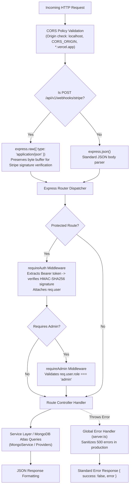
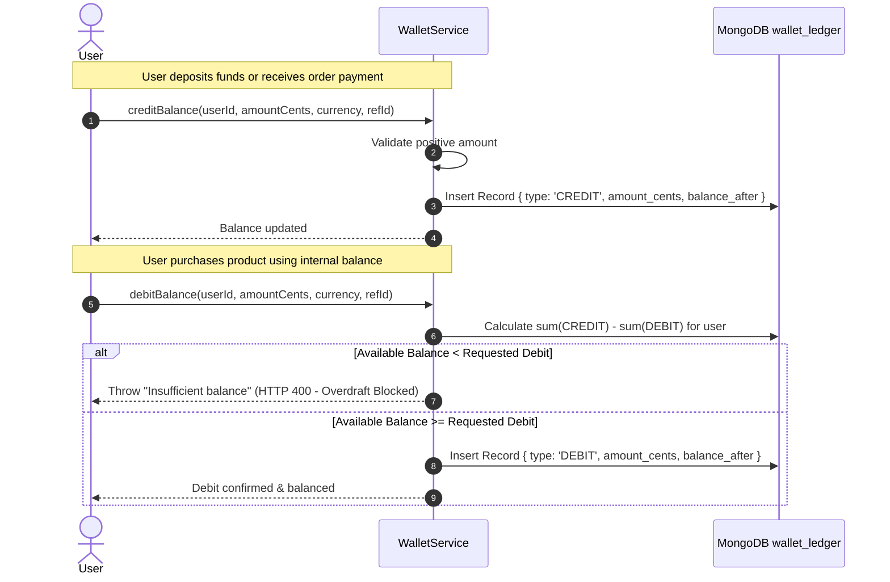

# 🏛️ NexusRail — System Architecture & Request Lifecycle

**Architecture Type:** Modular Monorepo with Microservice Backend & Edge Reverse Proxy  
**Runtime:** Node.js 22 (ESM with `--experimental-require-module`)  
**Backend Framework:** Express 4 with TypeScript  
**Frontend Framework:** Next.js 15.2 App Router (React 19)  

---

## 1. Monorepo Structural Topology

```
nexus-rail/
├── apps/
│   ├── api/                          # Express REST API microservice
│   │   ├── src/
│   │   │   ├── agent/                # AI proposal locks and tool registry
│   │   │   ├── config/               # Zod-validated environment schema (env.ts)
│   │   │   ├── db/                   # Secondary database connectors (supabase.ts)
│   │   │   ├── middleware/           # Auth JWT & API key verification
│   │   │   ├── plugins/              # Extensibility stubs (hyperliquid, privy)
│   │   │   ├── routes/               # Express feature routers (auth, orders, cart, etc.)
│   │   │   ├── services/             # Core business logic & SDK integrations
│   │   │   │   ├── ai/               # Groq LLM client & model discovery
│   │   │   │   ├── crypto/           # Multi-chain providers (Stellar & XRPL)
│   │   │   │   └── rwa/              # Commodity oracle services
│   │   │   ├── sockets/              # Socket service stubs
│   │   │   ├── workers/              # Ledger watcher and keep-alive pingers
│   │   │   └── server.ts             # Server entrypoint and middleware assembly
│   │   └── package.json
│   │
│   └── web/                          # Next.js 15 Frontend Client
│       ├── public/                   # Compressed WebP brand assets and favicons
│       ├── src/
│       │   ├── app/                  # App Router pages and API reverse proxy
│       │   │   └── api/v1/[...path]/ # Catch-all reverse proxy route handler
│       │   ├── components/           # UI components (NexusLogo, AgentDesk, MultiRail)
│       │   └── lib/                  # Wallets, rates, and client shopping state
│       └── package.json
│
├── packages/
│   └── shared/                       # Shared TypeScript types, interfaces & schemas
│       ├── src/
│       │   ├── plugins/              # Plugin contracts (PluginInterface.ts)
│       │   ├── schemas/              # Zod validation schemas (auth.ts)
│       │   └── types/                # Database, user, and health interfaces
│       └── package.json
│
├── scripts/                          # Automated verification suites
└── docs/                             # Architectural and operational documentation
```

---

## 2. Request Lifecycle & Middleware Pipeline

All incoming HTTP requests to the backend follow a strict middleware pipeline:



---

## 3. Multi-Chain Provider Architecture

NexusRail settles crypto transactions directly on public blockchain testnets using an extensible provider pattern centered around the `IChainProvider` interface.

```
┌────────────────────────────────────────────────────────┐
│                   IChainProvider                       │
├────────────────────────────────────────────────────────┤
│ + chainId: string                                      │
│ + assetSymbol: string                                  │
│ + network: ChainNetwork                                │
│ + getMerchantAddress(): string                         │
│ + validateAddress(address: string): boolean            │
│ + getExplorerUrl(txHash: string): string               │
│ + getAccountBalance(address?: string): Promise<Balance>│
│ + createInvoice(orderId, cents): Promise<ChainInvoice> │
│ + verifyPayment(orderId, hash, exp?): Promise<Result>  │
└───────────────────────────▲────────────────────────────┘
                            │
              ┌─────────────┴─────────────┐
              │                           │
┌─────────────┴────────────┐ ┌────────────┴────────────┐
│   StellarTestnetProvider │ │    XrplTestnetProvider  │
├──────────────────────────┤ ├─────────────────────────┤
│ - Horizon.Server client  │ │ - Client (xrpl WebSocket│
│ - HMAC-SHA256 Memo       │ │ - 32-bit DestinationTag │
│ - XLM Operation Checks   │ │ - tesSUCCESS Validation │
│ - Pre-builds Payment XDR │ │ - Partial Payment Defense│
└──────────────────────────┘ └─────────────────────────┘
```

### Registration & Routing
1. Providers are instantiated and registered at server initialization into `chainRegistry` (`apps/api/src/services/crypto/index.ts`).
2. When a customer selects a payment rail, `POST /api/v1/checkout/:chain/create-invoice` dynamically resolves the provider by `chainId` ('stellar' or 'xrpl').
3. Adding a new blockchain (e.g., EVM or Solana) requires only creating a class implementing `IChainProvider` and calling `chainRegistry.register()`, without touching existing route logic.

---

## 4. Double-Entry Accounting Model

NexusRail implements a double-entry ledger model in MongoDB Atlas collection `wallet_ledger`:



### Invariants Enforced
- **Write-Only Journal**: Ledger entries are never updated or deleted in place.
- **Overdraft Invariant**: A user's total debits can never exceed total credits.
- **Multi-Asset Segregation**: USD, XLM, and XRP are tracked as distinct currencies in separate ledger journal streams.

---

## 5. Next.js Reverse Proxy Gateway

To eliminate CORS configuration issues, header stripping, and browser origin conflicts, all client communication routes through Next.js server handlers:

```
[Browser Client]
       │
       ▼  POST https://nexus-rail-one.vercel.app/api/v1/checkout/stellar/create-invoice
┌────────────────────────────────────────────────────────┐
│ Next.js App Router Catch-All Edge Proxy Handler        │
│ Path: apps/web/src/app/api/v1/[...path]/route.ts       │
│                                                        │
│ 1. Extracts path segments and query parameters         │
│ 2. Prepends API_SERVER_URL                             │
│ 3. Strips host, origin, and connection headers         │
│ 4. Forwards request body buffer and Authorization      │
│ 5. Transparently streams response back to client       │
└────────────────────────────────────────────────────────┘
       │
       ▼  POST https://nexus-rail.onrender.com/api/v1/checkout/stellar/create-invoice
[Express Backend API Server]
```

---

## 6. Background Workers

1. **`LedgerWatcherWorker` (`apps/api/src/workers/ledgerWatcher.ts`)**:
   - Initialized during server boot in `server.ts`.
   - Polls MongoDB `orders` collection every 20 seconds for pending orders on crypto rails.
   - Logs active pending counts.
2. **`KeepAliveWorker` (`apps/api/src/workers/keepAlive.ts`)**:
   - Checks for `RENDER_EXTERNAL_URL` in the environment.
   - Pings `/api/v1/health` every 10 minutes (600,000 ms) to keep the Render free-tier dyno awake and prevent cold-start latency.
