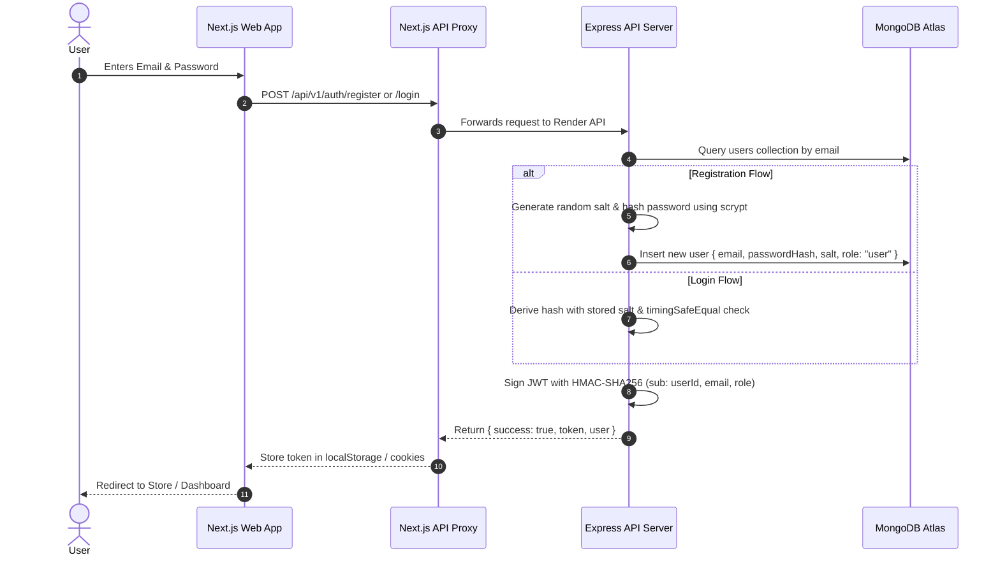
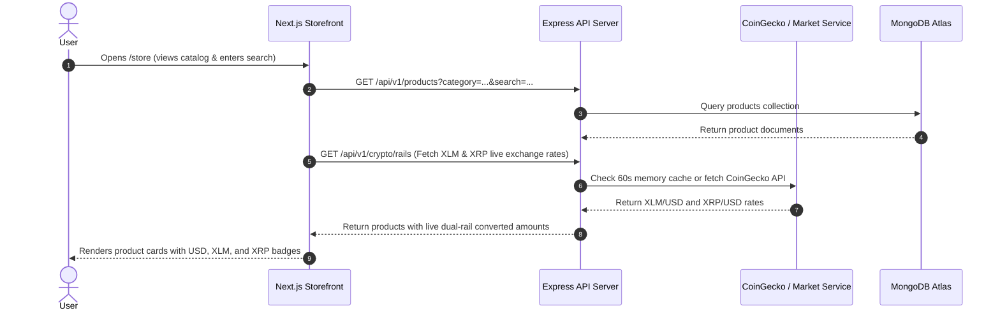
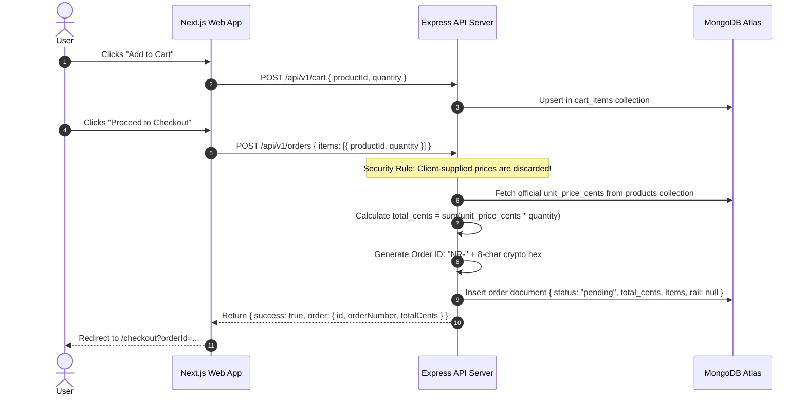
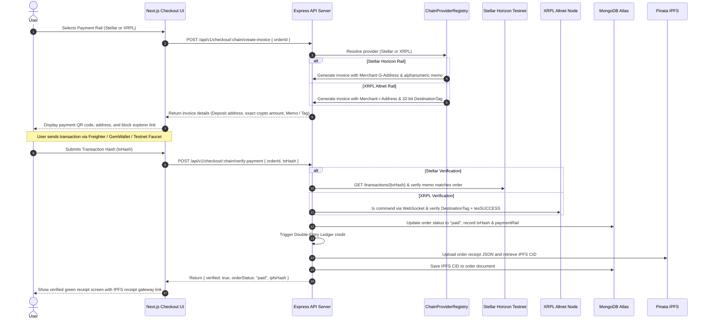
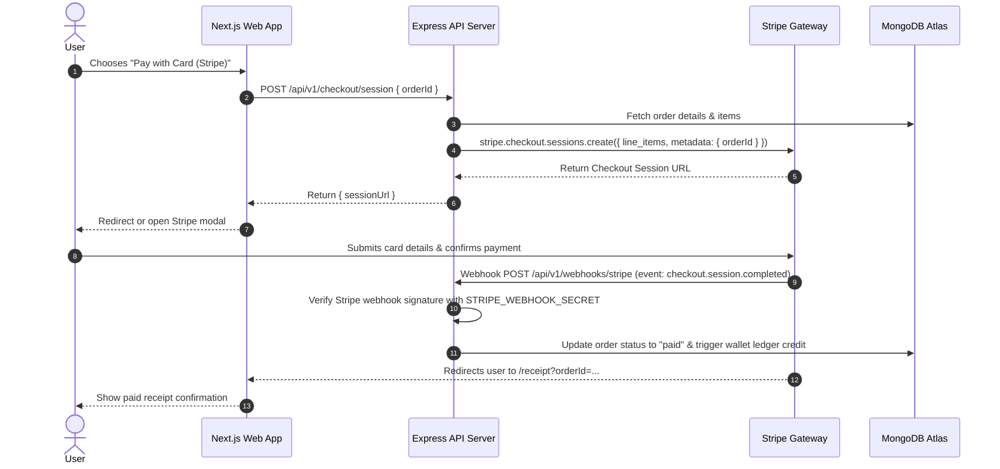
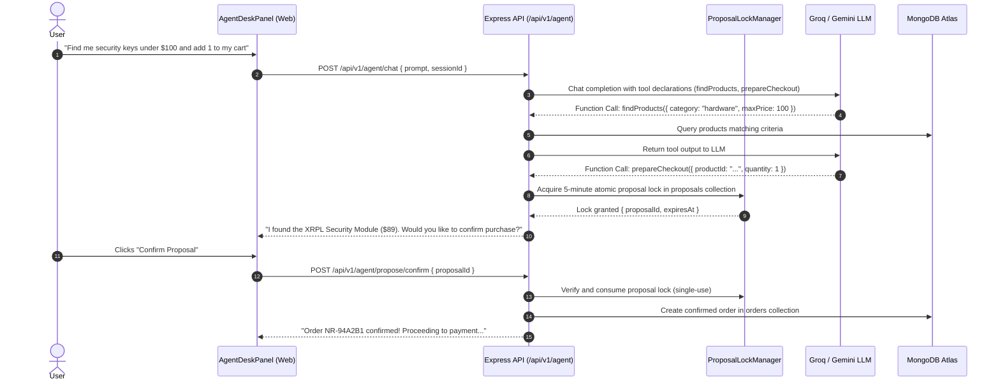
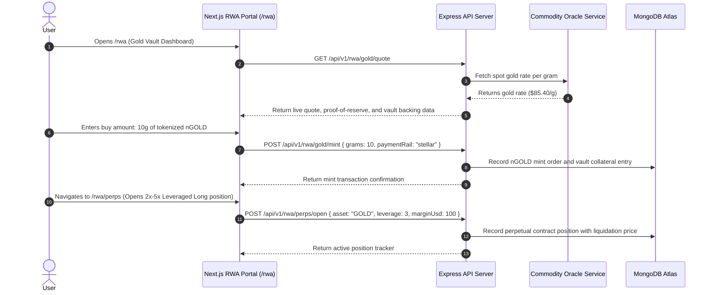

# 📖 NexusRail — Complete Features & End-to-End System Flows Guide

Welcome to the definitive architectural and functional reference for **NexusRail**. This document details every platform capability, system flow, cryptographic settlement engine, database model, and end-to-end user lifecycle implemented in the codebase.

---

## 📑 Table of Contents
1. [Platform Overview & Tech Stack](#1-platform-overview--tech-stack)
2. [Master Feature Matrix](#2-master-feature-matrix)
3. [End-to-End System & User Flows](#3-end-to-end-system--user-flows)
   - [Flow 1: User Authentication & Identity](#flow-1-user-authentication--identity)
   - [Flow 2: Product Discovery & Dynamic Catalog](#flow-2-product-discovery--dynamic-catalog)
   - [Flow 3: Tamper-Proof Cart & Order Lifecycle](#flow-3-tamper-proof-cart--order-lifecycle)
   - [Flow 4: Native Multi-Rail Web3 Crypto Settlement (Stellar & XRPL)](#flow-4-native-multi-rail-web3-crypto-settlement-stellar--xrpl)
   - [Flow 5: Traditional Card Checkout (Stripe Gateway)](#flow-5-traditional-card-checkout-stripe-gateway)
   - [Flow 6: Double-Entry Ledger Bookkeeping](#flow-6-double-entry-ledger-bookkeeping)
   - [Flow 7: Autonomous Sub-300ms AI Commerce Desk](#flow-7-autonomous-sub-300ms-ai-commerce-desk)
   - [Flow 8: Real-World Asset (RWA) Gold Vault & Perps](#flow-8-real-world-asset-rwa-gold-vault--perps)
   - [Flow 9: Social Commerce (Showdowns & Mento Reviews)](#flow-9-social-commerce-showdowns--mento-reviews)
   - [Flow 10: Next.js Reverse Proxy & Zero-CORS Architecture](#flow-10-nextjs-reverse-proxy--zero-cors-architecture)
4. [Database Architecture & Collections Schema](#4-database-architecture--collections-schema)
5. [Complete API Endpoints Map](#5-complete-api-endpoints-map)
6. [Verification & Test Suites](#6-verification--test-suites)

---

## 1. Platform Overview & Tech Stack

NexusRail is an enterprise-grade multi-rail commerce super-platform featuring native public testnet settlements, immutable double-entry ledgering, and an autonomous AI agent desk.

```
┌────────────────────────────────────────────────────────────────────────┐
│                          NEXUSRAIL ECOSYSTEM                           │
├──────────────────────────┬─────────────────────────────────────────────┤
│ Frontend Web App         │ Next.js 15 (React 19), Tailwind CSS,        │
│                          │ Dark/Light Theme Provider, Lucide Icons     │
├──────────────────────────┼─────────────────────────────────────────────┤
│ Backend API Gateway      │ Express 4 (Node.js 22 ESM), TypeScript,     │
│                          │ Socket.io, Zod runtime validation           │
├──────────────────────────┼─────────────────────────────────────────────┤
│ Settlement Rails         │ Stellar Horizon (XLM), XRPL Altnet (XRP),   │
│                          │ Stripe (Credit/Debit cards), Pinata IPFS    │
├──────────────────────────┼─────────────────────────────────────────────┤
│ Primary Database         │ MongoDB Atlas M0 (Users, Orders, Ledger,    │
│                          │ Products, Cart, Showdowns, Audit Traces)    │
├──────────────────────────┼─────────────────────────────────────────────┤
│ AI Intelligence Engine   │ Groq API (llama-3.3-70b-versatile) / Gemini │
│                          │ with Function Tool Calling & Atomic Locks   │
├──────────────────────────┼─────────────────────────────────────────────┤
│ Live Deployments         │ Frontend: https://nexus-rail-one.vercel.app │
│                          │ Backend:  https://nexus-rail.onrender.com   │
└──────────────────────────┴─────────────────────────────────────────────┘
```

---

## 2. Master Feature Matrix

| # | Feature Domain | Key Capabilities | Code Reference |
|---|---|---|---|
| **1** | **Authentication** | Email/Password with `scrypt` hashing & unique salt, HMAC-SHA256 JWT sessions, Web3 wallet nonce signing, Google OAuth exchange | `apps/api/src/services/auth.ts`<br>`apps/api/src/routes/auth.ts` |
| **2** | **Storefront & Catalog** | Live product catalog from MongoDB, atomic upvoting, search bar with embedded WebP branding, category filtering | `apps/api/src/routes/products.ts`<br>`apps/web/src/app/store/page.tsx` |
| **3** | **Tamper-Proof Orders** | Backend-enforced unit pricing, unique order IDs (`NR-XXXXXXXX`), atomic cart operations | `apps/api/src/routes/orders.ts`<br>`apps/api/src/routes/cart.ts` |
| **4** | **Stellar Settlement** | Direct Horizon testnet integration, alphanumeric memo matching, payment envelope decoding, sequence validation | `apps/api/src/services/crypto/stellarProvider.ts` |
| **5** | **XRPL Settlement** | Persistent WebSocket RPC connection, 32-bit Destination Tag matching, `tesSUCCESS` validation | `apps/api/src/services/crypto/xrplProvider.ts` |
| **6** | **Stripe Checkout** | Hosted Stripe Checkout sessions, asynchronous webhook handler, automatic order status update | `apps/api/src/services/stripe.ts`<br>`apps/api/src/routes/checkout.ts` |
| **7** | **Double-Entry Ledger** | Immutable debit/credit journal entries (`customer_escrow` & `merchant_settlement`), overdraft protection | `apps/api/src/services/wallet.ts`<br>`apps/api/src/routes/wallet.ts` |
| **8** | **Sub-300ms AI Desk** | LLM agent tool calling (`findProducts`, `prepareCheckout`, `checkLedgerStatus`), 5-min TTL proposal locks | `apps/api/src/agent/toolRegistry.ts`<br>`apps/api/src/agent/proposalLock.ts` |
| **9** | **RWA Gold Vault** | Live gold oracle quotes, fractional `nGOLD` minting simulation, 2x-5x perpetual futures trading | `apps/api/src/routes/rwa/`<br>`apps/web/src/app/rwa/page.tsx` |
| **10** | **Social Commerce** | Community product showdowns with voting, Mento verified reviews, real-time activity explorer | `apps/api/src/routes/showdowns.ts`<br>`apps/web/src/app/activity/page.tsx` |
| **11** | **Theme & UI** | Dark & Light modes with persistent `localStorage`, CSS variable tokens, portfolio keyframe animations | `apps/web/src/components/ThemeProvider.tsx`<br>`apps/web/src/app/globals.css` |
| **12** | **Reverse Proxy** | Edge API route forwarding `/api/v1/*` to Render, eliminating browser CORS mismatches | `apps/web/src/app/api/v1/[...path]/route.ts` |

---

## 3. End-to-End System & User Flows

### Flow 1: User Authentication & Identity

Users can authenticate via traditional credentials, Web3 wallet nonces, or Google OAuth.



---

### Flow 2: Product Discovery & Dynamic Catalog



---

### Flow 3: Tamper-Proof Cart & Order Lifecycle

Client-side price tampering is completely prevented. Product prices are strictly resolved server-side.



---

### Flow 4: Native Multi-Rail Web3 Crypto Settlement (Stellar & XRPL)

NexusRail executes direct on-chain verification against public testnets.



---

### Flow 5: Traditional Card Checkout (Stripe Gateway)



---

### Flow 6: Double-Entry Ledger Bookkeeping

Every transaction is balanced in MongoDB collection `wallet_ledger` to guarantee mathematical integrity.

```
       DEPOSIT / ORDER PAYMENT
                │
                ▼
   ┌──────────────────────────┐
   │      Double-Entry        │
   │      Ledger Engine       │
   └────────────┬─────────────┘
                │
       ┌────────┴────────┐
       ▼                 ▼
 ┌───────────┐     ┌───────────┐
 │   DEBIT   │     │  CREDIT   │
 │  Account: │     │  Account: │
 │  Customer │     │ Merchant  │
 │  Escrow   │     │Settlement │
 └───────────┘     └───────────┘
```

1. **Strict Immutability**: Ledger documents are write-only. Adjustments occur through offsetting reversal entries.
2. **Multi-Asset Support**: Individual sub-ledgers for `USD` (cents), `XLM` (stroops), and `XRP` (drops).
3. **Overdraft Protection**: A user's available balance is calculated before debiting; operations that exceed available funds are rejected with HTTP 400.

---

### Flow 7: Autonomous Sub-300ms AI Commerce Desk

The AI Commerce Desk uses LLMs with function tool-calling and atomic locks.



---

### Flow 8: Real-World Asset (RWA) Gold Vault & Perps



---

### Flow 9: Social Commerce (Showdowns & Mento Reviews)

- **Product Showdowns (`/api/v1/showdowns`)**: Head-to-head community battles (e.g., "Hardware Security Key vs Biometric Dongle"). Users cast atomic upvotes recorded via MongoDB `$inc`.
- **Mento Verified Reviews (`/api/v1/reviews`)**: Only users with confirmed, paid orders for a product can leave a verified review. Reviews include rating, comment, and verified on-chain badge.
- **On-Chain Activity Explorer (`/activity`)**: A public timeline of settled invoices, confirmed block hashes, and IPFS receipt CIDs.

---

### Flow 10: Next.js Reverse Proxy & Zero-CORS Architecture

To eliminate CORS issues, browser origin mismatches, and third-party tracking:

```
[Browser Client]
       │
       ▼  GET/POST https://nexus-rail-one.vercel.app/api/v1/orders
┌────────────────────────────────────────────────────────┐
│ Next.js App Router Catch-all Route Handler             │
│ (apps/web/src/app/api/v1/[...path]/route.ts)          │
│                                                        │
│ 1. Rewrites target to API_SERVER_URL + /api/v1/{path}  │
│ 2. Strips browser origin & host headers                │
│ 3. Forwards authorization & payload to upstream Render │
│ 4. Pipes back upstream response & content headers      │
└────────────────────────────────────────────────────────┘
       │
       ▼  POST https://nexus-rail.onrender.com/api/v1/orders
[Express Backend Server]
```

---

## 4. Database Architecture & Collections Schema

MongoDB Atlas `nexusrail` database collections:

### 1. `users`
```json
{
  "_id": "ObjectId",
  "email": "user@example.com",
  "passwordHash": "scrypt:salt:hash...",
  "role": "user | admin",
  "walletAddress": "G... | r...",
  "createdAt": "ISODate"
}
```
*Indexes: `{ email: 1 }` (unique), `{ walletAddress: 1 }` (sparse unique)*

### 2. `products`
```json
{
  "_id": "ObjectId",
  "title": "XRPL Hardware Validator Key",
  "slug": "xrpl-validator-key",
  "category": "hardware",
  "description": "Secure cryptographic signer...",
  "price_cents": 8900,
  "inventory": 42,
  "upvotes_count": 15,
  "createdAt": "ISODate"
}
```
*Indexes: `{ slug: 1 }` (unique), `{ category: 1 }`*

### 3. `orders`
```json
{
  "_id": "ObjectId",
  "orderNumber": "NR-B84A102F",
  "userId": "ObjectId",
  "total_cents": 8900,
  "status": "pending | paid | cancelled",
  "paymentRail": "stellar | xrpl | stripe",
  "txHash": "0x... / 4A2B...",
  "ipfsHash": "QmXoypizjW3WknFiJnKLwHCnL72vedxjQkDDP1mXWo6uco",
  "items": [
    {
      "productId": "ObjectId",
      "title": "XRPL Hardware Validator Key",
      "quantity": 1,
      "unit_price_cents": 8900
    }
  ],
  "createdAt": "ISODate",
  "updatedAt": "ISODate"
}
```
*Indexes: `{ orderNumber: 1 }` (unique), `{ userId: 1 }`, `{ status: 1 }`*

### 4. `wallet_ledger`
```json
{
  "_id": "ObjectId",
  "userId": "ObjectId",
  "orderId": "ObjectId",
  "type": "credit | debit",
  "account": "customer_escrow | merchant_settlement",
  "currency": "USD | XLM | XRP",
  "amount": 8900,
  "description": "Order NR-B84A102F settlement",
  "createdAt": "ISODate"
}
```
*Indexes: `{ userId: 1 }`, `{ account: 1 }`, `{ orderId: 1 }`*

### 5. `proposals`
```json
{
  "_id": "ObjectId",
  "proposalId": "prop_9f2a01",
  "userId": "ObjectId",
  "action": "cart_checkout",
  "payload": { "productId": "...", "quantity": 1 },
  "status": "active | consumed | expired",
  "createdAt": "ISODate",
  "expiresAt": "ISODate"
}
```
*Indexes: `{ proposalId: 1 }` (unique), `{ expiresAt: 1 }` (TTL: 300 seconds)*

---

## 5. Complete API Endpoints Map

| Method | Endpoint | Description | Auth Required |
|:---|:---|:---|:---:|
| `GET` | `/health` | Server uptime & status check | No |
| `POST` | `/api/v1/auth/register` | Register new user | No |
| `POST` | `/api/v1/auth/login` | Login with email & password | No |
| `POST` | `/api/v1/auth/google` | Exchange Google OAuth credential | No |
| `GET` | `/api/v1/auth/me` | Fetch authenticated profile | Yes (Bearer) |
| `GET` | `/api/v1/products` | Query products catalog | No |
| `GET` | `/api/v1/products/:id` | Fetch product details | No |
| `POST` | `/api/v1/products/:id/upvote` | Atomic upvote | Yes (Bearer) |
| `GET` | `/api/v1/cart` | Get current user cart items | Yes (Bearer) |
| `POST` | `/api/v1/cart` | Add product to cart | Yes (Bearer) |
| `DELETE` | `/api/v1/cart/:id` | Remove product from cart | Yes (Bearer) |
| `POST` | `/api/v1/orders` | Create tamper-proof order | Yes (Bearer) |
| `GET` | `/api/v1/orders` | Fetch user order history | Yes (Bearer) |
| `GET` | `/api/v1/orders/:id` | Fetch specific order details | Yes (Bearer) |
| `POST` | `/api/v1/checkout/session` | Create Stripe checkout session | Yes (Bearer) |
| `POST` | `/api/v1/checkout/:chain/create-invoice` | Generate Web3 payment invoice | Yes (Bearer) |
| `POST` | `/api/v1/checkout/:chain/verify-payment` | Verify on-chain payment & settle | Yes (Bearer) |
| `GET` | `/api/v1/crypto/rails` | List active payment rails & rates | No |
| `POST` | `/api/v1/webhooks/stripe` | Stripe asynchronous fulfillment | Webhook Sig |
| `GET` | `/api/v1/wallet/balance` | Query double-entry balance | Yes (Bearer) |
| `GET` | `/api/v1/wallet/transactions` | Query ledger entries | Yes (Bearer) |
| `POST` | `/api/v1/agent/chat` | Send conversational prompt to AI | Yes (Bearer) |
| `POST` | `/api/v1/agent/propose/confirm` | Confirm & execute AI proposal lock | Yes (Bearer) |
| `GET` | `/api/v1/rwa/gold/quote` | Live spot gold oracle price | No |
| `POST` | `/api/v1/rwa/gold/mint` | Simulate tokenized gold minting | Yes (Bearer) |
| `GET` | `/api/v1/showdowns` | List community product showdowns | No |
| `POST` | `/api/v1/showdowns/:id/vote` | Cast vote on showdown | Yes (Bearer) |

---

## 6. Verification & Test Suites

The codebase includes automated test suites in `scripts/`:

```bash
# 1. Test Phase 1: MongoDB & Authentication Engine
node scripts/test-phase1-auth.mjs

# 2. Test Phase 2: Catalog, Upvotes & Social Commerce
node scripts/test-phase2-products.mjs

# 3. Test Phase 3: Cart & Tamper-Proof Order Pricing
node scripts/test-phase3-cart-orders.mjs

# 4. Test Phase 4: Multi-Chain Stellar & XRPL Testnet Settlements
node scripts/test-phase4-multichain.mjs

# 5. Test Phase 5: Double-Entry Wallet Ledger & AI Agent Locks
node scripts/test-phase5-ledger-agent.mjs

# 6. Master End-to-End Suite (Validates all 33 criteria across the full platform)
node scripts/verify-master-flow.mjs
```

---

## 📌 Summary Reference Map

| What you need | Where to look |
|---|---|
| Complete Step-by-Step Architecture & Blueprint | [`docs/NEXUSRAIL_PRODUCTION_BLUEPRINT.md`](./NEXUSRAIL_PRODUCTION_BLUEPRINT.md) |
| All Features, User & System Flows with Diagrams | [`docs/COMPLETE_FEATURES_AND_FLOW_GUIDE.md`](./COMPLETE_FEATURES_AND_FLOW_GUIDE.md) |
| Combined Super-Platform Architecture | [`docs/MASTER_COMBINED_ARCHITECTURE.md`](./MASTER_COMBINED_ARCHITECTURE.md) |
| RWA Gold & Perpetual Protocol Spec | [`docs/RWA_COMMODITY_MASTER_PLAN.md`](./RWA_COMMODITY_MASTER_PLAN.md) |
| 35-Day Implementation Roadmap | [`sprints/README.md`](../sprints/README.md) |
| Monorepo Root Overview | [`README.md`](../README.md) |
| Frontend Web Client Docs | [`apps/web/README.md`](../apps/web/README.md) |
| Backend API Engine Docs | [`apps/api/README.md`](../apps/api/README.md) |
