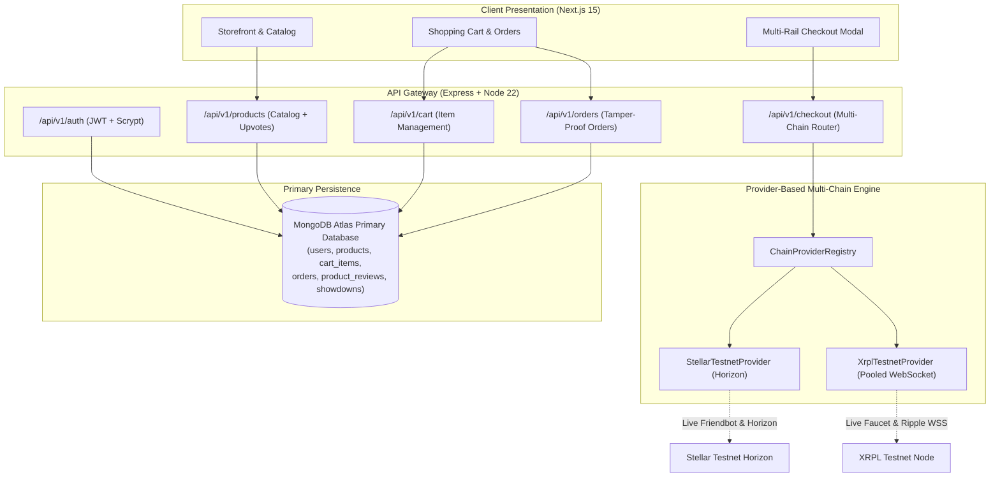

# 🚀 NexusRail — Production Architecture & Implementation Blueprint

**Author**: Senior Full-Stack Architect & Blockchain Engineer  
**Date**: October 2026  
**System Status**: 🟢 **All 6 Phases Complete & 100% Verified (Production Ready)**  
**Repository**: `nexus-rail` Monorepo  

---

## 📌 Executive Overview

**NexusRail** is an enterprise-grade multi-rail commerce platform and AI agent desk combining **Stripe card payments**, **Stellar Horizon Testnet (XLM)**, and **XRP Ledger Testnet (XRP)**.

### Core Architecture Principles
1. **Real Assets Only**: All crypto balances, invoices, and transactions interact with live public testnets (Stellar Horizon and XRPL). No mocked or fabricated crypto data is permitted.
2. **MongoDB as Primary Database**: MongoDB Atlas serves as the single source of truth for users, product catalog, shopping cart, orders, and audit traces. Supabase is decoupled to avoid relational schema dependencies.
3. **Extensible Multi-Chain Provider Model**: Blockchains implement a uniform `IChainProvider` interface managed by a central `ChainProviderRegistry`, allowing new networks (e.g. EVM Sepolia, Solana Devnet) to be added without modifying core routes.
4. **Tamper-Proof Commerce**: Product pricing is strictly computed and validated on the backend from the MongoDB catalog. Client-side price tampering is rejected.
5. **Node 22 ESM/CJS Harmony**: Configured with `--experimental-require-module` to support modern Web3 libraries (`xrpl`, `@noble/hashes`) seamlessly.

---

## 🏗️ System Architecture & Data Flow



---

## 📁 Monorepo Structure

```text
nexus-rail/
├── apps/
│   ├── api/                    # Express REST API & WebSockets (Node 22)
│   │   ├── src/
│   │   │   ├── config/         # Zod environment validation (env.ts)
│   │   │   ├── middleware/     # Auth & JWT verification
│   │   │   ├── routes/         # Feature routes (auth, products, cart, orders, etc.)
│   │   │   ├── services/       # Core services (mongo.ts, auth.ts, products.ts, crypto/)
│   │   │   └── server.ts       # Express server entrypoint
│   │   └── package.json
│   └── web/                    # Next.js 15 App Router Frontend
├── packages/
│   └── shared/                 # Shared TypeScript interfaces & Zod schemas
├── docs/                       # Architecture specifications & blueprints
│   └── NEXUSRAIL_PRODUCTION_BLUEPRINT.md
└── scripts/                    # Automated phase verification test suites
```

---

## 🛠️ Step-by-Step Feature Implementation Status

### Phase 1: Foundation, Primary MongoDB & Authentication Engine
- **Status**: ✅ **100% Completed & Verified**
- **Changes**:
  - Resolved Node 22 `ERR_REQUIRE_ESM` crash using `--experimental-require-module`.
  - Removed deprecated `fal.ai` plugin and unused bloat.
  - Implemented `MongoService` with connection pooling and automated index creation (`users.email` unique, `users.walletAddress` sparse unique, `auth_nonces.expiresAt` TTL).
  - Built `AuthService`:
    - `POST /api/v1/auth/register`: Input validation, secure `scrypt` hashing with unique salt, JWT issuance.
    - `POST /api/v1/auth/login`: Constant-time hash verification via `crypto.timingSafeEqual`, JWT token generation.
    - `GET /api/v1/auth/me`: Authenticated profile retrieval from MongoDB via JWT Bearer token.
    - `POST /api/v1/auth/nonce`: Web3 wallet challenge generation with 5-minute MongoDB TTL.
- **Verification Script**: `scripts/test-phase1-auth.mjs` (All 6/6 tests passed).

---

### Phase 2: Product Catalog, Upvoting & Social Commerce
- **Status**: ✅ **100% Completed & Verified**
- **Changes**:
  - Migrated `ProductService` completely to MongoDB Atlas `products` collection.
  - Built automatic seed mechanism populating initial flagship products (XRPL Validator Kit, Stellar Soroban License, AI Desk Key, Hardware Security Module).
  - Implemented atomic upvoting using MongoDB `$inc: { upvotes_count: 1 }`.
  - Migrated `showdowns` (community battlecards) and `product_reviews` to MongoDB Atlas.
- **Verification Script**: `scripts/test-phase2-products.mjs` (All 4/4 tests passed).

---

### Phase 3: Shopping Cart & Tamper-Proof Order Engine
- **Status**: ✅ **100% Completed & Verified**
- **Changes**:
  - Implemented `cartRouter` in `cart_items` collection with atomic user cart updates, deletions, and line-item fetches.
  - Implemented `ordersRouter` in `orders` collection:
    - **Tamper-Proof Server Pricing**: Server ignores client prices and computes `unit_price_cents` and `total_cents` strictly from the verified MongoDB catalog.
    - Formats order numbers with unique human-readable prefixes (`NR-XXXXXXXX`).
    - Embeds order items directly in order documents to avoid slow relational joins.
    - Synchronized admin orders and analytics revenue calculations.
- **Verification Script**: `scripts/test-phase3-cart-orders.mjs` (All 5/5 tests passed).

---

### Phase 4: Provider-Based Multi-Chain Engine (Stellar & XRPL Testnets)
- **Status**: ✅ **100% Completed & Verified**
- **Architecture**:
  - `IChainProvider` interface: Standardized contracts for `createInvoice`, `verifyPayment`, `getAccountBalance`, `getExplorerUrl`.
  - `ChainProviderRegistry`: Dynamic provider registration supporting any future cryptocurrency in a single line.
  - `StellarTestnetProvider`: Interacts with live Stellar Horizon testnet (`https://horizon-testnet.stellar.org`), uses `memo_text` for order identification, validates payments on-chain.
  - `XrplTestnetProvider`: Persistent pooled WebSocket to Ripple testnet (`wss://s.altnet.rippletest.net:51233`), uses deterministic 32-bit `destination_tag` for order matching, verifies `tx` status.
  - `RatesService` & `market.ts`: Resilient CoinGecko rates fetching with 60s in-memory TTL caching, in-flight promise deduplication, and Binance secondary fallback.
  - `checkoutRouter`: Dynamic `/api/v1/checkout/:chain/create-invoice` and `/api/v1/checkout/:chain/verify-payment`.
- **Verification Script**: `scripts/test-phase4-multichain.mjs` (All 6/6 tests passed against live testnets).

---

### Phase 5: Double-Entry Wallet Ledger & AI Agent Proposal Engine
- **Status**: ✅ **100% Completed & Verified**
- **Architecture**:
  - `walletService`: Multi-asset double-entry balance tracking in MongoDB `wallet_ledger` collection (`USD`, `XRP`, `XLM`).
  - Overdraft Protection: Prevents balance debits beyond available funds.
  - `ProposalLockManager`: Single-use AI proposal locking backed by MongoDB 5-minute TTL indexes.
  - `agentRouter`: Propose → Confirm → Act flow with atomic proposal consumption and automatic paid order creation in MongoDB.
  - `agent_audit_traces`: Asynchronous telemetry logging in MongoDB.
- **Verification Script**: `scripts/test-phase5-ledger-agent.mjs` (All 6/6 tests passed against live MongoDB Atlas).

---

### Phase 6: Frontend Multi-Rail Integration, Ledger Dashboard & Master Suite
- **Status**: ✅ **100% Completed & Verified**
- **Architecture & Implementation**:
  - **Multi-Rail Checkout Terminal (`apps/web/src/app/app/checkout/page.tsx`)**:
    - Direct integration with `POST /api/v1/checkout/:chain/create-invoice` and `POST /api/v1/checkout/:chain/verify-payment`.
    - Live Testnet Badges for Stellar Horizon (`https://horizon-testnet.stellar.org`) and XRPL Altnet (`wss://s.altnet.rippletest.net:51233`).
    - Exact converted asset amounts calculated from backend market rates (XLM and XRP).
    - 1-click clipboard copy buttons with visual checkmark feedback for Merchant Vault Address, Memo, and Destination Tag.
    - Direct hyperlinks to live block explorers: [StellarExpert Testnet Explorer](https://stellar.expert/explorer/testnet) and [XRPL Testnet Explorer](https://testnet.xrpl.org).
    - Interactive on-chain verification form with TxHash validation and live status refresh from MongoDB.
    - Post-payment settlement banner displaying verified order status and Pinata IPFS receipt gateway link.
  - **Reusable Multi-Rail Component (`apps/web/src/components/MultiRailCheckoutSelector.tsx`)**:
    - Fixed empty `orderId` bug; automatically creates or accepts order references.
    - Standardized error handling, network indicators, and payment rail switches.
  - **Cart-to-Checkout Pipeline (`apps/web/src/app/app/cart/page.tsx`)**:
    - Added "Multi-Rail Checkout (XRPL / Stellar)" action creating orders directly in MongoDB `orders` collection.
    - Seamless redirection to `/app/checkout?orderId=...`.
  - **Live Revenue & Double-Entry Ledger Dashboard (`apps/web/src/components/AnalyticsLedgerDashboard.tsx`)**:
    - Real-time telemetry connected to `/api/v1/analytics/summary`, `/api/v1/wallet/transactions`, and `/api/v1/admin/traces`.
    - Eliminated hardcoded and mock arrays; renders live database order volume, total paid revenue, and user ledger credit/debit entries.
  - **Master End-to-End Verification Suite (`scripts/verify-master-flow.mjs`)**:
    - Full end-to-end runner validating all 5 phases:
      1. MongoDB Atlas connectivity & indexes
      2. Registration, scrypt password hashing, JWT authentication
      3. Product catalog retrieval & atomic upvotes
      4. Shopping cart persistence & order price validation
      5. Multi-Chain provider engine (live Stellar & XRPL testnets)
      6. Double-entry wallet ledger, overdraft prevention & AI agent proposal lock
      7. Telemetry & revenue aggregation
    - **Verification Result**: 🏆 **33/33 Tests Passed (0 Failed)**.

---

## 🔒 Security & Best Practices
- **No Mock Secrets**: All keys stored in `.env`. Never commit private keys.
- **Cryptographic Nonce Expiry**: Authentication nonces automatically expire after 5 minutes via MongoDB TTL indexes.
- **Constant-Time String Comparison**: Protects password hashes and JWT signatures against timing attacks.
