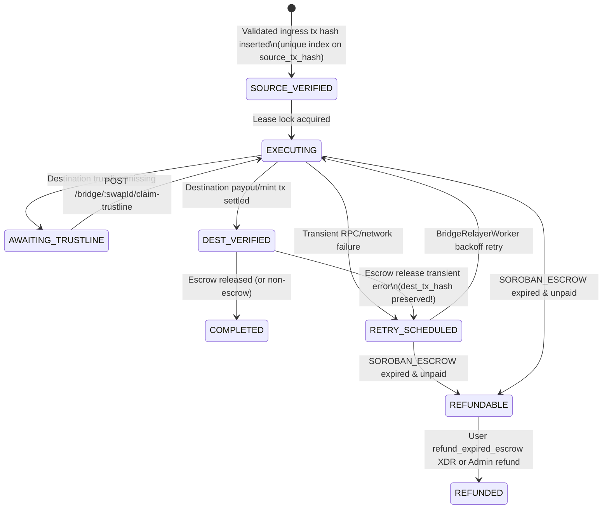

# $NXL & Dual-Rail Cross-Chain Bridge Architecture (`Stellar ↔ XRPL`)

> **Custody Model:** Escrow-First (`D3 Option A`) + 1:1 Burn-and-Mint (`$NXL`)  
> **Primary Service:** [`BridgeOperationService`](file:///d:/live/nexus-rail/backend/src/services/bridgeOperation.service.ts)  
> **Relayer Worker:** [`BridgeRelayerWorker`](file:///d:/live/nexus-rail/backend/src/workers/bridgeRelayerWorker.ts) (`45s` sweep, lease-locked)

---

## 1. Bridge Mechanisms Overview

| Route | Mechanism | Ingress Proof | Egress Action | Recovery on Failure |
|---|---|---|---|---|
| **Stellar `XLM` → XRPL `XRP`** | `SOROBAN_ESCROW` | User signs `NexusSwap.lock_bridge_escrow` (15m expiry) | Server pays XRP on XRPL → invokes `release_bridge_escrow(swapId, xrplTxHash)` | Auto-retry release or XRP payout; after 15m unpaid → `REFUNDABLE` → user self-refunds via `refund_expired_escrow` |
| **Stellar `NXL` → XRPL `NXL`** | `BURN_AND_MINT` (`1:1`) | User signs `NexusVault.burn_for_bridge` | Reserves global cap → mints exact 1:1 `$NXL` via XRPL Issuer (`rfogmLyR...`) | Missing trustline parks `AWAITING_TRUSTLINE` (0 minted); transient error → `RETRY_SCHEDULED` |
| **Stellar `NXL` → XRPL `XRP`** | `BURN_AND_MINT` | User signs `NexusVault.burn_for_bridge` | Server pays equivalent XRP on XRPL | Durable retry via `BridgeRelayerWorker` or Admin retry queue |
| **XRPL `NXL` → Stellar `NXL`** | `BURN_AND_MINT` (`1:1`) | Verified XRPL `Payment` (`validated: true`, exact currency hex `4E584C...`, issuer `rfogmLyR...`, vault `rHPcjC...`) | Reserves global cap → `SorobanService.mintNxlOnChain(reason='bridge')` | Missing trustline parks `AWAITING_TRUSTLINE`; transient error → `RETRY_SCHEDULED` |
| **XRPL `XRP` → Stellar `XLM`** | `LOCK_AND_RELEASE` | Verified XRPL `Payment` (`tesSUCCESS`, `validated: true`, recipient, tag, min drops) | Server pays XLM on Horizon | Durable retry via `BridgeRelayerWorker` |

---

## 2. State Machine & Crash Recovery (`bridge_operations`)

### Key Safety Guarantees
1. **Anti-Replay Protection (`HIGH-05`):**
   - MongoDB `bridge_operations` enforces a unique index on `source_tx_hash` (non-empty strings), and [`CrossChainSwapService.assertDepositHashNotReplayed`](file:///d:/live/nexus-rail/backend/src/services/crossChainSwap.service.ts#L254) checks both `swaps` and `bridge_operations`.
2. **Exact Deposit Proof Validation:**
   - [`CrossChainSwapService.verifyOnChainDeposit`](file:///d:/live/nexus-rail/backend/src/services/crossChainSwap.service.ts#L315) checks destination vault address, delivered amount, asset/issuer (`NXL_XRPL`), `DestinationTag` / Stellar `memo`, and `validated === true` (XRPL) / `successful === true` (Horizon).
3. **Never Double-Pay on Partial Failure (`CRIT-04`):**
   - If XRPL `XRP` payout succeeds (`dest_tx_hash` recorded in `DEST_VERIFIED`) and `NexusSwap.release_bridge_escrow` fails transiently, `BridgeRelayerWorker` skips payout and retries **only** `release_bridge_escrow`.
   - `BridgeOperationService.refundEscrow` refuses escrow refunds whenever `dest_tx_hash` already settled.

---

## 3. API & Admin Endpoints

- **User / Bridge Routes ([swap.routes.ts](file:///d:/live/nexus-rail/backend/src/routes/swap.routes.ts)):**
  - `POST /api/v1/swap/soroban/prepare` & `/submit` (`SOROBAN_AMM_SWAP`, `SOROBAN_BRIDGE_ESCROW`, `SOROBAN_BRIDGE_BURN`, `SOROBAN_BRIDGE_NXL`)
  - `POST /api/v1/swap/bridge/xrpl-to-stellar`
  - `GET /api/v1/swap/bridge/:swapId`
  - `POST /api/v1/swap/bridge/:swapId/refund` (builds unsigned `refund_expired_escrow` XDR for Freighter after 15m expiry)
  - `POST /api/v1/swap/bridge/:swapId/claim-trustline`
- **Admin Bridge Relayer Routes ([admin.routes.ts](file:///d:/live/nexus-rail/backend/src/routes/admin.routes.ts)):**
  - `GET /api/v1/admin/bridge/operations`
  - `POST /api/v1/admin/bridge/:swapId/retry`
  - `POST /api/v1/admin/bridge/:swapId/refund`
