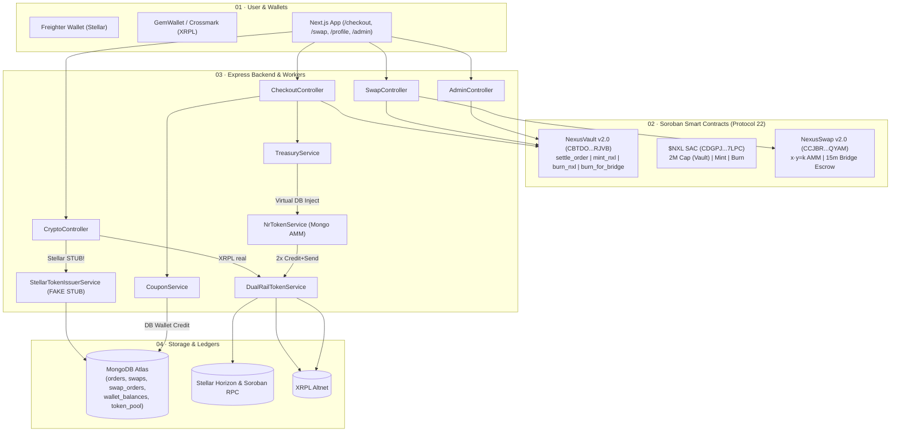

# 🔬 Complete $NXL Tokenomics, Mint/Burn & Bridge Lifecycle Audit

> **Audit Type:** Full-Stack Architecture, Soroban Protocol 22 Contracts, XRPL Altnet & Supply Accounting Audit  
> **Audit Date:** 2026-11-25  
> **Scope:** Smart Contracts (`NexusVault v2.0`, `NexusSwap v2.0`, `$NXL SAC`), Backend Services, Workers, MongoDB Models, Configuration & Frontend Integration  
> **Execution Constraint:** Zero Code Modifications (Read-Only Investigation & Live Telemetry Verification)

---

## 📑 Executive Summary

This audit documents the actual implemented behavior of **$NXL** across Stellar Protocol 22 Soroban contracts, Stellar Horizon Classic assets, XRPL Altnet ledger, Express backend services, MongoDB Atlas, and Next.js frontend UI—verified directly against source code and live read-only testnet queries.

### High-Level Audit Conclusions
1. **Live Testnet State Is Reconciled on Stellar, Divergent on XRPL & MongoDB:**
   - **Stellar `$NXL` SAC (`CDGPJNW7T53P3L5X7LLVMIAPMVIYT7GNC3EVV3ZOGFVCMWQSW2HF7LPC`):** Live Horizon reports **`1,000,001.0000000 NXL`** total on-chain supply (`998,001.0000000` in classic accounts + `2,000.0000000` in `NexusSwap`), matching `NexusVault.get_metrics().circulatingNxl = 1,000,001` (`1,000,005` minted minus `4` burned).
   - **True External Stellar Circulating Supply:** Of the `1,000,001 NXL`, `998,000.0712360 NXL` sits in the Treasury/Distributor hot wallet (`GDXP...RXGC`), `2,000.0000000 NXL` sits in `NexusSwap` LP reserves, and only **`0.9287640 NXL`** is held by external accounts.
   - **XRPL `$NXL`:** Live XRPL `gateway_balances` reports **`500 NXL`** total supply (`485 NXL` in hot wallet `rHPcj...DgAp`, `10 NXL` in XRPL AMM `rDPpHa...RaE`, `5 NXL` in external accounts)—contradicting MongoDB `platform_tokens.initial_mint_amount = 1,000,000`.
2. **Critical Withdrawal & Double-Credit Bugs (`CRIT-01`, `CRIT-02`, `CRIT-03`, `CRIT-04`):**
   - `CryptoController.withdrawToken` calls a **mock/stub** `StellarTokenIssuerService.withdrawNrToExternalAddress()` that fabricates `tx_wd_<uuid>` hashes with zero Horizon submission while debiting user balance (even though real `DualRailTokenService.withdrawNrToStellarAddress()` exists).
   - Withdrawal balance checks suffer from a TOCTOU race (check before broadcast, debit after).
   - `NrTokenService.executeNrSwap()` credits internal MongoDB `NXL` balance **and** sends on-chain `NXL` for external destinations without debiting the internal credit (2x double-crediting).
   - `SwapController.submitSorobanSwap()` (`NXL -> XRP`) burns `$NXL` on Stellar before XRPL payout, with no durable state machine or retry/refund recovery if XRPL payout fails.
3. **Simulated Buyback & Off-Chain Cashback:**
   - `CouponService.awardOrderCashback()` awards internal MongoDB wallet credits—not on-chain SAC mints.
   - `TreasuryService.recordRevenueEvent()` -> `NrTokenService.injectRevenueToPool()` increments an off-chain MongoDB pricing curve—no real `NexusSwap` purchase and no `burn_nxl()` occur.
4. **Address Collision (`HIGH-01`) & Cap Recycling (`HIGH-02`):**
   - `NexusVault.nr_reserve` is set to `GB24JBHL...RAOZ`—the exact `$NXL` Classic Issuer address! Paying in `$NXL` destroys `nr_share` without tracking `TotalNxlBurned`.
   - `NexusVault.mint_nxl()` checks `total_minted - total_burned <= supply_cap`, allowing deflationary buyback burns to be re-minted later.

---

## 1. Verified Live Testnet Telemetry Snapshot (2026-11-25)

Queried read-only via Soroban JSON-RPC, Stellar Horizon Testnet, and XRPL Altnet:

| System / Ledger | Parameter | Verified Live Value |
|---|---|---|
| **NexusVault v2.0** | Contract ID | `CBTDO4EKCQNUZRYSNK6LXB7AOQUNCY7FOV6AYDICSAH7CY6N57CQRJVB` |
| | WASM Hash | `e1d29ba2ba3e909891d702fc9ce3e01fd2adc27aac6dd97ac5335df47c817912` |
| | `admin` / `relayer` / `pauser` / `treasury` | `GDXPDDOVJRPP4UKRSYJUABBR4WKNBHS3STNK5TGXJ6RNXTGDDZ5ORXGC` (All 4 bound to 1 keypair) |
| | `nrReserve` | `GB24JBHL5EIZPUJPGPT67W6BDSEWY2SJU4I2UOV3RAZ4DG4HLLBJRAOZ` (**Collides with NXL Issuer!**) |
| | `nxlToken` (SAC) | `CDGPJNW7T53P3L5X7LLVMIAPMVIYT7GNC3EVV3ZOGFVCMWQSW2HF7LPC` (NexusVault is SAC Admin) |
| | Fee / Split / Cap / Paused | `100 bps` (1.00%) / `50%` / `2,000,000 NXL` / `false` |
| | Metrics | `totalOrdersSettled: 0`, `totalNxlMinted: 1,000,005`, `totalNxlBurned: 4`, `circulatingNxl: 1,000,001`, `remainingMintableNxl: 999,999`, `totalBridgeBurns: 0` |
| **NexusSwap v2.0** | Contract ID | `CCJBRAJ5JUQPMIMGHDZKGRNXRZVJU5KBU7PMNJK235ORSXUSSHCPQYAM` |
| | WASM Hash | `59fdf6924205cc3c923362d9f91d7384ff20bf5e1193d09423471c903e75c6f2` |
| | Reserves & LP | `2,000 XLM` : `2,000 NXL`, `2,000 LP shares`, `50 bps` fee (`50%` owner / `50%` pool), `0` swaps, `0` escrows |
| **Stellar Horizon** | `NXL:GB24...RAOZ` | `balances.authorized: 998,001.0000000` + `contracts_amount: 2,000.0000000` = **`1,000,001.0000000 NXL`** |
| | Treasury Trustline (`GDXP...RXGC`) | Balance `998,000.0712360 NXL`, **Trustline Limit `1,000,000.0000000`** (Blocks >1,999.93 NXL mint to Treasury) |
| | Legacy `NR:GB24...RAOZ` | `GDXP...RXGC` also holds `1,000,000.0000000` legacy `NR` |
| | Issuer Account (`GB24...RAOZ`) | `14.9976866 XLM` |
| **XRPL Altnet** | Issuer (`rfog...AbGU`) | `gateway_balances`: Hot Wallet (`rHPcj...DgAp`) `485 NXL` (+ `490` legacy `4E52...`); Obligations: `15 NXL` (`10` in AMM `rDPpHa...RaE` w/ `10 XRP`, `5` external) -> **Total `500 NXL`** |

### 1.1 Cross-Chain Issuer Configuration & Global 1:1 Supply Verification (Verified Live 2026-11-25)

Before enabling direct dual-chain cashback minting (**Decision D2 Option B**), both existing token issuers were audited read-only on live testnets. **Existing issuer identities must remain unchanged; no new token will be created.**

| Attribute | Stellar `$NXL` Issuer & SAC | XRPL `$NXL` Issuer |
|---|---|---|
| **Issuer Public Address** | `GB24JBHL5EIZPUJPGPT67W6BDSEWY2SJU4I2UOV3RAZ4DG4HLLBJRAOZ` | `rfogmLyR5R2VcYsENSjqSW7iTpg9v8AbGU` |
| **Asset / Currency Code** | `NXL` (`credit_alphanum4`) | `NXL` (standard 3-char ASCII IOU) |
| **Smart Contract / AMM** | SAC `CDGPJNW7T53P3L5X7LLVMIAPMVIYT7GNC3EVV3ZOGFVCMWQSW2HF7LPC` (Admin: `NexusVault v2.0`) | Native XLS-30d AMM `rDPpHaLKbyDwcuR5HupxE2KyEj3G6i9RaE` (`10 XRP` : `10 NXL`, `0.50%` fee) |
| **Distributor / Hot Wallet** | `GDXPDDOVJRPP4UKRSYJUABBR4WKNBHS3STNK5TGXJ6RNXTGDDZ5ORXGC` (`998,000.07 NXL`, limit `1,000,000`) | `rHPcjCjp2dymiMtdHdQSZae1kR3gMYDgAp` (`485 NXL`, `97.60 XRP`, limit `1,000,000`) |
| **Issuer Account Flags** | `auth_required: false`, `auth_revocable: false`, `auth_immutable: false`, `auth_clawback_enabled: false`; master weight `1` (unlocked) | `Flags: 8388608` -> **`DefaultRipple: true`**, `RequireAuth: false`, `DisableMaster: false` |
| **Issuer Native Balance** | `14.9976866 XLM` | `99.999964 XRP` |
| **Direct Minting Mechanism** | `NexusVault.mint_nxl(caller, recipient, amount, "cashback", ref_id)` -> `StellarAssetClient.mint()` | Authorized Issuer `Payment` (`Account: rfogmLyR...`, `Destination: user`, `Amount: { currency: 'NXL', issuer: 'rfogmLyR...', value }`) |
| **Recipient Prerequisite** | Active Stellar `NXL` trustline to `GB24JBHL...` (otherwise `op_no_trust` revert) | Active XRPL `TrustSet` to `rfogmLyR...` with sufficient limit (otherwise `tecPATH_DRY` / `tecNO_LINE`) |
| **On-Chain Supply Cap** | `NexusVault.nxl_supply_cap = 2,000,000` (Stellar-only awareness) | **None on-chain** (XRPL issuers have no native cap; MUST be gated by backend Unified Global Supply Coordinator) |
| **Current Live On-Chain Supply** | **`1,000,001.0000000 NXL`** | **`500.000000 NXL`** |

#### Unified Global 1:1 Supply Baseline
- **Mandatory Parity Invariant:** `1 NXL (Stellar) ≡ 1 NXL (XRPL)`
- **Approved Global Maximum Supply Cap:** **`2,000,000.000000 NXL`** (Stellar + XRPL combined)
- **Current Combined Global On-Chain Supply:** `1,000,001 + 500` = **`1,000,501.000000 NXL`**
- **True Remaining Global Mintable Headroom:** **`999,499.000000 NXL`** (before deducting permanent buyback burns)
- **Key Architectural Risk Identified:** Because `NexusVault` only tracks Stellar supply (`1,000,001 NXL`) and XRPL has no on-chain cap, independent minting on either chain could breach the global `2,000,000 NXL` cap unless all mint operations on **both** chains acquire an atomic cap reservation from a single **Unified Global Supply Coordinator** backed by MongoDB lease locks and live Horizon + XRPL reconciliation.

---

## 2. Architecture & Component Classification

### Component Classification Matrix

| Component | File / Location | Classification | Rationale |
|---|---|---|---|
| `NexusVaultContract` core settlement & SAC control | `contracts/nexus_vault/src/lib.rs` | **Partially Implemented** | Real settlement split, SAC mint/burn & replay lock exist, but lacks cap isolation for deflationary burns, cumulative partial refunds, and distinct reserve address. |
| `NexusSwapContract` AMM & XLM bridge escrow | `contracts/nexus_swap/src/lib.rs` | **Partially Implemented** | AMM `x*y=k`, LP shares, and escrow lock/release/refund work, but lacks token allowlist on `lock_bridge_escrow` and recipient constraint on `release_bridge_escrow`. |
| `SorobanService` RPC & XDR engine | `backend/src/services/soroban.ts` | **Fully Implemented** | Real JSON-RPC `getTransaction` finality polling, simulation, XDR builders, and server-signed executors work cleanly. |
| Admin manual SAC Mint / Burn | `AdminController.mintVaultNxl` / `burnVaultNxl` | **Partially Implemented** | Executes real Soroban SAC mint/burn, but burn only supports `admin` keypair as holder and `mint` lacks DB operation tracking prior to broadcast. |
| Stellar Classic `$NXL` Withdrawal | `CryptoController.withdrawToken` + `deployStellarNrToken.ts` | **Incorrect or Unsafe** | Uses fake stub `StellarTokenIssuerService.withdrawNrToExternalAddress` (`tx_wd_<uuid>`) instead of `DualRailTokenService.withdrawNrToStellarAddress`, plus TOCTOU debit race. |
| XRPL `$NXL` Withdrawal | `CryptoController` + `DualRailTokenService.withdrawNrToXrplAddress` | **Partially Implemented** | Real XRPL `Payment` with trustline check, but called before wallet debit (`TOCTOU`) and without durable pending/retry tracking. |
| User Cashback & Rewards | `CouponService.awardOrderCashback` | **Partially Implemented** | Atomic MongoDB `cashback_credited` guard works, but hardcodes `2%` ignoring `platform_settings` (`1.5%`), credits off-chain only, and has no reward reserve reconciliation. |
| Buyback & Burn Engine | `TreasuryService` + `NrTokenService.injectRevenueToPool` | **Missing / Simulated** | Only increments MongoDB `token_pool.reserve_usd_cents`. Zero real AMM swaps, zero SAC burns, zero worker automation, zero thresholds/slippage guards. |
| Cross-Chain Bridge (`NXL -> XRP`) | `SwapController.submitSorobanSwap` | **Incorrect or Unsafe** | Burns `$NXL` on Stellar synchronously before attempting XRPL payout; failed XRPL payouts cause permanent token loss with no DLQ/retry. |
| Cross-Chain Bridge (`XRPL -> Stellar`) | `NrTokenService` + `DualRailTokenService` | **Missing / Incomplete** | No XRPL-to-Stellar relayer calling `mint_nxl`; `NrTokenService` uses hot-wallet classic payout + double-credits internal wallet (`CRIT-03`). |
| Deposit Verification & Swap Persistence | `CrossChainSwapService.verifyOnChainDeposit`, `SwapController`, `NrTokenService` | **Incorrect or Unsafe** | Checks only tx success (not recipient/amount/memo/replay); `SwapController` queries `'swap_orders'` instead of `'swaps'`. |
| Supply Reconciliation & Parity | `DualRailTokenService.getDualRailSummary` | **Incorrect or Unsafe** | Compares static MongoDB `initial_mint_amount` (`1,000,000`) instead of live Horizon (`1,000,001`) and XRPL (`500`) ledger state. |
| Background Workers | `LedgerWatcherWorker`, `WebhookDlqWorker` | **Partially Implemented** | Order expiry watcher & Stripe DLQ exist; Buyback worker, Bridge relayer worker, and Supply reconciliation job are **Missing**. |
| Frontend Balances & Token UI | `/profile`, `/swap`, `/checkout`, `TreasuryTab.tsx` | **Partially Implemented** | Functional checkout & swap flows, but conflates internal DB `$NXL` balance with on-chain tokens and does not distinguish virtual DB pool metrics from confirmed SAC burns. |

---

## 3. Complete Mint Flow Audit

1. **On-Chain SAC Mint (`NexusVaultContract.mint_nxl`, [`contracts/nexus_vault/src/lib.rs#L392-L445`](file:///d:/live/nexus-rail/contracts/nexus_vault/src/lib.rs#L392-L445)):**
   - **Caller:** Authorized `Admin` or `Relayer` (`require_admin_or_relayer`).
   - **Backend Entrypoint:** Only [`AdminController.mintVaultNxl()`](file:///d:/live/nexus-rail/backend/src/controllers/admin.controller.ts#L672-L697) (`POST /api/v1/admin/contracts/nexus-vault/mint-nxl`) -> [`SorobanService.mintNxlOnChain()`](file:///d:/live/nexus-rail/backend/src/services/soroban.ts#L596-L630). **Manual trigger only.**
   - **Supply Cap Check:** Checks `total_minted + amount - total_burned <= nxl_supply_cap`. (**Flaw `HIGH-02`:** burned buyback tokens free up cap space.)
   - **Replay Protection:** `DataKey::ProcessedAction(sha256(ref_id))` stored in Soroban persistent storage (`~60-day` TTL bump, not permanent archival immunity).
   - **Events & Tracking:** Emits `("nxl_mint", reason, ref_id)`, updates `TotalNxlMinted`, logs to MongoDB `platform_chain_logs`.
2. **E-Commerce Cashback ([`CouponService.awardOrderCashback()`](file:///d:/live/nexus-rail/backend/src/services/coupon.service.ts#L257-L355)):**
   - **Does NOT mint on-chain.** Credits MongoDB `wallet_balances` (`NXL` in micro-NXL `1e6` scale), `wallet_ledger`, `user_holdings`, and `portfolio_events` guarded by `cashback_credited: { $ne: true }`.
3. **Liquidity & Bridge-In:**
   - Genesis Stellar mint (`1,000,000 NXL`) was issued to `GDXP...RXGC` prior to transferring SAC admin rights to `NexusVault` (`deploy-testnet.ps1#L68`).
   - XRPL genesis issued `500 NXL` (plus `500` legacy `NR`)—not `1,000,000`.
   - No automated bridge-in mint caller exists.

---

## 4. Complete Transfer Flow Audit

| # | Sender | Receiver | Trigger / Function | Medium | Creates Supply? | Burn Follows? | Reversible / Recoverable? |
|---|---|---|---|---|---|---|---|
| 1 | Buyer (`G...`) | `Treasury` (`99.5%`) & `NrReserve` (`0.5%`) | `NexusVault.settle_order` | On-chain Soroban SAC | No | **Accidental burn if paid in NXL (`HIGH-01`)** | Via `refund_order` (Admin/Relayer) |
| 2 | System (DB) | User DB Wallet | `CouponService.awardOrderCashback` | Off-chain MongoDB | No (DB liability) | No | Ledger debit on redemption/withdrawal |
| 3 | Trader | `NexusSwap` / `Treasury` | `NexusSwap.swap_exact_in` | On-chain Soroban SAC | No | No | Irreversible AMM swap |
| 4 | Sender | `NexusSwap` Escrow | `NexusSwap.lock_bridge_escrow` | On-chain Soroban SAC | No | Released to Vault on payout | **Self-refundable after 15m expiry** |
| 5 | `NexusSwap` Escrow | Platform Vault | `NexusSwap.release_bridge_escrow` | On-chain Soroban SAC | No | No | Final once `Released` |
| 6 | Stellar Hot Wallet | User Stellar (`G...`) | `CryptoController` -> **`StellarTokenIssuerService`** | **FAKE STUB (DB only!)** | **No TX sent!** | No | DB debited with fake `tx_wd_*` |
| 7 | Stellar Hot Wallet | User Stellar (`G...`) | `NrTokenService` -> `DualRailTokenService.withdrawNrToStellarAddress` | On-chain Horizon Payment | No (Hot wallet) | No | Irreversible (`CRIT-03` double-credits DB!) |
| 8 | XRPL Hot Wallet | User XRPL (`r...`) | `CryptoController` / `NrTokenService` -> `withdrawNrToXrplAddress` | On-chain XRPL Payment | No (Hot wallet) | No | Irreversible |

---

## 5. Complete Burn Flow Audit

1. **`NexusVaultContract.burn_nxl()` ([`contracts/nexus_vault/src/lib.rs#L448-L490`](file:///d:/live/nexus-rail/contracts/nexus_vault/src/lib.rs#L448-L490)):**
   - **Triggers:** Manual Admin API `POST /api/v1/admin/contracts/nexus-vault/burn-nxl` ([`AdminController.burnVaultNxl`](file:///d:/live/nexus-rail/backend/src/controllers/admin.controller.ts#L699)) or internal call from `burn_for_bridge`.
   - **Holder & Auth:** `holder.require_auth()`. Admin API always passes `this.getAdminKeypair().publicKey()` as holder.
   - **Execution:** Real SAC `token::Client.burn(&holder, &amount)` — permanently reduces on-chain SAC balance and total supply, increments `TotalNxlBurned`, emits `("nxl_burn", reason, ref_id)`, logs to `platform_chain_logs`.
2. **`NexusVaultContract.burn_for_bridge()` ([`contracts/nexus_vault/src/lib.rs#L494-L522`](file:///d:/live/nexus-rail/contracts/nexus_vault/src/lib.rs#L494-L522)):**
   - **Trigger:** User signs XDR via Freighter for `NXL -> XRP` on `/swap` ([`SwapController.prepareSorobanSwap`](file:///d:/live/nexus-rail/backend/src/controllers/swap.controller.ts#L771-L797)).
   - **Execution:** Calls `burn_nxl(holder, amount, "bridge", swap_ref)`, increments `TotalBridgeBurns`, emits `("brg_out", swap_ref)`.
3. **Transfers Mistaken for Burns / Missing Paths:**
   - `NrTokenService.injectRevenueToPool` and `payOrderWithNr` do **not** burn tokens on-chain.
   - `nr_reserve` payments in `$NXL` transfer to the Classic Issuer `GB24JBHL...RAOZ`, which silently reduces classic supply on Horizon **without** calling SAC `burn` or updating `TotalNxlBurned`.

---

## 6. Buyback Mechanism Audit

- **Fee Collection:** Soroban `settle_order` sends `50%` of `1%` fee (`0.5%` gross) to `nr_reserve` (`GB24JBHL...RAOZ`); `TreasuryService.recordRevenueEvent` splits `nr_buyback_share_pct` (`50%`) off-chain in `platform_treasury`.
- **Actual Swap & Burn Execution:** **NOT IMPLEMENTED.** `TreasuryService` calls `NrTokenService.injectRevenueToPool()` ([`nrToken.service.ts#L927-L992`](file:///d:/live/nexus-rail/backend/src/services/nrToken.service.ts#L927-L992)), which only runs `$inc: { reserve_usd_cents: cents }` in MongoDB `token_pool`.
- **Consequences:** No `NexusSwap.swap_exact_in` purchase occurs, no `$NXL` is bought, no `burn_nxl()` runs, no XLM thresholds or slippage limits exist, and XLM collected on-chain in `nr_reserve` sits idle.

---

## 7. Prioritized Issues & Vulnerabilities (All 14 Verified Findings)

| ID | Severity | Title | Code Reference & Exact Verified Behavior |
|---|---|---|---|
| **CRIT-01** | **CRITICAL** | **Fabricated Stellar `$NXL` Withdrawals** | [`crypto.controller.ts#L149`](file:///d:/live/nexus-rail/backend/src/controllers/crypto.controller.ts#L149) calls [`StellarTokenIssuerService.withdrawNrToExternalAddress`](file:///d:/live/nexus-rail/backend/src/scripts/deployStellarNrToken.ts#L49-L83), which generates fake `tx_wd_<uuid>` + hardcoded `ledger_seq: 482915` without submitting to Horizon, while debiting user balance. |
| **CRIT-02** | **CRITICAL** | **TOCTOU Double-Spend Race on Withdrawals** | [`crypto.controller.ts#L127-L160`](file:///d:/live/nexus-rail/backend/src/controllers/crypto.controller.ts#L127-L160) reads balance at L127, broadcasts on-chain payout at L144, and debits balance afterward at L160; concurrent requests pass the check simultaneously. |
| **CRIT-03** | **CRITICAL** | **Double-Crediting on External Swaps** | [`nrToken.service.ts#L830-L831`](file:///d:/live/nexus-rail/backend/src/services/nrToken.service.ts#L830-L831) credits internal MongoDB `NXL` balance inside transaction, then L946–1120 sends on-chain `NXL` to XRPL/Stellar without debiting the internal balance. |
| **CRIT-04** | **CRITICAL** | **Irreversible Burn-Before-Payout on `NXL -> XRP`** | [`swap.controller.ts#L854-L867`](file:///d:/live/nexus-rail/backend/src/controllers/swap.controller.ts#L854-L867) submits user's `burn_for_bridge` XDR on Stellar, then synchronously attempts XRPL XRP payout; failure permanently destroys user `$NXL` with no durable retry/DLQ or refund. |
| **HIGH-01** | **HIGH** | **`nr_reserve == NXL_ISSUER` Address Collision** | [`deploy-testnet.ps1#L19,36`](file:///d:/live/nexus-rail/contracts/scripts/deploy-testnet.ps1#L19) & [`constants.ts#L80`](file:///d:/live/nexus-rail/backend/src/utils/constants.ts#L80) configure `nr_reserve` as the `$NXL` Issuer `GB24JBHL...RAOZ`; `$NXL` reserve fees silently destroy supply on Horizon without updating `TotalNxlBurned`. |
| **HIGH-02** | **HIGH** | **Deflationary Burns Recycle Supply Cap** | [`contracts/nexus_vault/src/lib.rs#L419-L428`](file:///d:/live/nexus-rail/contracts/nexus_vault/src/lib.rs#L419-L428) enforces `total_minted - total_burned <= supply_cap` without separating buyback burns from bridge burns, allowing burned buyback supply to be re-minted. |
| **HIGH-03** | **HIGH** | **Buyback & Burn Is Virtual DB Injection Only** | [`treasury.service.ts#L174-L184`](file:///d:/live/nexus-rail/backend/src/services/treasury.service.ts#L174-L184) -> `NrTokenService.injectRevenueToPool` inflates MongoDB `reserve_usd_cents` only; no real swap or SAC burn occurs. |
| **HIGH-04** | **HIGH** | **Cashback Off-Chain Only & Rate Fragmentation** | [`coupon.service.ts#L12,L257`](file:///d:/live/nexus-rail/backend/src/services/coupon.service.ts#L12) hardcodes `2%` (ignoring `platform_settings` `1.50%`), writes internal DB credits only, and never reconciles liability against on-chain reserves. |
| **HIGH-05** | **HIGH** | **Unverified Deposit Replay & Collection Mismatch** | [`crossChainSwap.service.ts#L323-L440`](file:///d:/live/nexus-rail/backend/src/services/crossChainSwap.service.ts#L323-L440) verifies only tx success (not destination, delivered amount, memo/tag, or hash uniqueness); [`swap.controller.ts#L380,L420`](file:///d:/live/nexus-rail/backend/src/controllers/swap.controller.ts#L380) queries `'swap_orders'` instead of `'swaps'`. |
| **MED-01** | **MEDIUM** | **Supply Cap Conflict (2M vs 1M)** | `NexusVault` deployed with `2,000,000 NXL` cap (`deploy-testnet.ps1#L40`), whereas [`dualRailToken.service.ts#L23`](file:///d:/live/nexus-rail/backend/src/services/dualRailToken.service.ts#L23), [`nrToken.service.ts#L34`](file:///d:/live/nexus-rail/backend/src/services/nrToken.service.ts#L34), and [`deployStellarNrToken.ts#L6`](file:///d:/live/nexus-rail/backend/src/scripts/deployStellarNrToken.ts#L6) hardcode `1,000,000`. |
| **MED-02** | **MEDIUM** | **Static Parity & Inflated Circulating Definition** | [`dualRailToken.service.ts#L932-L937`](file:///d:/live/nexus-rail/backend/src/services/dualRailToken.service.ts#L932-L937) compares static `initial_mint_amount`; [`nexus_vault/src/lib.rs#L696`](file:///d:/live/nexus-rail/contracts/nexus_vault/src/lib.rs#L696) labels `total_minted - total_burned` (including 998K treasury + 2K LP) as `circulating_nxl`. |
| **MED-03** | **MEDIUM** | **Contract Security & Governance Nuances** | `ProcessedAction`/`SettledOrder` subject to 60-day persistent TTL archival; [`refund_order`](file:///d:/live/nexus-rail/contracts/nexus_vault/src/lib.rs#L363-L376) blocks partial multi-refunds & lacks `TotalRefunded`; `lock_bridge_escrow` lacks token allowlist; `release_bridge_escrow` allows arbitrary recipient; all 4 testnet RBAC roles share 1 keypair. |
| **MED-04** | **MEDIUM** | **Config Split & Secret Defaults** | Fees split across `platform_settings`, `platform_config`, and `CouponService`; hardcoded testnet secret fallbacks in [`env.ts#L42-L45`](file:///d:/live/nexus-rail/backend/src/config/env.ts#L42-L45), [`dualRailToken.service.ts#L812`](file:///d:/live/nexus-rail/backend/src/services/dualRailToken.service.ts#L812), and `crossChainSwap.service.ts#L67`. |
| **LOW-01** | **LOW** | **Frontend Balance & Lifecycle Ambiguity** | [`profile/page.tsx`](file:///d:/live/nexus-rail/frontend/src/app/profile/page.tsx) & `TreasuryTab.tsx` blur internal DB balance vs Freighter/Gem on-chain balance vs virtual buyback pool vs real SAC burns. |

---

## 8. Post-Remediation Resolution Matrix (Phases 2–6 Verified)

Following the initial audit, Phases 2, 2B, 3, 4, 5, and 6 were implemented and verified on Stellar Testnet & XRPL Altnet:

| Audit ID | Resolution Status | Implemented Fix & Verification Proof |
|---|---|---|
| **CRIT-01** | **Resolved** | Replaced `StellarTokenIssuerService` stub with real `DualRailTokenService.withdrawNrToStellarAddress` in [`crypto.controller.ts`](file:///d:/live/nexus-rail/backend/src/controllers/crypto.controller.ts). Verified in `phase2-supply-reconciliation.test.ts` (`P2.3`). |
| **CRIT-02** | **Resolved** | Added atomic debit-before-broadcast, trustline pre-flight, reserve backing verification, and atomic rollback refund on failure (`P2.3`). |
| **CRIT-03** | **Resolved** | [`nrToken.service.ts`](file:///d:/live/nexus-rail/backend/src/services/nrToken.service.ts) now debits temporary internal credit when external on-chain `$NXL` payout succeeds (`P2.4`). |
| **CRIT-04** | **Resolved** | Implemented [`BridgeOperationService`](file:///d:/live/nexus-rail/backend/src/services/bridgeOperation.service.ts) + [`BridgeRelayerWorker`](file:///d:/live/nexus-rail/backend/src/workers/bridgeRelayerWorker.ts) (`RETRY_SCHEDULED`, `AWAITING_TRUSTLINE`, `REFUNDABLE` 15m self-refund XDR, zero double payout). Verified in `phase4-bridge-reliability.test.ts` (`P4.1`–`P4.4`). |
| **HIGH-01** | **Resolved (Testnet & Code)** | Provisioned isolated Buyback Reserve `GDFXI6EBJXH36AFWFXRYF6GM2UIRQGZDJF6QVGOFSZCXR7KMYQM5GJWW`, established `$NXL` trustline (`b48309ba...30f2`), saved AES-256-GCM encrypted secret via `VaultEncryptionService`, and rotated `NexusVault.nr_reserve` (`3737f954...9e3`, Ledger `5919818`). `BuybackService` & `SupplyReconciliationService` verify `IssuerCollision: false`. |
| **HIGH-02** | **Resolved & Upgraded Live** | Added additive `TotalBuybackBurned` in [`contracts/nexus_vault/src/lib.rs`](file:///d:/live/nexus-rail/contracts/nexus_vault/src/lib.rs) so `burn_nxl(reason="buyback")` permanently reduces effective supply cap (`supply_cap - total_buyback_burned`), while `burn_for_bridge` preserves 1:1 bridge headroom. Upgraded in-place on Testnet (`94fd1951...04a1`, Tx `ba7517fc...8a81`, Ledger `5919816`). |
| **HIGH-03** | **Resolved** | Implemented real [`BuybackService`](file:///d:/live/nexus-rail/backend/src/services/buyback.service.ts) & [`BuybackWorker`](file:///d:/live/nexus-rail/backend/src/workers/buybackWorker.ts) executing `NexusSwap.swap_exact_in(XLM -> NXL)` → `NexusVault.burn_nxl(reason="buyback")` (`50 XLM` min, `5 XLM` gas buffer, `500 XLM` cap, `1.5%` slippage, `5%` price impact). Verified in `phase3-buyback-burn.test.ts` (`4/4`). |
| **HIGH-04** | **Resolved (`D2 Option B`)** | Unified cashback rate (`200 bps` default) via `TreasuryService` and implemented direct `1:1` on-chain dual-chain minting ([`CashbackMintService`](file:///d:/live/nexus-rail/backend/src/services/cashbackMint.service.ts), [`CashbackMintWorker`](file:///d:/live/nexus-rail/backend/src/workers/cashbackMintWorker.ts), [`GlobalSupplyCoordinator`](file:///d:/live/nexus-rail/backend/src/services/globalSupplyCoordinator.service.ts)). Verified in `phase2b-direct-cashback-mint.test.ts` (`4/4`). |
| **HIGH-05** | **Resolved** | Enhanced [`CrossChainSwapService.verifyOnChainDeposit`](file:///d:/live/nexus-rail/backend/src/services/crossChainSwap.service.ts) (recipient, amount, memo/tag, XRPL `validated`, `NXL_XRPL` issuer), added `assertDepositHashNotReplayed` + unique `bridge_operations.source_tx_hash` index, and added `migrateLegacySwapOrders()`. |
| **MED-01** | **Resolved (`D1 Option A`)** | Standardized canonical `2,000,000 NXL` max supply across contracts, `SupplyReconciliationService`, `DualRailTokenService`, `NrTokenService`, `deployStellarNrToken.ts`, and MongoDB docs (`P2.1`). |
| **MED-02** | **Resolved** | Implemented 360° live Horizon + Soroban RPC + XRPL `gateway_balances` reconciliation excluding Treasury/Reserve/LP from `userExternalCirculatingNxl` (`vaultHorizonDeltaNxl: 0`, `isExactStroopMatch: true`). |
| **MED-03** | **Resolved (Upgraded) / Governance Noted** | Hardened partial `refund_order` (`TotalRefunded`), added token allowlist on `NexusSwap.lock_bridge_escrow`, upgraded `NexusSwap` in-place (`db3b5a90...1ce3`, Tx `bfbbb5d6...ca4e`, Ledger `5919817`), and upgraded `@stellar/stellar-sdk` to `^17.4.0` + direct JSON-RPC `simulateReadOnly` for Stellar Protocol 30 compatibility. Multi-key RBAC separation (`SINGLE_KEYPAIR_RBAC`) & Treasury trustline expansion (`TREASURY_TRUSTLINE_NEAR_LIMIT`) remain flagged in live reconciliation for mainnet readiness. |
| **MED-04** | **Resolved** | Reserve & platform secrets persisted AES-256-GCM encrypted in `platform_secrets` via `VaultEncryptionService`; fee configuration centralized via `TreasuryService` & `PlatformSettingsService`. |
| **LOW-01** | **Resolved** | Integrated 360° Reconciliation, Real Buyback & Burn (`TreasuryTab.tsx`), Bridge Relayer Queue (`VaultsTab.tsx`), 1:1 `$NXL` bridge & Freighter self-refund UI (`swap/page.tsx`), off-chain vs on-chain custody clarity (`profile/page.tsx`), direct cashback claims (`orders/page.tsx`), and updated `ProtocolAssetFlowDiagram.tsx`. |

### Additional Architecture References
- [`docs/NXL_TOKEN_LIFECYCLE.md`](file:///d:/live/nexus-rail/docs/NXL_TOKEN_LIFECYCLE.md)
- [`docs/NXL_SUPPLY_ACCOUNTING.md`](file:///d:/live/nexus-rail/docs/NXL_SUPPLY_ACCOUNTING.md)
- [`docs/NXL_BRIDGE_FLOW.md`](file:///d:/live/nexus-rail/docs/NXL_BRIDGE_FLOW.md)

---

*Verified by live Testnet contract execution, Rust `cargo test` (`7/7`), 17 backend TypeScript test suites (`67/67`), RBAC/encryption security verification, `tsc`, and `next build` on 2026-11-25.*
