# 🗺️ $NXL Tokenomics — Master Implementation & Remediation Plan

> **Phase:** Phase 1 Complete (Audit & Architecture Planning)  
> **Target Stack:** Stellar Protocol 22 Soroban (`NexusVault v2.0`, `NexusSwap v2.0`, `$NXL SAC`), XRPL Altnet, Express/TypeScript API, MongoDB Atlas, Next.js 15  
> **Baseline Audit:** [`docs/NXL_TOKENOMICS_AUDIT.md`](file:///d:/live/nexus-rail/docs/NXL_TOKENOMICS_AUDIT.md)

---

## 1. Current-State Classification Matrix

| Layer / Module | Key Files | Classification | Summary of State |
|---|---|---|---|
| **NexusVault Contract** | `contracts/nexus_vault/src/lib.rs` | **Partially Implemented** | Atomic 50/50 split, SAC mint/burn & replay lock work, but `nr_reserve` collides with NXL issuer, buyback burns recycle supply cap, partial refunds lock out second refund, TTL is 60-day persistent. |
| **NexusSwap Contract** | `contracts/nexus_swap/src/lib.rs` | **Partially Implemented** | Constant-product AMM & 15m bridge escrow work; `lock_bridge_escrow` lacks token allowlist and `release_bridge_escrow` lacks destination vault constraint. |
| **Soroban Service** | `backend/src/services/soroban.ts` | **Fully Implemented** | JSON-RPC finality polling, read views, unsigned XDR builders, and server executors work cleanly. |
| **Stellar NXL Withdrawal** | `crypto.controller.ts`, `deployStellarNrToken.ts` | **Incorrect or Unsafe** | Calls stub generating fake `tx_wd_*` hashes + TOCTOU debit race (`CRIT-01`, `CRIT-02`). Real `DualRailTokenService.withdrawNrToStellarAddress` is unused here. |
| **XRPL NXL Withdrawal** | `crypto.controller.ts`, `dualRailToken.service.ts` | **Partially Implemented** | Real XRPL `Payment` with trustline guard, but executes before DB debit (`CRIT-02`) without durable retry/refund. |
| **Swap Execution & Bridge** | `swap.controller.ts`, `nrToken.service.ts`, `crossChainSwap.service.ts` | **Incorrect or Unsafe** | Double-credits DB + on-chain (`CRIT-03`), burns NXL before XRPL payout (`CRIT-04`), unverified deposit amounts/memos/replay, `swap_orders` vs `swaps` mismatch (`HIGH-05`). |
| **Buyback & Burn Engine** | `treasury.service.ts`, `nrToken.service.ts` | **Missing / Simulated** | Virtual MongoDB `reserve_usd_cents` increment only; zero `NexusSwap` purchases, zero SAC burns, no thresholds/slippage/workers (`HIGH-03`). |
| **Cashback & Loyalty** | `coupon.service.ts`, `portfolio.service.ts` | **Partially Implemented** | Idempotent MongoDB internal wallet credit only; hardcoded `2%` ignores `platform_settings` (`1.5%`); no liability reconciliation (`HIGH-04`). |
| **Supply Reconciliation** | `dualRailToken.service.ts` | **Incorrect or Unsafe** | Reads static `initial_mint_amount` (`1,000,000`) instead of live Horizon (`1,000,001`) and XRPL (`500`) ledger state; 1M vs 2M cap conflict (`MED-01`, `MED-02`). |
| **Frontend UI** | `profile/page.tsx`, `swap/page.tsx`, `TreasuryTab.tsx` | **Partially Implemented** | Functional flows exist, but internal ledger vs on-chain balance & virtual pool vs confirmed SAC burns are conflated (`LOW-01`). |

---

## 2. Verified Live Testnet Baseline (2026-11-25)

- **Local Toolchain Ready:** `cargo 1.100.0`, `stellar 23.1.2`, `stellar-xdr 23.0.0`.
- **Deployed Contracts (Preserve Contract IDs via In-Place WASM Upgrade):**
  - `NexusVault`: `CBTDO4EKCQNUZRYSNK6LXB7AOQUNCY7FOV6AYDICSAH7CY6N57CQRJVB` (`nxlSupplyCap: 2,000,000`, `totalNxlMinted: 1,000,005`, `totalNxlBurned: 4`, `circulatingNxl: 1,000,001`).
  - `NexusSwap`: `CCJBRAJ5JUQPMIMGHDZKGRNXRZVJU5KBU7PMNJK235ORSXUSSHCPQYAM` (`2,000 XLM` : `2,000 NXL`, `50 bps` fee).
  - `$NXL SAC`: `CDGPJNW7T53P3L5X7LLVMIAPMVIYT7GNC3EVV3ZOGFVCMWQSW2HF7LPC` (`NexusVault` is SAC Admin).
- **Operational Constraint Discovered on Horizon:**
  - Treasury/Distributor `GDXPDDOVJRPP4UKRSYJUABBR4WKNBHS3STNK5TGXJ6RNXTGDDZ5ORXGC` holds `998,000.0712360 NXL` with a **`1,000,000.0000000 NXL` trustline limit**. Any SAC mint to Treasury exceeding `1,999.9287640 NXL` will fail unless trustline limit is raised or mints target an unlocked account.
  - Current `nrReserve` (`GB24JBHL...RAOZ`) is the `$NXL` Issuer itself (`14.9976866 XLM`).
- **Live XRPL Altnet State:** Issuer `rfogmLyR5R2VcYsENSjqSW7iTpg9v8AbGU`, Hot Wallet `rHPcj...DgAp` holds `485 NXL` (+ `490 NR`), AMM `rDPpHa...RaE` holds `10 NXL` + `10 XRP`, external `5 NXL` (**500 NXL total**).

---

## 3. Target Production Tokenomics Architecture

```mermaid
flowchart TB
    subgraph MintControl["A. Controlled Supply-Capped Minting"]
        OpID["Unique Operation ID + Mongo token_operations"] --> VaultMint["NexusVault.mint_nxl(reason, ref_id)"]
        VaultMint -->|"Enforces cap <= (MaxCap - BuybackBurned)"| SAC["$NXL SAC"]
    end

    subgraph Rewards["B. Direct 1:1 Dual-Chain Cashback Minting (D2 Option B)"]
        OrderPaid["Verified Paid Order"] --> CashbackDoc["Mongo cashback_issuances\nUnique { order_id } Guard"]
        CashbackDoc --> GlobalCap["Unified Global Supply Coordinator\nStellar + XRPL + Pending <= EffectiveCap (2M)"]
        GlobalCap -->|"User Selected Stellar (G...)"| StellarMint["NexusVault.mint_nxl('cashback')\n-> Real Stellar SAC Mint"]
        GlobalCap -->|"User Selected XRPL (r...)"| XrplMint["Authorized XRPL Issuer Payment\n(rfogmLyR...) -> Real XRPL NXL Mint"]
        CashbackDoc -->|"No Wallet / No Trustline"| PendingClaim["AWAITING_WALLET / AWAITING_TRUSTLINE\n(Claimable Once Wallet & Trustline Ready)"]
    end

    subgraph Buyback["C. Real Automated/Admin Buyback & Burn"]
        Reserve["Dedicated Buyback Reserve Wallet\n(Separated from NXL Issuer!)"] -->|"Balance >= Threshold (e.g. 50 XLM)"| BuybackJob["BuybackService + Lease Lock"]
        BuybackJob -->|"1. swap_exact_in (slippage guarded)"| NexusSwap["NexusSwap v2.0"]
        NexusSwap -->|"2. Purchased $NXL to Buyback Wallet"| BuybackWallet["Protocol Buyback Holding"]
        BuybackWallet -->|"3. Verified SAC burn_nxl('buyback')"| Burned["Permanent Deflationary Burn\n(Reduces Effective Cap!)"]
    end

    subgraph Bridge["D. Durable State-Machine Bridge (Stellar <-> XRPL)"]
        BridgeReq["Bridge Request"] --> BridgeDoc["Mongo bridge_operations\nPENDING -> SOURCE_VERIFIED -> EXECUTING -> DEST_VERIFIED -> COMPLETED"]
        BridgeDoc -->|"Stellar -> XRPL: Escrow-First Lock"| Escrow["NexusSwap 15m Escrow\n(Refundable if Payout Fails)"]
        BridgeDoc -->|"XRPL -> Stellar: Verified TesSUCCESS + Tag"| ReleaseOrMint["Release Reserve / Cap-Checked Mint"]
    end
```



### Key Architectural Principles Adopted
1. **Strict 1:1 Cross-Chain Parity & Unified Global Supply Cap (`D1 Option A` + `D2 Option B`):**
   - `1 NXL (Stellar) ≡ 1 NXL (XRPL)` at all times.
   - Combined global supply across **Stellar + XRPL** may never exceed **`effective_global_cap = 2,000,000 NXL - permanent_buyback_burned`**.
   - Every mint on either chain (Stellar `NexusVault.mint_nxl` OR XRPL authorized issuer `Payment` from `rfogmLyR5R2VcYsENSjqSW7iTpg9v8AbGU`) must first obtain an atomic cap reservation via `GlobalSupplyCoordinator` (MongoDB `global_supply_reservations` + distributed lease lock reconciled against live Horizon + XRPL `gateway_balances`).
   - Direct cashback minting uses a durable `cashback_issuances` state machine (`PENDING -> AWAITING_WALLET | AWAITING_TRUSTLINE -> CAP_RESERVED -> MINTING -> VERIFYING -> COMPLETED | RETRY_SCHEDULED | FAILED`) with unique `{ order_id: 1 }` idempotency, separate chain-specific tx verification (Soroban `getTransaction` finality vs XRPL `validated: true` + `tesSUCCESS`), independent retry handling (`CashbackMintWorker`), and chain-specific audit logs in `platform_chain_logs`.
   - Existing internal wallet `$NXL` balances (legacy credits/swaps) remain strictly separated from on-chain balances and are backed by protocol reserves with atomic debit-before-broadcast withdrawals (`Phase 2`).
2. **Real Buyback & Burn Separation:**
   - Rotate `nr_reserve` off the `$NXL` issuer (`GB24JBHL...`) onto a dedicated protocol reserve keypair via `NexusVault.update_config`.
   - Maintain a durable `buyback_executions` state machine (`COLLECTING -> QUOTED -> SWAPPING -> SWAPPED -> BURNING -> COMPLETED | FAILED | RETRYING`) protected by a MongoDB distributed lease lock.
   - Execute real `NexusSwap.swap_exact_in(XLM -> NXL)` with slippage & max price-impact limits, verify finality, then execute `NexusVault.burn_nxl(reason="buyback")`. Update burn metrics **only after** SAC burn tx finality is verified.
   - Separate permanent deflationary burns (`TotalBuybackBurned`) from cross-chain bridge burns (`TotalBridgeBurns`) in `NexusVault` so buyback burns permanently reduce `effective_supply_cap = max_cap - buyback_burned` rather than freeing mint room.
3. **Unified Live Supply Accounting (`SupplyReconciliationService`):**
   Track and expose separately:
   - `maxSupplyCap` vs `effectiveSupplyCap`
   - `initialSupply`, `lifetimeMinted`, `lifetimeBurned` (`buybackBurned`, `bridgeBurned`, `holderBurned`)
   - `onChainStellarTotalSupply` (Horizon `/assets`), `onChainXrplTotalSupply` (`gateway_balances`)
   - `treasuryBalance`, `buybackReserveBalance`, `liquidityPoolBalance` (Stellar AMM + XRPL AMM), `bridgeEscrowLocked`
   - `trueExternalCirculatingSupply` (`onChainTotal - treasury - buyback - pools - escrows`)
   - `internalLedgerUserLiability` (sum of `wallet_balances` where `currency === 'NXL'`) & backing coverage check (`treasuryNxl >= internalLedgerUserLiability`).
4. **Durable Cross-Chain Bridge (`bridge_operations`):**
   Every bridge uses a Mongo-backed state machine (`PENDING -> SOURCE_VERIFIED -> EXECUTING -> DEST_VERIFIED -> COMPLETED`, plus `RETRY_SCHEDULED`, `REFUNDABLE`, `REFUNDED`, `FAILED`), unique `source_tx_hash` replay index, full deposit validation (destination vault, delivered amount, asset/issuer, memo/tag, finality), and crash-safe resume workers.

---

## 4. Approved Architectural Decisions (Locked for Phases 2B–6)

| # | Decision Topic | Approved Option | Key Constraints & Verification |
|---|---|---|---|
| **D1** | **Canonical Global Max Supply Cap** | **Option A — `2,000,000 NXL` Global Cap** | Applies to **Stellar + XRPL combined** (`1,000,001 + 500 = 1,000,501 NXL` live baseline -> `999,499 NXL` remaining global headroom). Permanent buyback burns reduce `effective_global_cap`. |
| **D2** | **Direct Dual-Chain Cashback Minting** | **Option B — Direct On-Chain 1:1 Minting (Stellar + XRPL)** | Stellar wallet -> `NexusVault.mint_nxl(reason="cashback")` via SAC (`CDGPJ...`); XRPL wallet -> direct `Payment` from existing authorized XRPL issuer (`rfogmLyR...`). Strict 1:1 ratio, unified global cap gate, unique `order_id` idempotency, separate chain verification/retries/audit logs. Missing wallet/trustline pauses safely in `AWAITING_WALLET` / `AWAITING_TRUSTLINE`. Existing issuers preserved untouched. |
| **D3** | **Stellar ↔ XRPL Bridge Custody Model** | **Option A — Escrow-First 1:1 Bridge** | `lock_bridge_escrow` (15m self-refund) on Soroban for both `XLM` and `NXL`; verified XRPL payout before release/burn; zero duplicate circulating supply (`-X` source + `+X` dest = `0` net global supply delta). |
| **D4** | **Contract Upgrades & Live Execution** | **Option B — Backend, Reconciliation & Testing First** | Complete backend reconciliation, storage compatibility checks, wallet-role verification, and unit/mocked tests first. Perform in-place WASM upgrades, `nr_reserve` rotation, and real token minting ONLY after explicit deployment approval. |

---

## 5. Phased Execution Roadmap (Phases 2–6)

### Phase 2 — Supply Accounting, Core Security & Bug Fixes
- **Backend Bug Fixes (Zero Breaking API Changes):**
  - Replace `StellarTokenIssuerService.withdrawNrToExternalAddress` call in [`CryptoController.withdrawToken`](file:///d:/live/nexus-rail/backend/src/controllers/crypto.controller.ts#L149) with real [`DualRailTokenService.withdrawNrToStellarAddress`](file:///d:/live/nexus-rail/backend/src/services/dualRailToken.service.ts#L803) + record real tx hash in `token_withdrawals` (`CRIT-01`).
  - Refactor `CryptoController.withdrawToken` to perform atomic MongoDB `wallet_balances` debit/lock **before** network broadcast, refunding atomically if on-chain submission definitively fails before broadcast (`CRIT-02`).
  - Fix double-crediting in [`NrTokenService.executeNrSwap`](file:///d:/live/nexus-rail/backend/src/services/nrToken.service.ts#L830-L1120): when external delivery (`r...` or `G...`) succeeds, either route without minting internal balance or atomically debit internal credit upon on-chain payout (`CRIT-03`).
  - Unify cashback rate & fee lookups onto `PlatformSettingsService` + `TreasuryService` single source of truth (`HIGH-04`), and remove/guard raw testnet secret fallbacks in production mode (`MED-04`).
- **Contract Hardening (`contracts/nexus_vault` & `contracts/nexus_swap`):**
  - Add `TotalBuybackBurned` storage key (default `0`) so `burn_nxl(reason == "buyback")` permanently reduces effective cap (`supply_cap - total_buyback_burned`), while `burn_for_bridge` still restores bridge mint room (`HIGH-02`).
  - Fix `refund_order` to allow incremental partial refunds up to `record.gross_amount` and track `TotalRefunded` (`MED-03`).
  - Validate `token == token_a || token == token_b` in `NexusSwap.lock_bridge_escrow` and enforce `recipient == treasury` (or explicit configured vault) in `release_bridge_escrow` (`MED-03`).
  - Update misleading "permanent" comments on Soroban persistent TTL keys and add explicit `extend_action_ttl` view/helper.
  - Add comprehensive Rust unit tests (`cargo test`) verifying upgrade storage compatibility with v2.0 keys.
- **Supply Reconciliation Engine:**
  - Create `backend/src/services/supplyReconciliation.service.ts` + `GET /api/v1/admin/tokenomics/reconciliation` querying live Horizon `/assets`, Soroban `get_metrics`/`get_pool_state`, XRPL `gateway_balances`/`amm_info`, and MongoDB `wallet_balances` liabilities.
  - Unify supply cap constants to canonical value across backend/docs (`MED-01`, `MED-02`).
- **Database Migrations & Tests:** Add unique index on `wallet_ledger (user_id, reference_id, type)` or `token_operations (operation_id)` + unit tests for mint/burn/withdraw concurrency/reconciliation.

### Phase 2B — Direct 1:1 Dual-Chain Cashback Minting & Unified Global Supply Coordinator (`D2 Option B`)
- **Unified Global Supply Coordinator (`backend/src/services/globalSupplyCoordinator.service.ts`):**
  - Durable MongoDB collection `global_supply_reservations` + distributed lease lock (`worker_locks`) enforcing the unified global cap across **Stellar + XRPL combined**:
    `stellar_onchain_supply + xrpl_onchain_supply + active_pending_reservations + requested_amount <= effective_global_cap (2,000,000 - permanent_buyback_burned)`.
  - Guarantees neither Stellar (`NexusVault.mint_nxl`) nor XRPL (Issuer `Payment`) can independently exceed the approved global supply cap.
  - Exposes `reserveMintCapacity(operationId, chain, amountNxl)`, `confirmMintCapacity(operationId, txHash, ledgerSeq)`, and `releaseMintCapacity(operationId, reason)`.
- **Direct Dual-Chain Cashback Engine (`backend/src/services/cashbackMint.service.ts` & `backend/src/workers/cashbackMintWorker.ts`):**
  - Durable MongoDB collection `cashback_issuances` with unique index `{ order_id: 1 }` (strictly prevents duplicate cashback issuance per order across both chains).
  - State machine:
    ```mermaid
    stateDiagram-v2
        [*] --> PENDING
        PENDING --> AWAITING_WALLET : No user wallet selected
        PENDING --> AWAITING_TRUSTLINE : Trustline missing on target chain
        AWAITING_WALLET --> PENDING : User selects Stellar or XRPL wallet
        AWAITING_TRUSTLINE --> PENDING : User enables NXL trustline
        PENDING --> CAP_RESERVED : GlobalSupplyCoordinator approves cap
        CAP_RESERVED --> MINTING : Broadcast Stellar SAC mint OR XRPL Issuer Payment
        MINTING --> VERIFYING : Tx hash received
        VERIFYING --> COMPLETED : Chain finality confirmed (Soroban SUCCESS / XRPL tesSUCCESS+validated)
        MINTING --> RETRY_SCHEDULED : Transient RPC/network error (release or hold cap)
        RETRY_SCHEDULED --> CAP_RESERVED : CashbackMintWorker backoff retry
        RETRY_SCHEDULED --> FAILED : Max retries exceeded (alert admin)
    ```
  - **Stellar Path (`G...` selected):** Verifies Stellar trustline to existing issuer `GB24JBHL...RAOZ` -> reserves global cap -> calls `SorobanService.mintNxlOnChain({ recipientAddress, amountNxl, reason: 'cashback', refId: 'cashback:' + order.id })` -> verifies Soroban finality -> logs to `platform_chain_logs` (`chain: 'STELLAR', action: 'MINT'`).
  - **XRPL Path (`r...` selected):** Verifies XRPL trustline to existing issuer `rfogmLyR...AbGU` -> reserves global cap -> calls `DualRailTokenService.mintNxlOnXrpl({ recipientAddress, amountNxl, orderId })` (submits `Payment` from authorized issuer `rfogmLyR...` signed via `VaultEncryptionService` / `XRPL_NXL_ISSUER_SEED` with hex memo `order.id`, verifies `validated: true` and `tesSUCCESS`) -> logs to `platform_chain_logs` (`chain: 'XRPL', action: 'MINT'`).
  - **1:1 Ratio Enforcement:** Same `cashbackNxl` quantity computed from unified order USD total & spot price is minted 1:1 regardless of whether user selects Stellar or XRPL.
  - **No Double-Minting / No Fake Credits:** Replaces off-chain internal wallet credit in `CouponService.awardOrderCashback` for eligible on-chain cashback orders (while preserving `order.cashback_usd_cents`, `order.cashback_nxl_amount`, and adding `POST /api/v1/orders/:id/claim-cashback` for users who connect a wallet or enable a trustline after checkout).
- **Phase 2B Automated Tests (Mocked & Isolated — Zero Real Testnet Minting):**
  - Stellar cashback mint flow (trustline check -> cap reserve -> `mint_nxl` -> verified `COMPLETED`).
  - XRPL cashback mint flow (trustline check -> cap reserve -> authorized issuer `Payment` -> verified `tesSUCCESS` -> `COMPLETED`).
  - Unified global supply cap enforcement (rejects XRPL mint if `stellar + xrpl + pending + amount > 2,000,000`, and vice versa).
  - Strict duplicate `order_id` idempotency across concurrent requests and across chain switching.
  - Missing trustline -> `AWAITING_TRUSTLINE` -> enable trustline -> claim succeeds strictly once.
  - Transient RPC failure -> `RETRY_SCHEDULED` -> worker recovery after simulated server restart.

### Phase 3 — Real Buyback & Burn Engine
- Create `backend/src/services/buyback.service.ts` and `backend/src/workers/buybackWorker.ts`:
  - Durable `buyback_executions` MongoDB collection with state machine: `COLLECTING -> QUOTED -> SWAPPING -> SWAPPED -> BURNING -> COMPLETED | RETRY_SCHEDULED | FAILED`.
  - Distributed lease lock (`worker_locks` collection with TTL) preventing concurrent workers or duplicate admin clicks from double-executing.
  - Dedicated `Buyback Reserve` Stellar account (`STELLAR_BUYBACK_RESERVE_SECRET` via `VaultEncryptionService`) configured as `NexusVault.nr_reserve`.
  - Guardrails: minimum XLM balance threshold (`minBuybackXlm`), max single swap amount, max slippage %, max price impact % against `NexusSwap.quote_swap`.
  - Execution flow: quote `NexusSwap` -> execute signed `swap_exact_in(XLM -> NXL)` -> poll Soroban finality -> verify `$NXL` received -> invoke `NexusVault.burn_nxl(reason="buyback")` -> poll Soroban finality -> persist `swapTxHash`, `burnTxHash`, `burnedNxl` -> update Treasury/Buyback metrics **only after confirmed SAC burn**.
  - Crash recovery: if server restarts in `SWAPPED`, worker resumes directly at `BURNING` without re-swapping.
- Admin endpoints: `GET /api/v1/admin/buyback/status`, `POST /api/v1/admin/buyback/execute`, `GET /api/v1/admin/buyback/history`.
- Full unit/mocked integration tests covering threshold, slippage abort, swap-success/burn-fail resume, duplicate lock, and restart recovery.

### Phase 4 — Cross-Chain Bridge Reliability (`Stellar ↔ XRPL`)
- Create `backend/src/services/bridgeOperation.service.ts` and `backend/src/workers/bridgeRelayerWorker.ts`:
  - Durable `bridge_operations` collection (`PENDING -> SOURCE_VERIFIED -> EXECUTING -> DEST_VERIFIED -> COMPLETED | RETRY_SCHEDULED | REFUNDABLE | REFUNDED | FAILED`).
  - Unique index on `source_tx_hash` preventing replay attacks across all swaps/bridges (`HIGH-05`).
  - Upgrade `CrossChainSwapService.verifyOnChainDeposit` to validate exact recipient vault, exact minimum delivered amount, asset/issuer, memo / destination tag, and ledger finality (`validated: true` on XRPL, `successful: true` on Stellar).
  - Unify `SwapController` (`swap_orders` -> `swaps`) and persist `NrTokenService` orders durably in MongoDB so server restarts never orphan pending claims (`HIGH-05`).
  - Safe Stellar→XRPL recovery (`CRIT-04`): support escrow-first custody or durable post-burn relayer retry with exponential backoff + admin recovery queue so XRPL payout transient failures are automatically retried after restart rather than losing user funds.
  - XRPL→Stellar consistency: enforce validated XRPL deposit proof + supply-cap-checked release/mint recorded atomically in `bridge_operations`.
- Comprehensive bridge test suite (both directions, replay rejection, invalid destination/tag/amount, failed payout retry after simulated restart, parity reconciliation).

### Phase 5 — Backend & Frontend Integration
- Connect verified telemetry to Admin Console (`TreasuryTab.tsx`, `VaultsTab.tsx`, `OverviewTab.tsx`):
  - Separate **Confirmed On-Chain SAC Burns** from **Virtual DB AMM Pool Injections**.
  - Add **Live Supply Reconciliation Panel** showing Stellar SAC total vs XRPL total vs True Circulating vs Internal User Liability & Backing Ratio + Buyback Execution controls/history.
- Upgrade User UI (`/profile`, `/swap`, `/checkout`, `ProtocolAssetFlowDiagram.tsx`):
  - Clearly label **Internal NexusRail Balance (Off-Chain Claims)** vs **Connected Wallet Balance (On-Chain)** vs **Pending Withdrawals / Bridge Transfers**.
  - Show real bridge pipeline stages and explorer links only after verified finality.
  - Preserve all existing cart, checkout, Freighter, GemWallet, and swap UX flows.

### Phase 6 — Full Testing, Security Verification & Final Documentation
- Execute Rust contract suite (`cargo test`), all TypeScript backend unit & mocked integration suites, `tsc` builds (backend & frontend), and security checks (auth, replay, pause, RBAC separation).
- Author final deliverable docs:
  - [`docs/NXL_TOKEN_LIFECYCLE.md`](file:///d:/live/nexus-rail/docs/NXL_TOKEN_LIFECYCLE.md)
  - [`docs/NXL_SUPPLY_ACCOUNTING.md`](file:///d:/live/nexus-rail/docs/NXL_SUPPLY_ACCOUNTING.md)
  - [`docs/NXL_BRIDGE_FLOW.md`](file:///d:/live/nexus-rail/docs/NXL_BRIDGE_FLOW.md)
  - Update [`docs/NXL_TOKENOMICS_AUDIT.md`](file:///d:/live/nexus-rail/docs/NXL_TOKENOMICS_AUDIT.md) with post-remediation status.

---

## 6. Migration, Compatibility & Risk Matrix

| Risk / Dependency | Impact if Unhandled | Mitigation Strategy |
|---|---|---|
| **Soroban Persistent Storage Schema Upgrade** | Adding new `DataKey` variants or changing existing `SettlementRecord` struct layouts in an in-place WASM upgrade can cause deserialization panics (`UnreachableCodeReached`) on existing ledger entries. | Keep `DataKey` existing variants and `SettlementRecord` fields untouched; add ONLY new enum variants (e.g. `DataKey::TotalBuybackBurned`, `DataKey::TotalRefunded`) read via `.unwrap_or(0)`. Verify via `soroban_sdk` upgrade simulation tests before any testnet upgrade. |
| **Treasury `$NXL` Trustline Limit (`1,000,000`)** | `GDXP...RXGC` holds `998,000.07 NXL` with trustline limit `1,000,000`. Minting >`1,999.93 NXL` to Treasury reverts on-chain (`op_line_full`). | Account for trustline ceiling in `SupplyReconciliationService` warnings; advise/raise trustline via `changeTrust` or mint rewards/bridge-ins directly to user/reserve wallets with open limits. |
| **`nr_reserve` Keypair Separation** | Currently `nr_reserve == NXL_ISSUER`, so `$NXL` fees destroy issuer asset untracked and XLM fees mingle with issuer account. | Provision a dedicated Buyback Reserve keypair stored AES-256 encrypted in `platform_secrets` (`VaultEncryptionService`), fund it with XLM reserve + `$NXL` trustline, and call `NexusVault.update_config(new_nr_reserve)`. |
| **MongoDB Collection Consolidation (`swaps` vs `swap_orders`)** | Old documents in `swap_orders` could disappear from `getXrplPendingClaims` if only `swaps` is queried. | Write an idempotent startup/CLI migration copying any remaining `swap_orders` records into `swaps` before unifying all controllers/services onto `swaps`. |
| **Zero-Downtime Backward Compatibility** | Existing checkout, cart, Freighter, and GemWallet clients must continue working during phased rollouts. | Maintain existing API response shapes while introducing new additive fields (`internalBalance`, `bridgeState`, `reconciliation`); keep old endpoints backward-compatible. |
