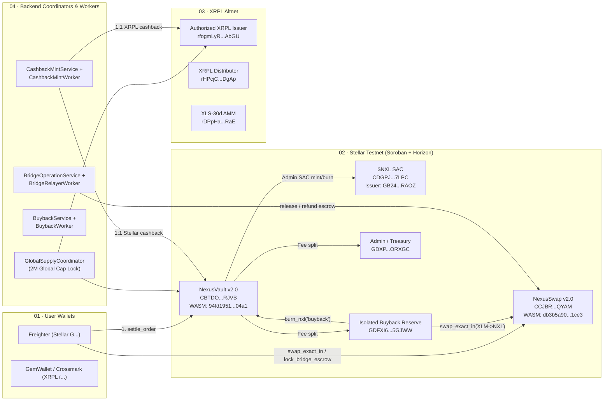

# $NXL Dual-Rail Token Lifecycle

> **Canonical Cap:** `2,000,000.000000 NXL` (`D1 Option A`) across Stellar SAC + XRPL combined  
> **Mandatory Parity:** `1 NXL (Stellar SAC) ≡ 1 NXL (XRPL IOU)`  
> **Updated:** 2026-11-25 (Post Phase 2–5 Implementation & Testnet Upgrade)

---

## 1. Deployed On-Chain Architecture

### Live Contract & Account Registry
- **Stellar `$NXL` Classic Issuer:** `GB24JBHL5EIZPUJPGPT67W6BDSEWY2SJU4I2UOV3RAZ4DG4HLLBJRAOZ`
- **Stellar `$NXL` SAC:** `CDGPJNW7T53P3L5X7LLVMIAPMVIYT7GNC3EVV3ZOGFVCMWQSW2HF7LPC` (SAC Admin: `NexusVault`)
- **NexusVault Contract:** `CBTDO4EKCQNUZRYSNK6LXB7AOQUNCY7FOV6AYDICSAH7CY6N57CQRJVB` (Upgraded WASM `94fd195166ec771ffba4bc4092f9961977fca445d32a777372696c9f3ae104a1`, Tx `ba7517fcd1f7a249a63e39acc8ca853af81d54e43137dd4f4cc00d9d9c5c8a81`)
- **NexusSwap Contract:** `CCJBRAJ5JUQPMIMGHDZKGRNXRZVJU5KBU7PMNJK235ORSXUSSHCPQYAM` (Upgraded WASM `db3b5a90fdcb7b45c3e3864ed3693a58c5ab4314e621865fadcf8588e53a1ce3`, Tx `bfbbb5d6d114aeadad1fbc2b888c2eba46e807e142dd97483e612ec66e85ca4e`)
- **Isolated Buyback Reserve (`nr_reserve`):** `GDFXI6EBJXH36AFWFXRYF6GM2UIRQGZDJF6QVGOFSZCXR7KMYQM5GJWW` (Rotated via `NexusVault.update_config`, Tx `3737f9540402e1197e03ceb9d92ddcdf53478d776f1160f148018a5f6afcc9e3`)
- **XRPL `$NXL` Issuer:** `rfogmLyR5R2VcYsENSjqSW7iTpg9v8AbGU` (`DefaultRipple: true`, Distributor `rHPcjCjp2dymiMtdHdQSZae1kR3gMYDgAp`, XLS-30d AMM `rDPpHaLKbyDwcuR5HupxE2KyEj3G6i9RaE`)

---

## 2. Minting Flows (All Supply-Creating Paths)

Every mint on either Stellar or XRPL **must** pass through [`GlobalSupplyCoordinator.reserveMintCapacity()`](file:///d:/live/nexus-rail/backend/src/services/globalSupplyCoordinator.service.ts#L160) before any chain submission.

| Mint Use Case | Target Chain | Contract / Function | Cap & Replay Guards |
|---|---|---|---|
| **Direct 2% Checkout Cashback (`D2 Option B`)** | Stellar (`G...`) | [`CashbackMintService`](file:///d:/live/nexus-rail/backend/src/services/cashbackMint.service.ts) → `SorobanService.mintNxlOnChain(..., reason='cashback')` → `NexusVault.mint_nxl` | Global `worker_locks` + unique `order_id` in `cashback_issuances` + Soroban `DataKey::ProcessedAction(sha256(ref_id))` |
| **Direct 2% Checkout Cashback (`D2 Option B`)** | XRPL (`r...`) | [`CashbackMintService`](file:///d:/live/nexus-rail/backend/src/services/cashbackMint.service.ts) → [`DualRailTokenService.mintNxlOnXrpl`](file:///d:/live/nexus-rail/backend/src/services/dualRailToken.service.ts#L541) | Global `GlobalSupplyCoordinator` cap reservation + `cashback_issuances` idempotency + `validated === true` & `tesSUCCESS` proof |
| **1:1 Bridge-In (`XRPL -> Stellar`)** | Stellar (`G...`) | [`BridgeOperationService.executeXrplToStellarBridge`](file:///d:/live/nexus-rail/backend/src/services/bridgeOperation.service.ts) → `SorobanService.mintNxlOnChain(..., reason='bridge')` | Unique `source_tx_hash` replay guard + XRPL deposit proof + `GlobalSupplyCoordinator` reservation |
| **1:1 Bridge-Out (`Stellar -> XRPL`)** | XRPL (`r...`) | [`BridgeOperationService.submitSorobanBridge`](file:///d:/live/nexus-rail/backend/src/services/bridgeOperation.service.ts) (`burn_for_bridge` first) → `DualRailTokenService.mintNxlOnXrpl` | Stellar `burn_for_bridge` reduces Stellar supply first + `GlobalSupplyCoordinator` reservation |
| **Admin Manual Mint** | Stellar (`G...`) | [`AdminController.mintVaultNxl`](file:///d:/live/nexus-rail/backend/src/controllers/admin.controller.ts) → `GlobalSupplyCoordinator` → `SorobanService.mintNxlOnChain` | Admin RBAC (`requireAuth`, `requireAdmin`) + global cap lock |

If a cashback or bridge recipient does not yet have a Stellar or XRPL `$NXL` trustline, the issuance parks cleanly in `AWAITING_WALLET` or `AWAITING_TRUSTLINE` with **zero tokens minted**, and the user can claim once ready via `/orders` (`POST /api/v1/orders/:id/claim-cashback`) or `/swap` (`POST /api/v1/swap/bridge/:swapId/claim-trustline`).

---

## 3. Transfers, Internal Custody & Withdrawals

- **Off-Chain Internal Balances (`wallet_balances`, `wallet_ledger`):**
  - Strictly separated in UI ([profile/page.tsx](file:///d:/live/nexus-rail/frontend/src/app/profile/page.tsx)) and audited continuously against protocol reserves (`SupplyReconciliationService.internalLedger`).
- **On-Chain Withdrawals (`CRIT-01` & `CRIT-02` Resolved):**
  - [`CryptoController.withdrawToken`](file:///d:/live/nexus-rail/backend/src/controllers/crypto.controller.ts) uses real `DualRailTokenService.withdrawNrToStellarAddress` / `withdrawNrToXrplAddress`.
  - Pre-flight checks recipient trustline and live reserve backing (`SupplyReconciliationService.verifyReserveForWithdrawal`), atomically debits internal balance **before** broadcast, and atomically refunds if broadcast fails.
- **AMM Swap Single-Delivery (`CRIT-03` Resolved):**
  - [`NrTokenService.executeNrSwap`](file:///d:/live/nexus-rail/backend/src/services/nrToken.service.ts) debits the temporary internal escrow credit immediately when external XRPL/Stellar payout succeeds so external swaps never double-credit internal balances.

---

## 4. Deflationary Burns & Buyback-and-Burn Engine

[`NexusVaultContract.burn_nxl`](file:///d:/live/nexus-rail/contracts/nexus_vault/src/lib.rs#L480-L523) invokes real `token::Client::burn(&holder, &amount)` on `$NXL SAC`, reducing live Horizon & SAC total supply:

1. **Buyback Burns (`reason = "buyback"`):**
   - Executed by [`BuybackService`](file:///d:/live/nexus-rail/backend/src/services/buyback.service.ts) & [`BuybackWorker`](file:///d:/live/nexus-rail/backend/src/workers/buybackWorker.ts).
   - State machine: `COLLECTING` → `QUOTED` → `SWAPPING` → `SWAPPED` → `BURNING` → `COMPLETED | RETRY_SCHEDULED | FAILED`.
   - Guards: rejects issuer-colliding reserve signers, reserves `5 XLM` gas buffer, requires `>= 50 XLM` spendable, caps single swap at `500 XLM`, enforces `<= 1.5%` slippage and `<= 5.0%` price impact.
   - Permanently increments `DataKey::TotalBuybackBurned`, reducing effective mintable cap (`supply_cap - total_buyback_burned`) so burned buyback tokens can **never** be re-minted.
2. **Bridge Burns (`reason = "bridge"` via `burn_for_bridge`):**
   - Increments `DataKey::TotalNxlBurned` and `DataKey::TotalBridgeBurns` **without** incrementing `TotalBuybackBurned`, preserving bridge mint headroom under the `2,000,000 NXL` global cap.
