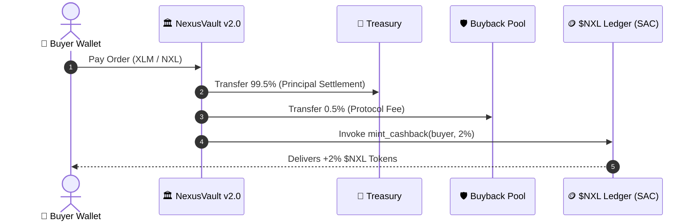

# 🌐 NexusRail Protocol Asset Flow Guide
## Visual Architecture & On-Chain Settlement Mechanics

> **Scope:** Detailed technical and business breakdown of the **Protocol Asset Flow** displayed on the NexusRail homepage and executed across Stellar Protocol 22 Soroban contracts and the XRPL Altnet ledger.

---

## 📸 Diagram Overview (3-Column Architecture)

The protocol flow diagram illustrates how user capital moves from wallets into smart contracts and gets routed to platform destinations across **4 core operational rails**:

```
[01 · USER]               [02 · SOROBAN CONTRACTS]              [03 · DESTINATIONS]

┌──────────────────┐      ┌─────────────────────────┐           ┌──────────────────┐
│                  │─────▶│  NexusVault v2.0 (VAULT)│──────────▶│  Owner Treasury  │ (99.5% + 0.25%)
│                  │      │  (Order Settlement)     │─────┐     └──────────────────┘
│                  │      └────────────┬────────────┘     │     ┌──────────────────┐
│                  │▲                  │ (Mint / Burn)    └────▶│   Buyback Pool   │ (0.5% Fee)
│ Freighter / Gem  ││ (+2% Cashback)   ▼                        └──────────────────┘
│ Wallet (XDR Sign)││     ┌─────────────────────────┐           ┌──────────────────┐
│                  │└─────│  $NXL Ledger (SAC)      │──────────▶│      Burned      │ (-$NXL Deflation)
│                  │      │  (2,000,000 Capped SAC) │           └──────────────────┘
│                  │▲     └────────────▲────────────┘
│                  ││                  │ (Pool Sync)
│                  ││ (Swap In/Out)    ▼
│                  ││     ┌─────────────────────────┐           ┌──────────────────┐
│                  │└────▶│  NexusSwap v2.0 (AMM)   │──────────▶│   XRPL Wallet    │ (15m Escrow Lock)
│                  │      │  (x · y = k + Escrow)   │─────┘     └──────────────────┘
└──────────────────┘      └─────────────────────────┘ (0.25% AMM Fee)
```

---

## 🏛️ Column 1: The User (`01 · USER`)

### **Node: Freighter / Gem Wallet**
- **Freighter:** Native browser extension for Stellar network (signs Soroban XDR transactions for XLM, USDC, and $NXL SAC).
- **GemWallet / Crossmark:** Browser extensions for the XRP Ledger (signs XRPL Payment and EscrowCreate transactions).
- **Albedo / LOBSTR:** Mobile and popup web wallet fallback support for Stellar via SEP-0007 URIs.
- **Mechanism:** The user never hands over private keys. The frontend builds an unsigned transaction envelope (XDR or XRPL JSON), the user reviews it in their wallet extension, and clicks once to cryptographically sign and broadcast.

---

## ⚙️ Column 2: Soroban Smart Contracts (`02 · SOROBAN CONTRACTS`)

All contracts run natively on **Stellar Protocol 22** WebAssembly (WASM):

### **1. NexusVault v2.0 (`settle_order`)**
- **Address:** `CBTDO...RJVB` (Testnet)
- **Role:** The authoritative payment custody and order settlement contract.
- **Source Code:** `contracts/nexus_vault/src/lib.rs`
- **What happens here:**
  1. Receives payment (XLM or $NXL) for e-commerce purchases from the user's wallet.
  2. Splits the funds automatically on-chain according to platform fee rules.
  3. Commands the `$NXL Ledger` to mint a **2% cashback reward** to the buyer.

### **2. $NXL Ledger (SAC — Stellar Asset Contract)**
- **Address:** `CDGPJ...7LPC` (Testnet)
- **Role:** The native token contract regulating the official utility asset ($NXL).
- **Capped Supply:** Strictly governed with a **2,000,000 NXL hard cap**.
- **Capabilities:**
  - **Mint:** Controlled exclusively by `NexusVault` for issuing cashback rewards and initial liquidity.
  - **Burn:** Permanent destruction of supply when bridging or executing deflationary buybacks.
  - **Pool Sync:** Maintains reserve balance synchronization with the AMM liquidity pool.

### **3. NexusSwap v2.0 (AMM & Cross-Chain Bridge)**
- **Address:** `CCJBR...QYAM` (Testnet)
- **Role:** Decentralized Constant Product Market Maker ($x \cdot y = k$) and cross-chain bridge escrow.
- **Source Code:** `contracts/nexus_swap/src/lib.rs`
- **What happens here:**
  1. **Instant Swaps:** Users swap XLM for $NXL or vice versa without order books.
  2. **LP Reserves:** Holds paired reserves (e.g., 2,000 XLM : 2,000 NXL).
  3. **Bridge Escrow:** Manages cross-chain transfers between Stellar and XRPL with a **15-minute time lock** and self-refund guarantee.

---

## 🎯 Column 3: Destinations (`03 · DESTINATIONS`)

### **1. Treasury (`99.5% + 0.25%`)**
- The platform merchant and owner profit destination.
- **Receives:**
  - **99.5%** of every e-commerce checkout payment settled through `NexusVault`.
  - **0.25%** (owner split) of every swap fee executed on `NexusSwap`.

### **2. Buyback Pool / Protocol Reserve (`0.5% Fee`)**
- Dedicated on-chain reserve account.
- **Receives:** The remaining **0.5%** protocol fee from e-commerce checkout.
- **Purpose:** Used for token buybacks on the open market and bolstering AMM liquidity to create positive price pressure on $NXL.

### **3. Burned (`-$NXL`)**
- Unrecoverable burn address / dead state.
- **Mechanism:** When $NXL is bridged to another network or burned via deflationary mechanics, the SAC permanently reduces total circulating supply.

### **4. XRPL Wallet (`XRP · 15m Lock`)**
- Destination ledger on Ripple XRP Ledger (Altnet / Mainnet).
- **Mechanism:** When a user bridges assets or receives an XRPL payout, funds are locked in an atomic XRPL escrow for 15 minutes before being released to the recipient address.

---

## 🔄 4 Real-World System Flows (Step-by-Step)

### **Flow A: E-Commerce Store Checkout (Order Settlement & Cashback)**
1. **User initiates checkout:** Adds items to cart, chooses XLM or $NXL payment.
2. **XDR Sign:** User signs the payment transaction via Freighter.
3. **Settlement in `NexusVault`:**
   - 99.5% goes straight to the **Owner Treasury**.
   - 0.5% goes to the **Buyback Pool**.
4. **Cashback Reward:** `NexusVault` calls `$NXL Ledger` via SAC:
   - Mints **2% of the order value in $NXL** and deposits it directly into the buyer's wallet (`+2% $NXL`).



---

### **Flow B: AMM DEX Swap (XLM ⇄ $NXL)**
1. **Swap Input:** User enters `100 XLM` on the `/swap` page to buy `$NXL`.
2. **Quote Engine:** Front-end calculates output based on constant product formula:
   $$(x + \Delta x \cdot (1 - \text{fee})) \cdot (y - \Delta y) = k$$
3. **Execution in `NexusSwap`:**
   - User signs swap transaction.
   - 0.25% fee is routed to **Treasury**.
   - 0.25% fee is retained in the pool reserve, increasing LP share value.
   - User receives swapped `$NXL` tokens directly into their wallet.

---

### **Flow C: Cross-Chain Liquidity Bridge (Stellar ⇄ XRPL)**
1. **User initiates bridge:** Wants to swap Stellar XLM for native XRPL XRP.
2. **Timed Escrow Lock:** Assets are locked into the `NexusSwap` bridge escrow contract on Stellar with a **15-minute expiration deadline**.
3. **Relayer Verification:** The backend dual-rail daemon listens for the on-chain lock event, verifies block confirmations, and triggers an XRPL `EscrowCreate` or payment to the destination wallet.
4. **Safety Guarantee:** If the relayer or counterparty fails to settle within 15 minutes, the contract allows the user to invoke `self_refund()`, reclaiming 100% of their locked funds.

---

### **Flow D: Tokenomics & Deflationary Burns**
- **Hard Cap:** Total lifetime supply of `$NXL` cannot exceed **2,000,000 tokens**.
- **Deflation:** When tokens are burned (via bridge conversions, fee burns, or buyback burn mechanics), the `$NXL Ledger` burns tokens from circulation, permanently lowering the circulating supply and mathematically increasing token scarcity.

---

## 📁 Source Code & Configuration Files

| Component | Repository Path | Description |
|---|---|---|
| **NexusVault Contract** | [`contracts/nexus_vault/src/lib.rs`](file:///d:/live/nexus-rail/contracts/nexus_vault/src/lib.rs) | Rust Protocol 22 vault settlement contract |
| **NexusSwap Contract** | [`contracts/nexus_swap/src/lib.rs`](file:///d:/live/nexus-rail/contracts/nexus_swap/src/lib.rs) | Rust AMM DEX & 15m escrow bridge contract |
| **UI Interactive Diagram** | [`frontend/src/components/home/ProtocolAssetFlowDiagram.tsx`](file:///d:/live/nexus-rail/frontend/src/components/home/ProtocolAssetFlowDiagram.tsx) | Live SVG animated flow on homepage |
| **Platform Config Service** | [`backend/src/services/platformSettings.service.ts`](file:///d:/live/nexus-rail/backend/src/services/platformSettings.service.ts) | Dynamic fee percentages & contract registry |
| **Dual-Rail Daemon** | [`backend/src/services/dualRailReconciliation.service.ts`](file:///d:/live/nexus-rail/backend/src/services/dualRailReconciliation.service.ts) | Cross-chain reconciliation between Stellar & XRPL |
