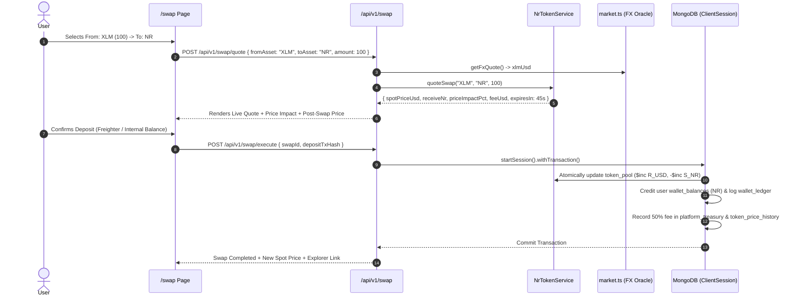
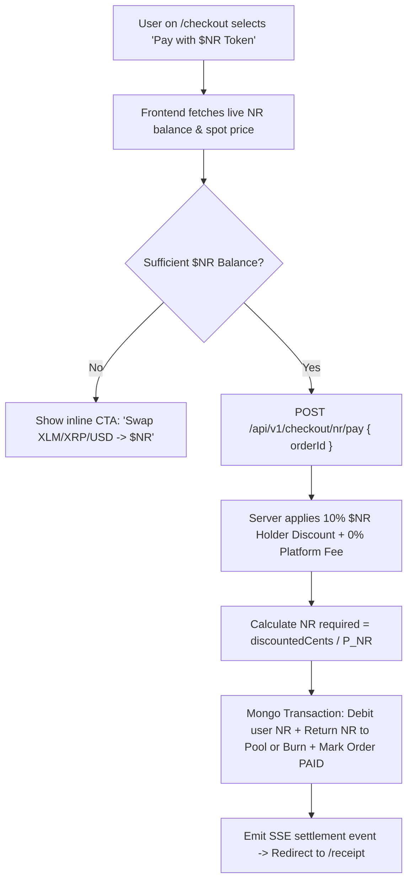

# Module 1 (`M1`): `$NR` Native Token Economy & Constant-Product Bonding Curve AMM

> **Status:** Planned Specification (Ready for Approval)  
> **Dependencies:** `M6` (Persistent MongoDB Swap Storage recommended first)  
> **2026 Protocol References:** XRPL Native AMM (`XLS-30`) & `MPTokensV1` (`XLS-89`) Metadata, Stellar Issued Assets & Protocol 22 Atomic Transfers  

---

## 1. 2026 Research & Design Rationale

### 1.1 Why a Native Token (`$NR`) Makes NexusRail Self-Sustaining
In modern Web3 commerce architectures (modeled after Binance `BNB`, Uniswap `UNI`, and Crypto.com `CRO`), a native asset turns isolated checkout transactions into a **closed-loop value flywheel**:
- **Demand Side**: Users swap `XLM`, `XRP`, or `USD` into `$NR` because holding or spending `$NR` unlocks **10% checkout discounts**, **0% swap/routing fees**, and **VIP `NRHOLDER20` coupons** (see [M7](./M7_SMART_COUPONS_AND_NR_CASHBACK.md)).
- **Supply & Backing Side**: Instead of an unbacked "arbitrary price" token, `$NR` is governed by an **XRPL `XLS-30`-inspired constant-product Automated Market Maker (`R_USD * S_NR = k`)** where **50% of all platform fees collected across the store, swaps, and AI orders are injected directly into the `$NR` USD reserve** without minting additional `$NR`.
- **2026 XRPL & Stellar Standard Alignment**:
  - Per the 2026 **XRPL `MPTokensV1` (`XLS-89`)** specification, modern institutional tokens embed scale, supply cap, transfer fee metadata, and backing descriptors on-chain rather than relying on opaque strings.
  - On **Stellar Horizon**, `$NR` operates with 7-decimal precision (`stroops` scale) and deterministic memo tagging (`NR...`), allowing future 1:1 mainnet issuance as a Stellar Asset / Soroban SAC (`Stellar Asset Contract`).

### 1.2 Current Codebase Audit (What Exists Today)
| Component | Current Location | Current Limitation |
| :--- | :--- | :--- |
| **Static Product Entry** | `apps/api/src/services/products.ts` (L185–199) | `NR-TOKEN` has a hardcoded `price_cents: 2500` (`$25.00`) and `stock_quantity: 100000`. Price never changes with demand. |
| **Static Agent Holdings** | `apps/api/src/routes/agent.ts` (L147–148) | Hardcodes `const nrTokensUnits = 45.0; const nrTokenUsdPrice = 25.0;` instead of querying the user's real `$NR` ledger balance and live AMM spot price. |
| **Currency Enum** | `packages/shared/src/types/database.ts` (L3)<br>`apps/api/src/services/wallet.ts` (L6) | `WalletCurrency` only allows `'USD' | 'XRP' | 'XLM'`. There is no `'NR'` currency in `wallet_balances` or `wallet_ledger`. |
| **Swap Router** | `apps/api/src/routes/swap.ts` (L9–15)<br>`apps/web/src/app/swap/page.tsx` (L38–45) | `initiateSwapSchema` restricts swaps to `'XRP' <-> 'XLM'`. Users cannot buy or sell `$NR` via `/swap`. |

---

## 2. Mathematical Model: Constant-Product AMM & Revenue Floor Growth

### 2.1 Pool State Variables (`token_pool` Collection)
Let the global `$NR` AMM pool maintain:
- $R_{\text{USD}}$ (`reserve_usd_cents`): Total USD-equivalent liquidity backing the pool (stored in integer cents for precision).
- $S_{\text{NR}}$ (`pool_nr_micro`): Circulating pool supply of `$NR` (stored in `10^6` micro-units, i.e., `1.000000 NR = 1,000,000` units, avoiding floating-point drift).
- $k = R_{\text{USD}} \times S_{\text{NR}}$ (`invariant_k`): Constant product invariant during pure swaps.
- $S_{\text{circulating}}$: Total `$NR` held by users (`total_minted_supply - S_NR`).

**Genesis Initialization Values (Configurable via Env / Admin):**
- $R_{\text{USD}}^{(0)} = \$100{,}000.00$ (`10,000,000` cents)
- $S_{\text{NR}}^{(0)} = 100{,}000.000000\text{ NR}$ (`100,000,000,000` micro-units)
- **Genesis Spot Price**:
  $$P_{\text{NR}}^{(0)} = \frac{\$100{,}000.00}{100{,}000\text{ NR}} = \$1.00 / \text{NR}$$

### 2.2 Spot Price & Buy Formula (`USD / XLM / XRP -> $NR`)
At any moment $t$, the live spot price per `1 NR` in USD cents is:
$$P_{\text{NR}}(t) = \frac{R_{\text{USD}}}{S_{\text{NR}} / 10^6} \quad (\text{USD cents per NR})$$

When a user swaps an input asset worth $V_{\text{in}}$ USD cents into `$NR`:
1. **Swap Fee ($0.5\%$)**:
   $$\text{Fee}_{\text{cents}} = \text{round}(V_{\text{in}} \times 0.005), \quad \Delta_{\text{USD}} = V_{\text{in}} - \text{Fee}_{\text{cents}}$$
   *(Note: If the swap input is `XLM` or `XRP`, $V_{\text{in}} = \text{amountAsset} \times P_{\text{oracle}} \times 100$ using `getFxQuote()` from `market.ts`.)*
2. **Bonding Curve Output ($\Delta_{\text{NR\_out}}$)**:
   $$k = R_{\text{USD}} \times S_{\text{NR}}$$
   $$R'_{\text{USD}} = R_{\text{USD}} + \Delta_{\text{USD}}$$
   $$S'_{\text{NR}} = \left\lceil \frac{k}{R'_{\text{USD}}} \right\rceil$$
   $$\Delta_{\text{NR\_out}} = S_{\text{NR}} - S'_{\text{NR}}$$
3. **Revenue Fee Injection (50% to Pool Reserve, 50% to Owner Treasury)**:
   $$\text{Fee}_{\text{pool}} = \lfloor 0.5 \times \text{Fee}_{\text{cents}} \rfloor, \quad \text{Fee}_{\text{owner}} = \text{Fee}_{\text{cents}} - \text{Fee}_{\text{pool}}$$
   The pool reserve increases again by $\text{Fee}_{\text{pool}}$ without removing any `$NR` from $S'_{\text{NR}}$:
   $$R''_{\text{USD}} = R'_{\text{USD}} + \text{Fee}_{\text{pool}}, \quad k'' = R''_{\text{USD}} \times S'_{\text{NR}}$$
   **Effect**: Because $R''_{\text{USD}}$ increases while $S'_{\text{NR}}$ decreased, **$P_{\text{NR}}(t+1) > P_{\text{NR}}(t)$ after every Buy!**

### 2.3 Sell Formula (`$NR -> USD / XLM / XRP`)
When a user sells $\Delta_{\text{NR\_in}}$ micro-units back to the pool:
1. Compute gross USD cents returned by the curve:
   $$S'_{\text{NR}} = S_{\text{NR}} + \Delta_{\text{NR\_in}}$$
   $$R'_{\text{USD}} = \left\lceil \frac{k}{S'_{\text{NR}}} \right\rceil$$
   $$\text{Gross}_{\text{USD}} = R_{\text{USD}} - R'_{\text{USD}}$$
2. Apply $0.5\%$ exit fee ($\text{Fee}_{\text{cents}} = \text{round}(\text{Gross}_{\text{USD}} \times 0.005)$):
   - User receives $\text{Net}_{\text{USD}} = \text{Gross}_{\text{USD}} - \text{Fee}_{\text{cents}}$ (credited to `USD` ledger balance, or paid out via `CrossChainSwapService` in `XLM` / `XRP`).
   - $50\%$ of $\text{Fee}_{\text{cents}}$ remains in $R_{\text{USD}}$ as permanent LP backing; $50\%$ goes to Owner Treasury (`M4`).

### 2.4 Revenue-Backed Floor Growth (Cross-Platform Flywheel)
Every time a **store order** or **XRP ⇄ XLM swap** completes (even if the user did not trade `$NR`), `TreasuryService` ([M4](./M4_OWNER_PROFIT_ENGINE_SOROBAN_P22.md)) calls `NrTokenService.injectRevenueToPool(halfFeeCents)`:
$$R_{\text{USD}} \leftarrow R_{\text{USD}} + \text{halfFeeCents}, \quad k \leftarrow R_{\text{USD}} \times S_{\text{NR}}$$
This guarantees that **$P_{\text{NR}}$ increases continuously with overall NexusRail GMV**, creating a transparent, auditable backing metric (`treasury_backing_ratio`).

---

## 3. Database Schema & Shared Type Changes

### 3.1 `packages/shared/src/types/database.ts`
Extend `WalletCurrency` and `PaymentRail`:
```ts
export type PaymentRail = 'STRIPE' | 'WALLET' | 'XRPL' | 'STELLAR' | 'NR_TOKEN';
export type WalletCurrency = 'USD' | 'XRP' | 'XLM' | 'NR';
```
*(Important note on scaling: `wallet_balances.available_cents` for `'USD'` stores cents ($10^{-2}$), while for `'NR'` we standardize on **micro-NR** ($10^{-6}$, so `1.000000 NR = 1_000_000`) or clearly document a `NR_SCALE = 1_000_000` constant inside `WalletService` and `NrTokenService`.)*

### 3.2 `apps/api/src/services/mongo.ts`
Add two new collections with unique indexes in `MongoService.initIndexes`:

1. **`token_pool`** (`MongoTokenPoolDoc`):
```ts
export interface MongoTokenPoolDoc {
  _id?: any;
  symbol: 'NR';
  name: 'NexusRail Protocol Token';
  reserve_usd_cents: number;       // R_USD
  pool_nr_micro: number;           // S_NR (scale 1e6)
  total_supply_nr_micro: number;   // Max cap (e.g., 1,000,000 * 1e6)
  total_volume_usd_cents: number;  // Cumulative swap volume
  cumulative_fee_injected_cents: number;
  spot_price_usd_cents: number;    // Cached P_NR in USD cents
  price_24h_open_cents: number;    // Baseline for 24h % change badge
  updated_at: string;
}
```
2. **`token_price_history`** (`MongoTokenPriceTickDoc`):
- Stores price snapshots `{ symbol: 'NR', price_usd_cents, reserve_usd_cents, trigger: 'SWAP' | 'REVENUE_INJECTION', created_at }` indexed on `{ symbol: 1, created_at: -1 }` so `/swap` can plot a **live `$NR` bonding curve & 24h price chart**.

---

## 4. Architecture & End-to-End Flows

### 4.1 Swap Flow (`XLM / XRP / USD <-> $NR`)



### 4.2 Checkout Flow: "Pay with `$NR` (10% Discount + 0% Fee)"



---

## 5. API Endpoints & Service Design

### 5.1 New Service: `apps/api/src/services/nrTokenService.ts`
- `ensureGenesisPool(): Promise<MongoTokenPoolDoc>` — Idempotently seeds the `token_pool` document on startup.
- `getPoolStats()` — Returns `spotPriceUsd`, `spotPriceCents`, `marketCapUsd`, `reserveUsd`, `circulatingNr`, `change24hPercent`, and recent price ticks from `token_price_history`.
- `quoteSwap({ fromAsset, toAsset, amount })` — Supports all pairs involving `'NR'`, `'USD'`, `'XLM'`, `'XRP'`. Computes exact output, price impact %, fee breakdown, and post-trade spot price.
- `executeNrSwap({ userId, fromAsset, toAsset, amount, depositTxHash, destinationAddress })` — Executes inside a MongoDB `ClientSession` transaction:
  - Uses conditional `findOneAndUpdate` on `token_pool` so concurrent swaps cannot double-spend pool liquidity.
  - Updates `wallet_balances` (`USD` or `NR`) via `WalletService.applyEntry(..., session)`.
  - Calls `PortfolioService` (`M3`) and `TreasuryService` (`M4`).
- `injectRevenueToPool(feeCents: number, referenceId: string, session?: ClientSession)` — Adds revenue directly to `reserve_usd_cents` and records a price tick.

### 5.2 Route Additions
1. **`apps/api/src/routes/swap.ts`**:
   - `GET /api/v1/swap/nr-pool` — Public endpoint returning live `$NR` pool stats, spot price, 24h change %, and recent chart ticks.
   - Update `initiateSwapSchema` and `POST /api/v1/swap/quote` to accept `'NR' | 'USD' | 'XLM' | 'XRP'`.
   - Protect `NR` swaps executed against internal balances with `requireAuth` (while preserving guest quote previews).
2. **`apps/api/src/routes/checkout.ts`**:
   - `POST /api/v1/checkout/nr/pay` (`requireAuth`): Pays a `PENDING` order using the user's `$NR` balance with an automatic **10% `$NR` payment discount** and **0% routing fee**, marks the order `PAID`, triggers `settlementEmitter.emitSettlement()`, and pins receipt to IPFS.

---

## 6. Frontend Changes

1. **`apps/web/src/app/swap/page.tsx`**:
   - Expand `SwapToken` type to `'XRP' | 'XLM' | 'NR' | 'USD'`.
   - Add a **Live `$NR` Tokenomics Banner** above the swap card showing:
     - Current Spot Price (`$1.XX / NR`), 24h Delta (`+X.XX%`), Reserve Backing (`$100,XXX`), and Circulating Supply.
     - Interactive SVG sparkline generated from `token_price_history` ticks.
   - Show **Estimated Price Impact %** and **"Post-Swap `$NR` Price"** inside the quote breakdown.
2. **`apps/web/src/app/checkout/page.tsx`** & **`apps/web/src/components/MultiRailCheckoutSelector.tsx`**:
   - Add a 4th rail button: **`Pay with $NR Token` (Save 10% • 0% Fee)** showing live `$NR` equivalent and user balance.
3. **`apps/web/src/app/store/page.tsx`**:
   - Hydrate `NR-TOKEN` card dynamically from `NrTokenService.getPoolStats()` instead of hardcoded `$25.00`.

### 6.4 Layer 3: Admin Dashboard Integration (`apps/web/src/app/admin/page.tsx` & `apps/api/src/routes/admin.ts`)
1. **Backend Admin Endpoints (`apps/api/src/routes/admin.ts`)**:
   - `GET /api/v1/admin/nr-pool` (`requireAuth`, `requireAdmin`): Returns full `$NR` AMM pool state (`reserve_usd_cents`, `pool_nr_micro`, `invariant_k`, `spot_price_usd_cents`, `circulating_nr`, `total_volume_usd_cents`, `cumulative_fee_injected_cents`, and recent price ticks).
   - `POST /api/v1/admin/nr-pool/adjust-reserve` (`requireAuth`, `requireAdmin`): Allows operator liquidity injection (with audit trail entry) into the `$NR` AMM reserve pool.
2. **Frontend Admin Console (`apps/web/src/app/admin/page.tsx`)**:
   - **`overview` & `rails` Tabs**: Add a **Live `$NR` Native Token & AMM Pool Monitor** card displaying live Spot Price (`$1.XX`), Reserve Liquidity (`R_USD`), Circulating `$NR`, Invariant $k$, 24h Volume, and a quick modal to seed/top-up liquidity or inspect recent `$NR` swaps.

---

## 7. Step-by-Step Implementation & Verification Checklist

- [ ] **Step 1.1**: Update `WalletCurrency` and `PaymentRail` in `packages/shared/src/types/database.ts` and rebuild `@nexusrail/shared`.
- [ ] **Step 1.2**: Add `MongoTokenPoolDoc` and `MongoTokenPriceTickDoc` + indexes in `apps/api/src/services/mongo.ts`.
- [ ] **Step 1.3**: Extend `WalletService` (`apps/api/src/services/wallet.ts`) to handle `'NR'` micro-unit atomic debits and credits.
- [ ] **Step 1.4**: Implement `NrTokenService` (`apps/api/src/services/nrTokenService.ts`) with constant-product AMM math and `ClientSession` transactions.
- [ ] **Step 1.5**: Wire `/api/v1/swap/nr-pool`, `NR` pairs in `apps/api/src/routes/swap.ts`, and `POST /api/v1/checkout/nr/pay` in `apps/api/src/routes/checkout.ts`.
- [ ] **Step 1.6**: Update `apps/web/src/app/swap/page.tsx` and `apps/web/src/app/checkout/page.tsx`.
- [ ] **Step 1.7 (Admin Layer)**: Add `GET /api/v1/admin/nr-pool` & `POST /api/v1/admin/nr-pool/adjust-reserve` in `apps/api/src/routes/admin.ts` and render the `$NR` AMM Pool Monitor in `apps/web/src/app/admin/page.tsx`.
- [ ] **Step 1.8 (Tests)**: Create `apps/api/test/nr-token-amm.test.ts` verifying:
  - Constant-product invariant preservation ($R'_{\text{USD}} \times S'_{\text{NR}} \ge k$) across buy and sell cycles.
  - Spot price strictly increases after buys and after `injectRevenueToPool()`.
  - Atomic overdraft rejection when paying an order with insufficient `$NR`.
  - 10% discount math on `/checkout/nr/pay`.
