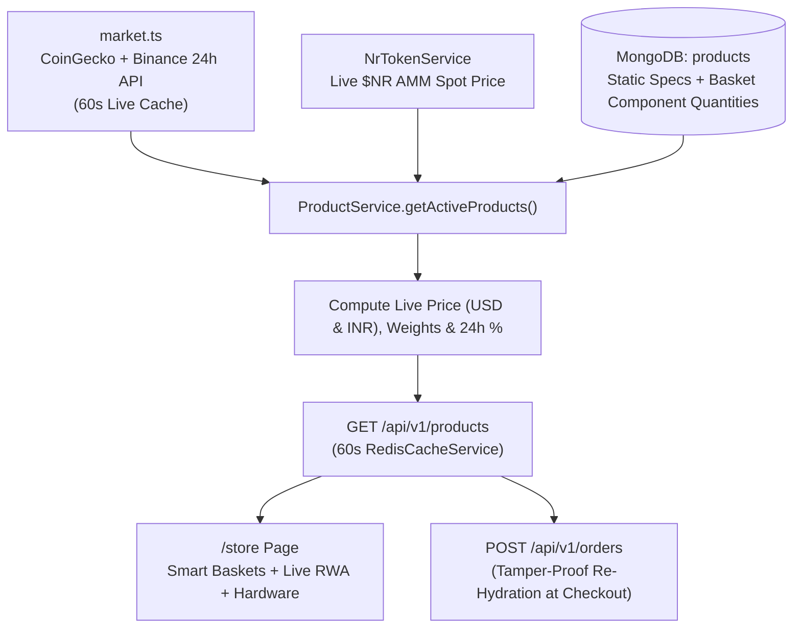

# Module 2 (`M2`): Live Multi-Rail Smart Baskets & Real-Time Oracle Store

> **Status:** Planned Specification (Ready for Approval)  
> **Dependencies:** `M1` (`$NR` Live Spot Price for *AI Alpha Basket* & `$NR` Packs)  
> **2026 Protocol References:** XRPL On-Chain Price Oracles (`XLS-47` / `fixPriceOracleOrder`), CoinGecko `PAXG` / `KAG` / `XRP` / `XLM` Feeds, Binance Spot Ticker Fallback  

---

## 1. 2026 Research & Current Codebase Audit

### 1.1 Why "Multi-Rail Smart Baskets" Are Unique in Web3 Commerce
Traditional e-commerce apps sell static physical items, and single-chain DEXs only swap tokens within one network (e.g., Uniswap on Ethereum). Because NexusRail natively bridges **Stellar (XLM, USDC, Soroban)**, **XRPL (XRP)**, and **Fiat (Stripe)**, it can offer **Cross-Chain Financial Combo Packs ("Smart Baskets")** that are impossible to buy in a single click on standard single-chain platforms:
- A shopper pays once (via Card, Stellar, XRPL, or `$NR`) and acquires a diversified basket spanning **allocated Gold (`PAXG`), Silver (`KAG`), `USDC`, `XRP`, `XLM`, and `$NR`**.
- Every asset's price is hydrated live from market oracles—eliminating arbitrary dummy prices while requiring **zero physical warehouse or shipping logistics** in production.

### 1.2 Current Codebase Audit
| File | Current Implementation | Gap Identified |
| :--- | :--- | :--- |
| `apps/api/src/services/market.ts` | `getMetalQuote()` fetches `pax-gold` (Gold) and `kinesis-silver` (Silver) in USD & INR; `getFxQuote()` fetches `ripple` & `stellar` with Binance fallback (`XRPUSDT`, `XLMUSDT`). | Does not currently expose **24-hour percentage changes** (`include_24hr_change=true` on CoinGecko / `/api/v3/ticker/24hr` on Binance) and is not wired to product catalog pricing. |
| `apps/api/src/services/products.ts` (L23–216) | Seeds 12 `DEFAULT_PRODUCTS` with static `price_cents` (`RAIL-ONE`, `NGOLD-TOKEN` at `$85.00`, `NR-TOKEN` at `$25.00`). | `NGOLD-TOKEN` is hardcoded at `$85.00` instead of tracking live `goldUsdPerGram`, and no Multi-Rail Smart Baskets exist. |
| `apps/api/src/routes/products.ts` (L10–23) | Caches `products:active` for `300s` (5 minutes) in `RedisCacheService`. | Should reduce live-oracle product cache TTL to `60s` so catalog prices stay aligned with checkout quotes. |
| `apps/web/src/app/store/page.tsx` (L131–138) | `primarySix` filters the catalog down to strictly 6 hardware/merch SKUs (`RAIL-ONE`, `RELAY-MAT`, `NEXUS-TEE`, `NODE-STAND`, `SIGNAL-CAP`, `RAIL-CABLES`), hiding digital RWA & token products. | Must expose **"Smart Baskets"** and **"Live RWA & Tokens"** tabs alongside existing hardware/essentials. |

---

## 2. Smart Basket Catalog & Live NAV Mathematics

### 2.1 Smart Basket & Live Asset Definitions

| SKU | Display Title | Category | Allocation Formula (Per 1 Unit) | Settlement Rails |
| :--- | :--- | :--- | :--- | :--- |
| **`BASKET-INFLATION-SHIELD`** | **Inflation Shield Basket** | `baskets` | `0.50g` 24K Gold (`PAXG`) + `30.00` `USDC` + `20.00g` Silver (`KAG`) | `STELLAR` + `RWA` |
| **`BASKET-DUAL-RAIL`** | **Dual-Rail Flash Pack** | `baskets` | `25.00 XRP` + `150.00 XLM` (Simultaneous XRPL + Stellar pack) | `MULTI` (`XRPL` + `STELLAR`) |
| **`BASKET-AI-ALPHA`** | **AI Dynamic Alpha Basket** | `baskets` | `0.40g` Gold + `25.00 $NR` + `15.00 XRP` + `100.00 XLM` | `MULTI` + `NR` |
| **`NGOLD-1G`** | **1g 24K Digital Gold (`nGOLD`)** | `live-assets` | `1.00g` Allocated Gold (`PAXG` Spot Oracle) | `STELLAR` |
| **`NSILVER-10G`** | **10g Digital Silver (`nSILVER`)** | `live-assets` | `10.00g` Allocated Silver (`KAG` Spot Oracle) | `STELLAR` |
| **`NR-PACK-50`** | **50 `$NR` Protocol Pack** | `live-assets` | `50.00 $NR` Native Tokens (`NrTokenService` AMM Price) | `MULTI` |

*(Note: Existing 6 Figma products — `RAIL-ONE`, `RELAY-MAT`, `NEXUS-TEE`, `NODE-STAND`, `SIGNAL-CAP`, `RAIL-CABLES` — remain active under `hardware`, `workspace`, and `essentials` so zero existing routes or tests break.)*

### 2.2 Live Net Asset Value (NAV) & 24h Change Formulas
Let $\mathcal{B}$ be a Smart Basket composed of $n$ underlying assets $\{A_1, \dots, A_n\}$, where each component specifies a fixed physical/token unit quantity $Q_i$ and live oracle unit price $P_i(t)$ (in USD cents):

1. **Basket Live Price (in USD cents)**:
   $$\text{Price}_{\mathcal{B}}(t) = \sum_{i=1}^{n} \text{round}\big(Q_i \cdot P_i(t)\big)$$
   Where:
   - $P_{\text{GOLD\_G}}(t) = \text{round}(\text{goldUsdPerGram} \times 100)$
   - $P_{\text{SILVER\_G}}(t) = \text{round}(\text{silverUsdPerGram} \times 100)$
   - $P_{\text{XRP}}(t) = \text{round}(\text{xrpUsd} \times 100)$
   - $P_{\text{XLM}}(t) = \text{round}(\text{xlmUsd} \times 100)$
   - $P_{\text{USDC}}(t) = 100$ (`$1.00`)
   - $P_{\text{NR}}(t) = \text{NrTokenService.getSpotPriceCents()}$

2. **Dynamic Allocation Weight $w_i(t)$**:
   $$w_i(t) = \frac{Q_i \cdot P_i(t)}{\text{Price}_{\mathcal{B}}(t)} \times 100\%$$

3. **Weighted 24-Hour Change ($\Delta_{24\text{h}}\%$)**:
   $$\Delta_{24\text{h}, \mathcal{B}}\% = \sum_{i=1}^{n} \left(\frac{Q_i \cdot P_i(t)}{\text{Price}_{\mathcal{B}}(t)}\right) \cdot \Delta_{24\text{h}, A_i}\%$$

---

## 3. Data Flow Architecture



---

## 4. Schema & Backend Modifications

### 4.1 `packages/shared/src/types/database.ts` & `apps/api/src/services/mongo.ts`
Extend `DbProduct` and `MongoProductDoc` with optional live-asset metadata:
```ts
export type AssetSymbol = 'GOLD_G' | 'SILVER_G' | 'XRP' | 'XLM' | 'USDC' | 'NR';

export interface ProductAllocation {
  symbol: AssetSymbol;
  label: string;         // e.g. "24K Gold (PAXG)"
  unitQty: number;       // Exact units credited per 1 item purchased
  weightPercent?: number;
}
```
New optional fields on `MongoProductDoc` / `DbProduct`:
- `is_live_asset?: boolean`
- `is_basket?: boolean`
- `allocations?: ProductAllocation[]`
- `price_inr?: number` (calculated dynamically from live INR/USD oracle)
- `change_24h_percent?: number`
- `oracle_source?: 'coingecko' | 'binance' | 'amm' | 'static'`
- `price_updated_at?: string`

### 4.2 `apps/api/src/services/market.ts`
Upgrade `getMetalQuote()` and `getFxQuote()` (and add `getExtendedMarketSnapshot()`):
- Query CoinGecko with `&include_24hr_change=true` (`pax-gold`, `kinesis-silver`, `ripple`, `stellar`).
- On Binance fallback, query `https://api.binance.com/api/v3/ticker/24hr?symbol=XRPUSDT` and `XLMUSDT` to preserve `xrp24hChange` and `xlm24hChange`.
- Cache live market snapshot for `60 seconds` (down from 30 minutes for quote accuracy, while preserving fallback cache on 429 rate limits).

### 4.3 `apps/api/src/services/products.ts`
- Seed the 3 Smart Baskets and 3 Live RWA/Token packs in `DEFAULT_PRODUCTS` (alongside existing items; deactivate or replace the old static `NGOLD-TOKEN` alias cleanly with `NGOLD-1G` or map `NGOLD-TOKEN` to live `1g` Gold price for backward compatibility with `agent.ts`).
- Implement `hydrateLivePricing(doc: MongoProductDoc, snapshot, nrSpotCents)` inside `ProductService.getActiveProducts()`, `getProductBySku()`, and `getProductById()`—ensuring `POST /api/v1/orders` in `orders.ts` automatically charges the **exact live oracle price** at order creation time.

---

## 5. Frontend UI Design (`apps/web/src/app/store/page.tsx`)

1. **Category Tabs Upgrade**:
   - Replace hardcoded `primarySix` filter (`store/page.tsx` L131–138) so all active products are browsable.
   - Add category pills:
     - `All Products`
     - `Smart Baskets` (`baskets` — featured at top with gradient border)
     - `Live RWA & Tokens` (`live-assets`)
     - `Hardware` (`hardware`)
     - `Workspace` (`workspace`)
     - `Essentials` (`essentials`)
   - Update `maxPrice` slider upper bound dynamically (e.g., up to `$600` so validator kits and multi-asset baskets are not filtered out by the default `maxPrice = 150` slider!).
2. **Smart Basket & Live Card UI**:
   - Pulsing green dot badge: `● LIVE ORACLE` + 24h trend pill (`+1.84% ▲` in emerald or `-0.42% ▼` in rose).
   - **Composition Bar**: Stacked mini color bar + breakdown chips (`50% Gold • 30% USDC • 20% Silver`).
   - Dual-currency subtitle showing USD price and approximate INR (`₹...`) / `$NR` equivalent.
   - Cashback preview tag: `Earn 2% back in $NR`.
3. **Live Refresh Control**:
   - Auto-refresh catalog every `60 seconds` in the background + manual "Sync Live Prices" button.

### 5.4 Layer 3: Admin Dashboard Integration (`apps/web/src/app/admin/page.tsx` & `apps/api/src/routes/admin.ts`)
1. **Backend Admin Endpoints (`apps/api/src/routes/admin.ts`)**:
   - Extend `GET /api/v1/admin/products` to return **both** active and paused products with live oracle prices, `is_basket`, `allocations`, and `oracle_source`.
   - Add `POST /api/v1/admin/products` and `PATCH /api/v1/admin/products/:sku` (`requireAuth`, `requireAdmin`) so the operator can create new Smart Baskets/Assets, adjust allocation quantities, toggle `active` visibility, and invalidate `RedisCacheService.invalidateCache('products:active')`.
2. **Frontend Admin Console (`apps/web/src/app/admin/page.tsx`)**:
   - Add a **Smart Baskets & Live Oracle Catalog** management panel (under `rates` or a dedicated `catalog` sub-section) displaying every basket's live USD/INR NAV, 24h oracle trend, stock/active toggle, and a **"+ New Smart Basket / Product"** modal.

---

## 6. Step-by-Step Implementation & Verification Checklist

- [ ] **Step 2.1**: Extend `MarketSnapshot` in `apps/api/src/services/market.ts` with 24h percentage change fields and `60s` live TTL.
- [ ] **Step 2.2**: Add `ProductAllocation`, `AssetSymbol`, and live fields to `packages/shared/src/types/database.ts` and `apps/api/src/services/mongo.ts`.
- [ ] **Step 2.3**: Seed `BASKET-INFLATION-SHIELD`, `BASKET-DUAL-RAIL`, `BASKET-AI-ALPHA`, `NGOLD-1G`, `NSILVER-10G`, and `NR-PACK-50` in `apps/api/src/services/products.ts` and implement `hydrateLivePricing()`.
- [ ] **Step 2.4**: Reduce catalog cache TTL in `apps/api/src/routes/products.ts` from `300s` to `60s` (or invalidate on `$NR` price shift).
- [ ] **Step 2.5**: Update `apps/web/src/lib/shop.ts` (`CatalogItem` parser) and `apps/web/src/app/store/page.tsx` (remove `primarySix` cap, widen price slider, render basket breakdown & live badges).
- [ ] **Step 2.6 (Admin Layer)**: Add `POST /api/v1/admin/products` & `PATCH /api/v1/admin/products/:sku` in `apps/api/src/routes/admin.ts` and build the Live Baskets & Catalog Manager in `apps/web/src/app/admin/page.tsx`.
- [ ] **Step 2.7 (Tests)**: Add `apps/api/test/live-baskets.test.ts` verifying:
  - `hydrateLivePricing()` matches $\sum Q_i \cdot P_i(t)$ precisely.
  - `POST /api/v1/orders` uses live server-hydrated basket price and ignores any tampered client `unitPriceCents`.
  - Existing SKU tests (`RAIL-ONE`, `RELAY-MAT`, etc.) continue passing unchanged.
