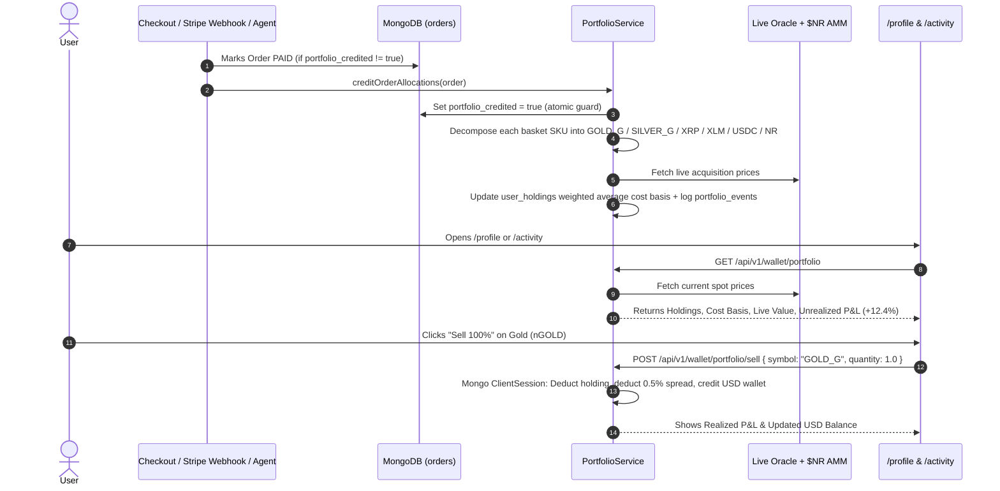

# Module 3 (`M3`): User Live Portfolio, Profit/Loss Tracker & 1-Click Cashout

> **Status:** Planned Specification (Ready for Approval)  
> **Dependencies:** `M1` (`$NR` Spot Price) and `M2` (`ProductAllocation` on Baskets & Live RWA Assets)  
> **Target UX:** Real-time wealth tracking in `/profile` and `/activity` with instant liquidation  

---

## 1. Problem Statement & Codebase Audit

### 1.1 Current Gap
Today, when a shopper completes payment in `apps/api/src/routes/checkout.ts`, `apps/api/src/services/stripe.ts`, or `apps/api/src/routes/agent.ts`:
- The order's status changes from `PENDING` to `PAID` and a receipt is optionally pinned to Pinata IPFS.
- **Nothing is credited to an asset portfolio.** If the user bought `1g Gold (nGOLD)` or a `Smart Basket`, they have no way to track whether their asset went up or down in value today, nor any way to sell it back for cash or crypto.

### 1.2 Goal of Module 3
Transform every purchase of a **Smart Basket** or **Live RWA/Token Asset** into a **real-time tracked holding** with:
1. Automatic **decomposed crediting** upon order settlement (e.g., buying 1 `Inflation Shield Basket` credits `0.50g Gold`, `30.00 USDC`, and `20.00g Silver`).
2. **Weighted-Average Cost Basis & Live Unrealized P&L** computed dynamically against `market.ts` + `NrTokenService`.
3. **1-Click Sell / Cashout** back into internal `USD` (or `XLM`/`XRP` swap) at live market rate minus the platform spread (`0.5%`).

---

## 2. Portfolio Accounting & P&L Mathematics

### 2.1 Weighted-Average Cost Basis (Buy / Credit)
Suppose a user already owns $Q_{\text{old}}$ units of asset $A$ (`GOLD_G`, `SILVER_G`, `XRP`, `XLM`, `USDC`, or `NR`) with cumulative cost basis $C_{\text{old}}$ (in USD cents).
When an order settles and delivers $\Delta Q$ additional units at acquisition unit price $P_{\text{buy}}$ (USD cents per unit):
$$\Delta C = \text{round}(\Delta Q \cdot P_{\text{buy}})$$
$$Q_{\text{new}} = Q_{\text{old}} + \Delta Q$$
$$C_{\text{new}} = C_{\text{old}} + \Delta C$$
$$\text{AvgBuyPrice}_{\text{new}} = \frac{C_{\text{new}}}{Q_{\text{new}}}$$

### 2.2 Live Valuation & Unrealized P&L
Given current live oracle price $P_{\text{live}}(t)$ (USD cents per unit):
$$\text{CurrentValue}_{\text{cents}} = \text{round}(Q_{\text{new}} \cdot P_{\text{live}}(t))$$
$$\text{UnrealizedPnL}_{\text{cents}} = \text{CurrentValue}_{\text{cents}} - C_{\text{new}}$$
$$\text{UnrealizedPnL}_{\%} = \begin{cases} \frac{\text{UnrealizedPnL}_{\text{cents}}}{C_{\text{new}}} \times 100 & \text{if } C_{\text{new}} > 0 \\ 0 & \text{if } C_{\text{new}} = 0 \end{cases}$$

### 2.3 Partial / Full Sell & Cashout Math
When the user sells $\Delta Q_{\text{sell}}$ units ($0 < \Delta Q_{\text{sell}} \le Q_{\text{current}}$):
1. **Gross Proceeds**: $\text{Gross}_{\text{cents}} = \text{round}(\Delta Q_{\text{sell}} \cdot P_{\text{live}}(t))$
2. **Platform Exit Spread ($0.5\%$ / `50 bps`)**:
   $$\text{Spread}_{\text{cents}} = \text{round}(\text{Gross}_{\text{cents}} \times 0.005)$$
   $$\text{NetPayout}_{\text{cents}} = \text{Gross}_{\text{cents}} - \text{Spread}_{\text{cents}}$$
3. **Cost Basis Reduction (Proportional)**:
   $$\text{CostRemoved}_{\text{cents}} = \text{round}\left(C_{\text{current}} \cdot \frac{\Delta Q_{\text{sell}}}{Q_{\text{current}}}\right)$$
   $$Q_{\text{after}} = Q_{\text{current}} - \Delta Q_{\text{sell}}, \quad C_{\text{after}} = \max(0, C_{\text{current}} - \text{CostRemoved}_{\text{cents}})$$
4. **Realized P&L**: $\text{RealizedPnL}_{\text{cents}} = \text{NetPayout}_{\text{cents}} - \text{CostRemoved}_{\text{cents}}$.
5. **Atomic Settlement**:
   - If selling `NR`, route through `NrTokenService` curve or debit user `NR` and inject $50\%$ of `Spread_cents` to `$NR` reserve + $50\%$ to Owner Treasury (`M4`).
   - Credit `NetPayout_cents` to user's `USD` `wallet_balances` via `WalletService.creditBalance(..., session)`.

---

## 3. Database Schema (`apps/api/src/services/mongo.ts`)

### 3.1 `user_holdings` Collection (`MongoUserHoldingDoc`)
```ts
export interface MongoUserHoldingDoc {
  _id?: any;
  id: string;
  user_id: string;
  symbol: 'GOLD_G' | 'SILVER_G' | 'XRP' | 'XLM' | 'USDC' | 'NR';
  label: string;
  quantity: number;               // Floating quantity (e.g. 1.50 grams, 25.00 XRP)
  total_cost_cents: number;       // Sum of USD cents paid for remaining units
  avg_buy_price_cents: number;    // total_cost_cents / quantity
  realized_pnl_cents: number;     // Cumulative realized P&L from past sells
  updated_at: string;
}
```
- Unique Compound Index: `{ user_id: 1, symbol: 1 }`.

### 3.2 `portfolio_events` Collection (`MongoPortfolioEventDoc`)
Audit log for every asset acquisition, cashback credit, or cashout sell:
```ts
export interface MongoPortfolioEventDoc {
  _id?: any;
  id: string;
  user_id: string;
  type: 'ACQUIRE_ORDER' | 'CASHBACK_REWARD' | 'SWAP_IN' | 'SELL_CASHOUT';
  symbol: 'GOLD_G' | 'SILVER_G' | 'XRP' | 'XLM' | 'USDC' | 'NR';
  quantity_delta: number;
  unit_price_cents: number;
  total_usd_cents: number;
  fee_cents: number;
  reference_id: string;           // order_number or swapId
  created_at: string;
}
```
- Index: `{ user_id: 1, created_at: -1 }`.
- **Idempotency Flag on Orders**: Add `portfolio_credited?: boolean` to `MongoOrderDoc` so webhook retries or `LedgerWatcherWorker` ticks can **never double-credit** a user's holdings for the same order.

---

## 4. End-to-End Lifecycle Flow



---

## 5. Backend Service & API Endpoints

### 5.1 New Service: `apps/api/src/services/portfolioService.ts`
- `creditOrderAllocations(order: MongoOrderDoc, session?: ClientSession)`
  - Atomically flips `portfolio_credited: false -> true` on `orders` to guarantee strict once-only execution.
  - Iterates over `order.items`, looks up `allocations` from `ProductService`, and credits each underlying asset (multiplying `alloc.unitQty * item.qty`).
  - If an allocation includes `'NR'`, also syncs `WalletService.creditBalance(userId, nrMicro, 'NR', order.order_number, session)` so wallet balance and portfolio stay unified.
- `getUserPortfolio(userId: string)`
  - Loads all `user_holdings` (plus user's `$NR` balance if held via cashback/swaps), fetches live oracle snapshot (`getMetalQuote()`, `getFxQuote()`, `NrTokenService.getPoolStats()`), and returns:
    - `totalCostCents`, `totalCurrentValueCents`, `totalUnrealizedPnlCents`, `totalUnrealizedPnlPercent`, `totalRealizedPnlCents`, and per-asset rows.
- `sellHolding({ userId, symbol, quantity, payoutCurrency })`
  - Executes inside a MongoDB `ClientSession` with conditional filter `{ user_id: userId, symbol, quantity: { $gte: quantity } }`.
  - Records `0.5%` spread revenue in `TreasuryService` (`M4`).

### 5.2 Routes (`apps/api/src/routes/wallet.ts`)
- `GET /api/v1/wallet/portfolio` (`requireAuth`): Live hydrated holdings + P&L summary + recent `portfolio_events`.
- `POST /api/v1/wallet/portfolio/sell` (`requireAuth`): Liquidates specified quantity at live oracle rate and credits internal USD (or initiates XLM/XRP payout).

---

## 6. Frontend UI Upgrades

1. **`apps/web/src/app/profile/page.tsx`**:
   - Add a **"Live Asset Portfolio & P&L"** section directly above or beside Connected Wallets:
     - Top Summary Strip: **Invested Value**, **Current Market Value**, **Net Unrealized P&L (`+$ / +%`)**, and **Realized Gains**.
     - Per-Asset Cards (`24K Gold`, `Silver`, `$NR Token`, `XRP`, `XLM`, `USDC`) displaying:
       - Quantity owned, Average Buy Price, Current Live Price, Live Value, and green/red P&L pill.
       - **`Sell / Cashout`** button opening a quick slider modal (`25%`, `50%`, `100%` or custom amount) showing net proceeds after `0.5%` spread.
2. **`apps/web/src/app/activity/page.tsx`**:
   - Add a **"Portfolio Events & Realized Trades"** tab alongside the Orders & Double-Entry Reconciliation table so users see every asset credit, cashback drop, and sell execution.

### 6.3 Layer 3: Admin Dashboard Integration (`apps/web/src/app/admin/page.tsx` & `apps/api/src/routes/admin.ts`)
During our audit of `apps/web/src/app/admin/page.tsx`, we found that the sidebar navigation includes `{ id: 'ledger', label: 'Reconciliation Ledger' }` (L270), **but there is no `{activeTab === 'ledger' && (...)}` view rendered in the body**, so clicking **"Reconciliation Ledger"** currently shows a blank workspace!
1. **Backend Admin Endpoint (`apps/api/src/routes/admin.ts`)**:
   - Add `GET /api/v1/admin/portfolios` (`requireAuth`, `requireAdmin`) returning platform-wide **Assets Under Custody (AUC)** aggregated across all users (`GOLD_G`, `SILVER_G`, `NR`, `XRP`, `XLM`, `USDC`), total unrealized user liability in USD, and the latest `portfolio_events` (buys, cashbacks, and user sell cashouts).
2. **Frontend Admin Console (`apps/web/src/app/admin/page.tsx`)**:
   - Implement the missing `{activeTab === 'ledger' && (...)}` view displaying:
     - **Assets Under Custody vs. Reserve Backing Table** (Total User Gold Grams / XRP / XLM / `$NR` vs. Master Vault coverage).
     - **Recent User Cashouts & Portfolio Settlements Feed** showing `SELL_CASHOUT` spreads earned by the platform.

---

## 7. Step-by-Step Implementation & Verification Checklist

- [ ] **Step 3.1**: Add `MongoUserHoldingDoc`, `MongoPortfolioEventDoc`, and `portfolio_credited?: boolean` on `MongoOrderDoc` in `apps/api/src/services/mongo.ts` with indexes.
- [ ] **Step 3.2**: Implement `PortfolioService` (`apps/api/src/services/portfolioService.ts`) with idempotent order allocation, weighted-average cost basis math, and conditional atomic sell execution.
- [ ] **Step 3.3**: Hook `PortfolioService.creditOrderAllocations()` into all 4 settlement paths:
  - `apps/api/src/routes/checkout.ts` (`verifyPayment` & `/nr/pay`)
  - `apps/api/src/services/stripe.ts` (`fulfillOrderFromSession`)
  - `apps/api/src/workers/ledgerWatcher.ts` (`reconcilePendingOrders`)
  - `apps/api/src/routes/agent.ts` (`POST /confirm`)
- [ ] **Step 3.4**: Mount `GET /api/v1/wallet/portfolio` and `POST /api/v1/wallet/portfolio/sell` in `apps/api/src/routes/wallet.ts`.
- [ ] **Step 3.5**: Build the Live Portfolio & Sell UI in `apps/web/src/app/profile/page.tsx` and event log tab in `apps/web/src/app/activity/page.tsx`.
- [ ] **Step 3.6 (Admin Layer)**: Add `GET /api/v1/admin/portfolios` in `apps/api/src/routes/admin.ts` and implement the missing `activeTab === 'ledger'` Custody & Reconciliation view in `apps/web/src/app/admin/page.tsx`.
- [ ] **Step 3.7 (Tests)**: Create `apps/api/test/portfolio-pnl.test.ts` verifying:
  - Weighted-average cost basis across multiple purchases at different prices.
  - Idempotency: calling `creditOrderAllocations` twice for the same `order_number` credits assets exactly once.
  - Atomic sell prevents overselling (`quantity > owned`) and accurately calculates `0.5%` spread and realized P&L.
