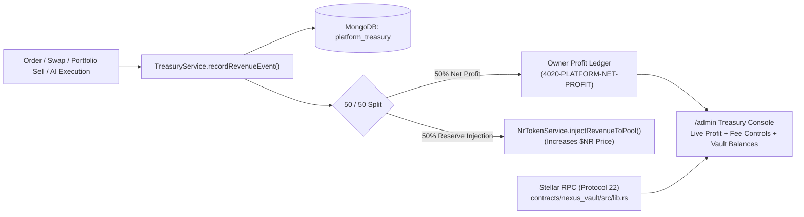

# Module 4 (`M4`): Platform Owner Profit Engine & Stellar Protocol 22 Smart Contract

> **Status:** Planned Specification (Ready for Approval)  
> **Dependencies:** `M1` (`$NR` Reserve Injection) and `M3` (Asset Sell Spread)  
> **2026 Protocol References:** Stellar Protocol 22 (`CAP-0058` Native Constructors, `CAP-0059` BLS12-381, **Stellar RPC**), Multi-Operation Atomic Envelopes  

---

## 1. 2026 Research & Current Codebase Audit

### 1.1 How Real FinTech Platforms Manage Profit, Treasury & Liquidity
In real multi-rail settlement platforms (e.g., Stripe + Coinbase Commerce + Robinhood):
- **Revenue must be separated from Customer Funds** in the double-entry ledger so customer balances are never commingled with platform earnings.
- **Every transaction produces 4 deterministic accounting streams**:
  1. **Routing / Platform Fee** (`1.0%` / `100 bps` on standard orders; waived to `0%` when paying in `$NR`).
  2. **FX / Cashout Spread** (`0.5%` / `50 bps` on cross-chain swaps and portfolio liquidations).
  3. **Network Gas Arbitrage** (Flat `$0.10` network settlement fee charged at checkout vs. `~$0.0001` actual Stellar/XRPL gas cost).
  4. **AI Agent Desk Execution Fee** (`0.25%` on autonomous custom basket execution).

### 1.2 2026 Stellar Protocol 22 & Soroban Audit
| Component | Current Location | Audit Finding |
| :--- | :--- | :--- |
| **Soroban Inspector** | `apps/api/src/services/soroban.ts` (13 lines) | Only calls `StellarService.getTransaction(txHash)` on Horizon. Does not connect to **Stellar RPC** (`https://soroban-testnet.stellar.org`) or verify Protocol 22 contract state. |
| **Admin Stats API** | `apps/api/src/routes/admin.ts` (L19–47) | Only sums `totalVolumeCents`, `totalOrdersCount`, `productsCount`, and `usersCount`. Has zero tracking for **Net Platform Profit**, **Spread Revenue**, **`$NR` Buyback Injections**, or **Fee Configuration**. |
| **Admin UI** | `apps/web/src/app/admin/page.tsx` | Displays static placeholder arrays (`INITIAL` `liveOrders`, hardcoded `64% Stellar / 36% XRPL`) rather than live database treasury profit and vault liquidity. |

### 1.3 Stellar Protocol 22 (`CAP-0058` & Stellar RPC) Capabilities
Per Stellar's official Protocol 22 documentation:
1. **`CAP-0058` Constructor Support**: Soroban contracts now define `pub fn __constructor(env: Env, owner: Address, nr_pool: Address, fee_bps: u32)` which initializes admin ownership and fee parameters **atomically at deployment**, preventing front-running initialization attacks.
2. **Stellar RPC Rebranding**: *Soroban RPC* was officially rebranded to **Stellar RPC** (`https://soroban-testnet.stellar.org`), serving unified JSON-RPC methods (`getHealth`, `getLatestLedger`, `getNetwork`, `getTransaction`) that report `protocolVersion >= 22`.
3. **Atomic Multi-Operation Payments**: On Stellar Horizon, `TransactionBuilder` can bundle **3 atomic operations** inside a single transaction:
   - Op 1: User sends net asset principal $\rightarrow$ **Platform Asset Vault**.
   - Op 2: User sends fee share $\rightarrow$ **Owner Profit Wallet** (when on-chain split is enabled).
   - Op 3: `Operation.manageData({ name: "nr_order_proof", value: orderHash })` anchors the basket/fee split directly on the ledger.

---

## 2. Double-Entry Fee Split & Revenue Allocation Math

For every revenue-generating event with gross value $G_{\text{cents}}$, configurable fee rate $r_{\text{fee}}$ (default `100 bps = 1.0%`), and spread rate $r_{\text{spread}}$ (default `50 bps = 0.5%`):

1. **Fee & Spread Calculation**:
   $$F_{\text{gross}} = \text{round}\left(G_{\text{cents}} \times \frac{r_{\text{fee}}}{10{,}000}\right) + \text{round}\left(G_{\text{cents}} \times \frac{r_{\text{spread}}}{10{,}000}\right) + \text{GasSurplus}_{\text{cents}}$$
2. **50 / 50 Ecosystem Allocation**:
   - **$50\%$ Owner Net Profit (`4020-PLATFORM-NET-PROFIT`)**:
     $$\Pi_{\text{owner}} = \left\lceil 0.5 \times F_{\text{gross}} \right\rceil$$
   - **$50\%$ `$NR` Treasury Buyback Reserve (`1050-NR-POOL-RESERVE`)**:
     $$\Pi_{\text{NR\_pool}} = F_{\text{gross}} - \Pi_{\text{owner}}$$
     Automatically injected into `token_pool.reserve_usd_cents` via `NrTokenService.injectRevenueToPool()`, increasing the `$NR` floor price.
3. **Zero-Sum Double-Entry Verification**:
   $$\text{User Gross Debit} - \left(\text{Asset Principal Credit} + \Pi_{\text{owner}} + \Pi_{\text{NR\_pool}} + \text{Actual Gas Cost}\right) = \$0.00$$

---

## 3. Architecture & Soroban Contract Design

### 3.1 Soroban Protocol 22 Smart Contract Specification (`contracts/nexus_vault/src/lib.rs`)
Create a clean, auditable Rust contract source in the repository implementing Protocol 22 `CAP-0058`:
- `#[contract]` struct `NexusVaultContract`
- `pub fn __constructor(env: Env, admin: Address, treasury_vault: Address, nr_reserve: Address, fee_bps: u32)`:
  - Stores `admin`, `treasury_vault`, `nr_reserve`, and `fee_bps` atomically in `env.storage().instance()`.
- `pub fn settle_with_split(env: Env, buyer: Address, token: Address, gross_amount: i128, order_ref: Symbol) -> (i128, i128, i128)`:
  - Enforces `buyer.require_auth()`.
  - Calculates `total_fee = (gross_amount * fee_bps as i128) / 10_000`.
  - Splits `owner_share = total_fee / 2`, `nr_backing = total_fee - owner_share`, and `principal = gross_amount - total_fee`.
  - Transfers `principal + owner_share` to `treasury_vault` and `nr_backing` to `nr_reserve` via `soroban_sdk::token::Client`, emitting a `Settled` contract event.
- `pub fn update_fee_bps(env: Env, new_fee_bps: u32)` — Enforces `admin.require_auth()` and caps `new_fee_bps <= 500` (5% max protocol safety cap).

*(Because Rust/Cargo may not be installed in every local developer environment, `contracts/nexus_vault/src/lib.rs` + `Cargo.toml` serves as the complete verifiable contract source, while `apps/api/src/services/soroban.ts` queries the live Stellar Protocol 22 Testnet RPC + builds multi-operation Horizon fee-split transactions today without blocking builds.)*

---

## 4. Database Schema & Backend Implementation

### 4.1 New Collections in `apps/api/src/services/mongo.ts`
1. **`platform_treasury`** (`MongoTreasuryEntryDoc`):
   - `{ id, source_type: 'ORDER' | 'SWAP' | 'SELL_SPREAD' | 'AI_EXECUTION' | 'GAS_ARBITRAGE', reference_id, gross_cents, fee_cents, spread_cents, gas_arbitrage_cents, nr_pool_injected_cents, net_owner_profit_cents, rail, created_at }`
   - Index: `{ created_at: -1 }`, `{ source_type: 1 }`, `{ reference_id: 1, source_type: 1 }` (unique idempotency key preventing duplicate profit entries).
2. **`platform_config`** (`MongoPlatformConfigDoc`):
   - `{ key: 'treasury_settings', order_fee_bps: number (100), swap_spread_bps: number (50), ai_fee_bps: number (25), gas_flat_cents: number (10), nr_buyback_share_pct: number (50), cashback_pct: number (2), updated_at: string }`

### 4.2 New Service: `apps/api/src/services/treasuryService.ts`
- `getConfig(): Promise<MongoPlatformConfigDoc>` — Reads dynamic fee configuration (defaults: `100 bps` order fee, `50 bps` spread, `50%` NR buyback share).
- `updateConfig(updates, adminId)` — Validates safe bounds (e.g., `order_fee_bps` `0..500`, `nr_buyback_share_pct` `0..100`) and updates `platform_config`.
- `recordRevenueEvent(...)` — Runs inside or alongside settlement `ClientSession`, computes the 50/50 split, writes to `platform_treasury`, and calls `NrTokenService.injectRevenueToPool(nrPoolInjectedCents, referenceId, session)`.
- `getTreasurySummary()` — Aggregates total net owner profit, 24h profit, total injected into `$NR` pool, revenue breakdown by source (`ORDER`, `SWAP`, `SELL_SPREAD`, `AI_EXECUTION`), and zero-sum ledger balance proof.

### 4.3 Upgrading `apps/api/src/services/soroban.ts`
- Add `getStellarRpcHealth()` making JSON-RPC `POST` calls to `https://soroban-testnet.stellar.org` (`getHealth`, `getLatestLedger`) to return live `protocolVersion` (Protocol 22+), `latestLedger`, and RPC latency.
- Add `verifyAtomicSplitTransaction(txHash)` inspecting Horizon transaction operations + `manage_data` proofs.

### 4.4 Upgrading `apps/api/src/routes/admin.ts`
- Update `GET /api/v1/admin/stats` to include `treasurySummary`, `nrPoolStats`, `stellarRpcStatus`, and live Stellar/XRPL master vault balances (via `stellarProvider.getAccountBalance()` & `xrplProvider.getAccountBalance()`).
- Add `PATCH /api/v1/admin/treasury/config` (`requireAuth`, `requireAdmin`) so the platform owner can tune fee rates live.
- Add `GET /api/v1/admin/treasury/entries` for the detailed revenue audit log.

---

## 5. Frontend Admin Console Upgrade (`apps/web/src/app/admin/page.tsx`)

1. **Owner Profit & Treasury KPI Row**:
   - **Total Owner Net Profit (`$`)**, **24h Revenue**, **Injected into `$NR` Reserve (`$`)**, and **Ledger Audit Difference (`$0.00`)**.
2. **Revenue Breakdown & Live Fee Controller**:
   - Interactive breakdown chart: *Smart Basket Fees* vs. *Swap Spreads* vs. *Cashout Spreads* vs. *Gas Surplus*.
   - Admin control sliders/inputs for `Order Fee (%)`, `Swap Spread (%)`, `Cashback (%)`, and `$NR Buyback Allocation (%)` saved directly via `PATCH /api/v1/admin/treasury/config`.
3. **Protocol 22 Soroban & Master Vault Health Panel**:
   - Shows live Stellar RPC Protocol Version (`v22+`), Latest Ledger Sequence, Master Vault XLM/XRP balances, and link to `contracts/nexus_vault/src/lib.rs` spec.

---

## 6. Step-by-Step Implementation & Verification Checklist

- [ ] **Step 4.1**: Add `MongoTreasuryEntryDoc` and `MongoPlatformConfigDoc` + idempotency indexes in `apps/api/src/services/mongo.ts`.
- [ ] **Step 4.2**: Implement `TreasuryService` (`apps/api/src/services/treasuryService.ts`) and hook it into `checkout.ts`, `stripe.ts`, `swap.ts`, `portfolioService.ts`, and `agent.ts`.
- [ ] **Step 4.3**: Write `contracts/nexus_vault/Cargo.toml` and `contracts/nexus_vault/src/lib.rs` using Protocol 22 `CAP-0058` `__constructor`.
- [ ] **Step 4.4**: Upgrade `apps/api/src/services/soroban.ts` with live Stellar RPC `getHealth` / `getLatestLedger` inspection.
- [ ] **Step 4.5**: Extend `apps/api/src/routes/admin.ts` with treasury summary, ledger entries, and `PATCH /treasury/config`.
- [ ] **Step 4.6**: Replace static placeholder stats in `apps/web/src/app/admin/page.tsx` with real `/api/v1/admin/stats` data + Owner Profit & Fee Controller UI.
- [ ] **Step 4.7 (Tests)**: Create `apps/api/test/treasury-profit.test.ts` verifying:
  - 50/50 split precision (no rounding leaks; `net_owner_profit_cents + nr_pool_injected_cents === total_fee_cents`).
  - Double-entry zero-sum check across order + treasury + `$NR` pool.
  - Idempotent recording prevents double-counting profit on duplicate webhook calls.
  - Admin-only RBAC guard rejects non-admin updates to `/api/v1/admin/treasury/config` with `403`.
