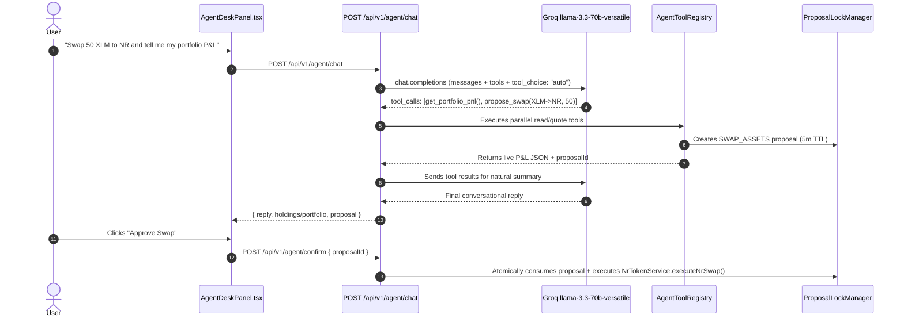

# Module 5 (`M5`): AI Agent Desk 2.0 — Groq `llama-3.3-70b-versatile` Native Tool Calling

> **Status:** Planned Specification (Ready for Approval)  
> **Dependencies:** `M1` (`$NR` Token Swap), `M2` (Smart Baskets), `M3` (User Portfolio P&L), `M7` (AI Coupons)  
> **2026 Protocol References:** Groq Production Tool Calling (`llama-3.3-70b-versatile`, `llama-3.1-8b-instant`), OpenAI-Compatible `tools` / `tool_choice: "auto"` Schema, Single-Use Proposal Locks  

---

## 1. 2026 Research & Current Codebase Audit

### 1.1 Groq API 2026 Tool Calling Standard
Per the 2026 Groq API documentation:
- Legacy preview models (such as `llama3-groq-70b-8192-tool-use-preview`) are **deprecated** in favor of production models with native function calling and parallel tool execution:
  - **`llama-3.3-70b-versatile`**: Primary heavy-duty model for multi-step reasoning, basket allocation synthesis, and function orchestration.
  - **`llama-3.1-8b-instant`**: Ultra-low-latency model supporting full tool calling and JSON mode.
- Standard request schema uses OpenAI-compatible `tools: Array<{ type: 'function', function: { name, description, parameters } }>` and `tool_choice: 'auto'`.

### 1.2 Current Codebase Audit
| Component | Current Location | Current Limitation |
| :--- | :--- | :--- |
| **`AIRouterService`** | `apps/api/src/services/ai/aiRouter.ts` (L60–125) | `chatCompletion(messages)` only sends `model`, `messages`, `temperature: 0.2`, `max_tokens: 400`. It does **not** accept `tools` or `tool_choice`, and ignores `tool_calls` in responses. Moreover, `liveModels` puts arbitrary models ahead of `llama-3.3-70b-versatile`. |
| **`AgentToolRegistry`** | `apps/api/src/agent/toolRegistry.ts` (L6–33) | Defines `search_catalog`, `check_wallet_balance`, `get_exchange_rates`, `get_live_gold_rates`, and stubs `mint_gold_tokens`/`open_perp_position`, **but is never imported or called by `agent.ts`**. |
| **Agent Router** | `apps/api/src/routes/agent.ts` (L36–514) | Relies strictly on brittle keyword/regex matching (`lower.includes('balance')`, `parseQuantityAndProduct`) and hardcodes fake `$NR`/`nGOLD` values (`nrTokensUnits = 45.0` on L147, `ngoldUnits = 1.0` on L149). |
| **Proposal Lock Manager** | `apps/api/src/agent/proposalLock.ts` (L8)<br>`apps/api/src/services/mongo.ts` (L128) | `action` is restricted to `'PURCHASE_ORDER' | 'DEPOSIT_FUNDS' | 'PAY_ORDER'`. It cannot lock a conversational **Swap**, **Custom AI Basket**, or **Portfolio Cashout**. |

---

## 2. Target Architecture: Hybrid Native Tool Calling + Deterministic Proposal Locks

To ensure both **natural conversational intelligence** and **zero-hallucination financial safety**, Module 5 separates **Read/Compute Tools** (executed automatically by the LLM loop) from **State-Mutating Actions** (which always generate a 5-minute single-use `ProposalLock` requiring explicit human approval).



*(Resilience Guarantee: If `GROQ_API_KEY` is missing or rate-limited (`429`), `agent.ts` gracefully falls back to an upgraded deterministic intent parser that supports `SWAP_ASSETS`, `CREATE_CUSTOM_BASKET`, `GENERATE_DISCOUNT_COUPON`, and real `PortfolioService` reads—so tests and demos never fail offline.)*

---

## 3. Native Tool Registry Specification (`apps/api/src/agent/toolRegistry.ts`)

Expose OpenAI/Groq-compatible JSON schemas via `AgentToolRegistry.getToolDefinitions()`:

| Tool Name | Mode | Inputs (JSON Schema) | Underlying Service Called |
| :--- | :--- | :--- | :--- |
| **`search_live_catalog`** | Read-Only | `{ query?: string, category?: 'all' \| 'baskets' \| 'live-assets' \| 'hardware' }` | `ProductService.getActiveProducts()` (with live oracle hydration from `M2`) |
| **`get_portfolio_and_balance`** | Read-Only | `{}` (uses authenticated `userId`) | `WalletService.getBalance()` + `PortfolioService.getUserPortfolio()` + `NrTokenService.getPoolStats()` |
| **`get_live_market_and_nr_price`** | Read-Only | `{}` | `getMetalQuote()` + `getFxQuote()` + `NrTokenService.getPoolStats()` |
| **`propose_order_purchase`** | **Proposal Lock** | `{ sku: string, qty: number, rail?: 'STELLAR' \| 'XRPL' \| 'NR_TOKEN' }` | `ProposalLockManager.createProposal(userId, 'PURCHASE_ORDER', ...)` |
| **`propose_token_swap`** | **Proposal Lock** | `{ fromAsset: 'XLM' \| 'XRP' \| 'USD' \| 'NR', toAsset: 'NR' \| 'XLM' \| 'XRP' \| 'USD', amount: number }` | `NrTokenService.quoteSwap()` + `ProposalLockManager.createProposal(userId, 'SWAP_ASSETS', ...)` |
| **`propose_custom_ai_basket`** | **Proposal Lock** | `{ budgetUsd: number, riskProfile: 'conservative' \| 'balanced' \| 'growth' }` | Builds a personalized allocation (`GOLD_G`, `USDC`, `NR`, `XRP`, `XLM`) using live prices + `ProposalLockManager.createProposal(userId, 'CREATE_CUSTOM_BASKET', ...)` |
| **`negotiate_discount_coupon`** | Controlled Reward | `{ cartTotalUsd?: number }` | `CouponService.issueAgentBargainCoupon(userId)` $\rightarrow$ returns verified single-use `AGENT15` (`15%` off) |

---

## 4. Proposal Lock Extensions & Execution (`proposalLock.ts` & `agent.ts`)

### 4.1 Extended `MongoProposalDoc['action']`
In `apps/api/src/services/mongo.ts` and `apps/api/src/agent/proposalLock.ts`:
```ts
action: 'PURCHASE_ORDER' | 'DEPOSIT_FUNDS' | 'PAY_ORDER' | 'SWAP_ASSETS' | 'CREATE_CUSTOM_BASKET'
```

### 4.2 Custom AI Basket Synthesis Logic (`propose_custom_ai_basket`)
When a user asks *"Build me a $100 low-risk basket"*, the agent checks `riskProfile`:
- **`conservative` (Low Risk)**: `60% 24K Gold (PAXG) + 30% USDC + 10% Silver (KAG)`
- **`balanced` (Moderate Risk)**: `40% Gold + 25% $NR + 20% XRP + 15% XLM`
- **`growth` (High Upside)**: `40% $NR + 30% XRP + 30% XLM`

Every component quantity $Q_i$ is computed from `budgetUsd * weight_i / livePrice_i` at proposal creation time and locked for 5 minutes. When the user clicks **Approve** (`POST /api/v1/agent/confirm`):
1. `ProposalLockManager.consumeProposal()` marks the proposal `CONFIRMED` atomically.
2. **If `action === 'SWAP_ASSETS'`**: Executes `NrTokenService.executeNrSwap()` or `CrossChainSwapService` inside the transaction, records treasury profit (`M4`), and returns swap explorer links.
3. **If `action === 'CREATE_CUSTOM_BASKET'`**: Inserts a real `MongoOrderDoc` with `items` containing the custom SKU `AI-CUSTOM-BASKET` and `custom_allocations`, charges the internal USD/`$NR` wallet (or creates `PENDING` checkout order), triggers `PortfolioService.creditOrderAllocations()` (`M3`) + `2% $NR` Cashback (`M7`), and records `0.25%` AI execution fee in `TreasuryService` (`M4`).

---

## 5. `AIRouterService` & Frontend UI Updates

### 5.1 `apps/api/src/services/ai/aiRouter.ts`
- Prioritize tool-capable production models at the top of `candidateModels`:
  1. `env.GROQ_MODEL` (if set)
  2. `'llama-3.3-70b-versatile'`
  3. `'llama-3.1-8b-instant'`
  4. Other live chat models returned from `GET /models`
- Add `chatWithTools({ messages, tools, toolChoice = 'auto' })` returning `{ message, toolCalls, modelUsed, latencyMs }` and handling up to `3` tool-execution round trips safely (preventing infinite loops).

### 5.2 `apps/web/src/components/AgentDeskPanel.tsx`
- Update `ProposalData['action']` type (`'PURCHASE_ORDER' | 'PAY_ORDER' | 'DEPOSIT_FUNDS' | 'SWAP_ASSETS' | 'CREATE_CUSTOM_BASKET'`).
- Render tailored confirmation cards inside the chat feed:
  - **Swap Proposal Card**: Shows `50 XLM ➔ 18.42 $NR`, Live Rate, Price Impact %, and `[Approve Swap]` / `[Reject]`.
  - **Custom AI Basket Card**: Shows allocation pills (`60% Gold • 30% USDC • 10% Silver`), `$100.00` total, `+$2.00 NR Cashback`, and `[Approve & Invest]`.
  - **Coupon Bargain Card**: Shows copyable `AGENT15` badge with a 1-click **"Apply to Cart"** shortcut.
- Replace hardcoded balance response in `agent.ts` (L143–151) with live `PortfolioService` + `NrTokenService` balances so chat answers always match `/profile`.

### 5.3 Layer 3: Admin Dashboard Integration (`apps/web/src/app/admin/page.tsx` & `apps/api/src/routes/admin.ts`)
Currently, `apps/web/src/app/admin/page.tsx` uses a static `Proposal AG-0182` placeholder in the `agent` tab (L619–666) and a static 3-item `agentAuditTrace` array in the `audit` tab (L96–100 & L669–682).
1. **Backend Admin Endpoint (`apps/api/src/routes/admin.ts`)**:
   - Add `GET /api/v1/admin/agent-telemetry` (`requireAuth`, `requireAdmin`) returning:
     - Recent `proposals` from MongoDB (`PROPOSED`, `CONFIRMED`, `REJECTED`, `EXPIRED`, including `SWAP_ASSETS` and `CREATE_CUSTOM_BASKET`).
     - Recent `agent_audit_traces` with `prompt`, `toolsInvoked`, `modelUsed`, `latencyMs`, and `createdAt`.
     - Aggregate metrics: Total AI Conversations, Average Latency (`ms`), and Proposal Approval Rate (`%`).
2. **Frontend Admin Console (`apps/web/src/app/admin/page.tsx`)**:
   - **`agent` Tab**: Replace hardcoded `AG-0182` card with live AI Proposals feed from MongoDB (showing pending/confirmed swaps & custom baskets) plus a **Live Groq Model & Tool Registry Status** badge (`llama-3.3-70b-versatile`).
   - **`audit` Tab**: Replace static `agentAuditTrace` array with real `agent_audit_traces` rows showing timestamp, user prompt, tools called, latency (`ms`), and model used.

---

## 6. Step-by-Step Implementation & Verification Checklist

- [ ] **Step 5.1**: Upgrade `apps/api/src/services/ai/aiRouter.ts` with `chatWithTools()` prioritizing `llama-3.3-70b-versatile` and `llama-3.1-8b-instant`.
- [ ] **Step 5.2**: Expand `AgentToolRegistry` (`apps/api/src/agent/toolRegistry.ts`) with OpenAI/Groq JSON schemas and handlers for catalog, portfolio P&L, swaps, custom AI baskets, and coupons.
- [ ] **Step 5.3**: Extend `ProposalLockManager` (`apps/api/src/agent/proposalLock.ts`) and `MongoProposalDoc` (`mongo.ts`) to support `'SWAP_ASSETS'` and `'CREATE_CUSTOM_BASKET'`.
- [ ] **Step 5.4**: Update `apps/api/src/routes/agent.ts` (`/chat` and `/confirm`) to wire native Groq tool calling + deterministic fallback + real `PortfolioService` data.
- [ ] **Step 5.5**: Update `apps/web/src/components/AgentDeskPanel.tsx` with Swap, Custom Basket, and Coupon chat cards + quick-action prompt chips (`"Swap 20 XLM to NR"`, `"Build $100 low-risk basket"`, `"Show my portfolio profit"`).
- [ ] **Step 5.6 (Admin Layer)**: Add `GET /api/v1/admin/agent-telemetry` in `apps/api/src/routes/admin.ts` and wire `activeTab === 'agent'` and `activeTab === 'audit'` in `apps/web/src/app/admin/page.tsx` to live MongoDB telemetry.
- [ ] **Step 5.7 (Tests)**: Create `apps/api/test/agent-v2-tools.test.ts` verifying:
  - Tool definitions conform to Groq/OpenAI function schema (`type: 'function'`, valid JSON Schema `parameters`).
  - `SWAP_ASSETS` proposal lock cannot be replayed twice (`409 Conflict` on second `/confirm`).
  - `CREATE_CUSTOM_BASKET` rejects negative/excessive budgets (`>$5,000` `MAX_TRANSACTION_LIMIT_CENTS`) and credits exact allocations when confirmed.
  - Real portfolio holdings are returned instead of static `45.0 NR` mock values.
