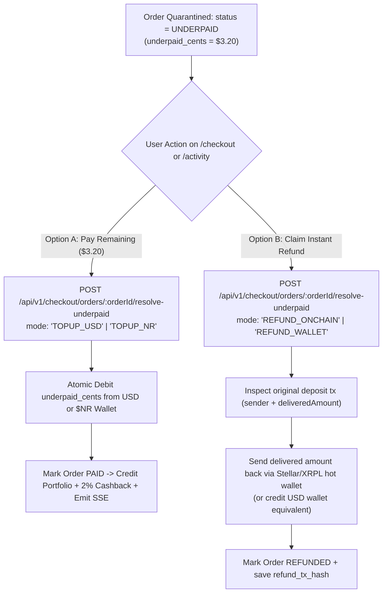

# Module 6 (`M6`): Core Infrastructure Gap Fixes (MongoDB Swaps, Live Perps Oracle & Underpaid Resolution)

> **Status:** Planned Specification (Ready for Approval)  
> **Dependencies:** None (Recommended to execute **first** as the stability foundation for `M1`–`M5`)  
> **Scope:** Resolves the 3 critical half-built / stubbed paths discovered during codebase audit  

---

## 1. Overview of Identified Codebase Gaps

During our line-by-line audit of `apps/api` and `apps/web`, three functional gaps were found where either state is lost on restart, the UI triggers an `HTTP 501` error, or quarantined orders have no completion/refund path:

| # | Gap Title | Exact Files Audited | Impact Today |
| :--- | :--- | :--- | :--- |
| **6.1** | In-Memory `SWAP_ORDERS` Map | `apps/api/src/services/crossChainSwapService.ts` (L39) | Swaps disappear on server restart; users cannot view swap history on `/activity` or `/swap`. |
| **6.2** | `/rwa/perps` Calls `HTTP 501` Stub | `apps/api/src/routes/rwa/rwaModularRouter.ts` (L21–23)<br>`apps/web/src/app/rwa/perps/page.tsx` (L19) | Clicking **"Get quote"** on `/rwa/perps` always fails with `Perpetual quotes are not connected to a provider.` |
| **6.3** | `UNDERPAID` Slippage Quarantine Dead-End | `apps/api/src/routes/checkout.ts` (L224–253) | If crypto drops $>1.5\%$ after quote expiry, the order is marked `UNDERPAID`, but the user cannot pay the shortfall or claim an on-chain refund. |

---

## 2. Gap 6.1: Persist Cross-Chain Swaps to MongoDB (`swaps` Collection)

### 2.1 Current Behavior (`apps/api/src/services/crossChainSwapService.ts` L38–39)
```ts
// In-memory swap order storage with Map (fallback / cache)
const SWAP_ORDERS = new Map<string, SwapOrder>();
```
`createSwapOrder()`, `getSwapOrder()`, and `executeSwap()` read/write solely to `SWAP_ORDERS` in RAM. Also, `apps/api/src/routes/swap.ts` (`POST /initiate` and `GET /:swapId`) never attaches `user_id` even when a logged-in user initiates the swap.

### 2.2 Target Design
1. **MongoDB Schema (`apps/api/src/services/mongo.ts`)**:
   Add `MongoSwapOrderDoc` (`collection: 'swaps'`):
   ```ts
   export interface MongoSwapOrderDoc {
     _id?: any;
     swapId: string;
     user_id?: string;
     fromAsset: 'XRP' | 'XLM' | 'NR' | 'USD';
     toAsset: 'XLM' | 'XRP' | 'NR' | 'USD';
     payAmount: number;
     receiveAmount: number;
     exchangeRate: number;
     userSourceAddress?: string;
     userDestinationAddress: string;
     platformDepositAddress: string;
     paymentIdentifierType: 'destination_tag' | 'memo_text' | 'internal_ledger';
     paymentIdentifier: string | number;
     status: 'PENDING_DEPOSIT' | 'DEPOSIT_CONFIRMED' | 'PAYOUT_PROCESSING' | 'COMPLETED' | 'FAILED';
     depositTxHash?: string;
     payoutTxHash?: string;
     depositExplorerUrl?: string;
     payoutExplorerUrl?: string;
     journalEntry?: string;
     feeUsdCents?: number;
     createdAt: string;
     expiresAt: string;
     updatedAt: string;
   }
   ```
   Indexes in `MongoService.initIndexes`:
   - `{ swapId: 1 }` (`unique: true`)
   - `{ user_id: 1, createdAt: -1 }`
2. **Write-Through Persistence (`crossChainSwapService.ts`)**:
   - `createSwapOrder()` inserts into `swaps` collection (with graceful fallback to `SWAP_ORDERS` Map if Mongo is offline in unit tests) and updates cache.
   - `getSwapOrder(swapId)` checks cache first, then queries MongoDB `swaps` if absent (and make callers `await CrossChainSwapService.getSwapOrder(swapId)` in `swap.ts` L115 and L168).
   - `executeSwap()` transitions swap status atomically in MongoDB (`$set` updates) and persists `depositTxHash`, `payoutTxHash`, and `journalEntry`.
3. **New History Endpoint (`apps/api/src/routes/swap.ts`)**:
   - Attach optional auth extraction (`optionalAuth`) on `POST /initiate` so `user_id` is saved when signed in.
   - Add `GET /api/v1/swap/history/me` (`requireAuth`) returning the authenticated user's past swaps sorted newest-first, rendered inside `/activity` and `/swap`.

---

## 3. Gap 6.2: Wire `/api/v1/rwa-modular/perps/quote` to Live Metal Oracles

### 3.1 Current Behavior
- Frontend `apps/web/src/app/rwa/perps/page.tsx` calls `fetchPerpQuote(pair, leverage, positionSize)` in `apps/web/src/lib/shop.ts` (L687–707).
- `shop.ts` expects `payload.data` to contain `{ pair, leverage, indexPriceUsd, sizeUsd, marginUsd, liquidationPrice }`.
- Backend `apps/api/src/routes/rwa/rwaModularRouter.ts` (L21–23) unconditionally returns:
  `res.status(501).json({ success: false, error: 'Perpetual quotes are not connected to a provider.' });`

### 3.2 Target Mathematical Design (Live Oracle Quote Engine)
In `apps/api/src/routes/rwa/rwaModularRouter.ts`, replace the `501` stub on `GET /perps/quote` with live calculations powered by `getMetalQuote()` (`apps/api/src/services/market.ts`):
- Parse & validate query params with Zod:
  - `pair`: `'XAU/USD' | 'XAG/USD'` (default `'XAU/USD'`)
  - `leverage`: integer/number in `[1, 10]` (default `2`)
  - `size`: positive number $> 0$ (default `100`)
- Compute **Troy Ounce Index Price** (standard global XAU/XAG spot unit, `1 troy oz = 31.1034768 grams`):
  $$P_{\text{index}} = \begin{cases} \text{goldUsdPerGram} \times 31.1034768 & \text{if pair} = \text{XAU/USD} \\ \text{silverUsdPerGram} \times 31.1034768 & \text{if pair} = \text{XAG/USD} \end{cases}$$
- Compute **Illustrative Initial Margin**:
  $$\text{Margin}_{\text{USD}} = \frac{\text{Size}_{\text{USD}}}{\text{Leverage}}$$
- Compute **Illustrative Long Liquidation Price** (with $0.5\%$ maintenance margin buffer):
  $$P_{\text{liq}} = P_{\text{index}} \times \left(1 - \frac{1}{\text{Leverage}} + 0.005\right)$$
- Return `{ success: true, data: { pair, leverage, indexPriceUsd, sizeUsd, marginUsd, liquidationPrice, oracleSource: quote.source, disclaimer: 'Illustrative oracle quote only; not an executed leveraged trade.', timestamp: quote.fetchedAt } }`.
- This matches `fetchPerpQuote()` in `apps/web/src/lib/shop.ts` (L691–706) cleanly with zero breaking UI changes!

---

## 4. Gap 6.3: `UNDERPAID` Slippage Order Top-Up & Instant On-Chain Refund

### 4.1 Current Behavior (`apps/api/src/routes/checkout.ts` L224–253)
When `verifyPayment` checks `order.quote_ticket` and `RatesService.evaluateSlippage()` detects $>1.5\%$ adverse slippage after the 5-minute TTL expires:
- Order status is updated to `'UNDERPAID'` with `tx_hash`, `slippage_percent`, and `underpaid_cents` saved on `MongoOrderDoc`.
- **Gap**: There is no recovery path. The user's crypto already landed in the platform vault, yet the order sits stuck in `UNDERPAID`.

### 4.2 Target Resolution Flow



### 4.3 Implementation Details
1. **Extend `MongoOrderDoc` (`apps/api/src/services/mongo.ts`)**:
   Add `refund_tx_hash?: string`, `topup_reference?: string`, `delivered_crypto_amount?: number`, `sender_wallet_address?: string`.
2. **Save Verified Sender & Delivered Amount (`checkout.ts` L231–243)**:
   When quarantining an order as `UNDERPAID`, also persist `sender_wallet_address: verification.sourceAddress` and `delivered_crypto_amount: verification.amountDelivered` so an automatic on-chain refund knows the exact origin address and amount.
3. **New Endpoint (`apps/api/src/routes/checkout.ts`)**:
   - `POST /api/v1/checkout/orders/:orderId/resolve-underpaid` (`requireAuth`)
   - Supports 3 deterministic modes inside a MongoDB `ClientSession`:
     - **`TOPUP_USD`**: Atomically debits `order.underpaid_cents` from user's `USD` `wallet_balances`, updates status to `PAID`, emits SSE settlement, and triggers portfolio/cashback hooks.
     - **`TOPUP_NR`**: Converts `order.underpaid_cents` to `$NR` at live spot price, debits user's `NR` balance, and marks order `PAID`.
     - **`REFUND_ONCHAIN`** (or `REFUND_WALLET` fallback if original sender is missing): Uses `CrossChainSwapService` payout helpers (or `StellarProvider` / `XrplProvider` hot wallet) to return `delivered_crypto_amount` to `sender_wallet_address`, marks order `REFUNDED`, and records `refund_tx_hash`.
4. **Frontend UI (`apps/web/src/app/checkout/page.tsx` & `apps/web/src/app/activity/page.tsx`)**:
   - Whenever an order has `status === 'UNDERPAID'`, render an amber alert card showing the shortfall (`$X.XX` due to slippage) with two 1-click buttons: **"Pay Shortfall from Wallet / $NR"** and **"Claim Instant Refund"**.

### 4.4 Layer 3: Admin Dashboard Integration (`apps/web/src/app/admin/page.tsx` & `apps/api/src/routes/admin.ts`)
During our audit of `apps/web/src/app/admin/page.tsx`, we found that the `orders` tab (L478–543) renders a static hardcoded array `liveOrders` (L45–90) instead of querying MongoDB. As part of `M6`, wire `/admin` directly to persistent order, swap, and metal-oracle data:
1. **Backend Admin Endpoints (`apps/api/src/routes/admin.ts`)**:
   - Add `GET /api/v1/admin/swaps` (`requireAuth`, `requireAdmin`) returning persistent swap records from MongoDB `swaps` collection sorted newest-first.
   - Extend `GET /api/v1/admin/orders` to include `txHash`, `underpaidCents`, `slippagePercent`, and `refundTxHash`.
   - Extend `POST /api/v1/admin/orders/:id/resolve-underpaid` (or reuse admin override in `admin.ts`) so an operator can manually force-settle (`PAID`) or trigger a refund (`REFUNDED`) for a stuck `UNDERPAID` order.
2. **Frontend Admin Console (`apps/web/src/app/admin/page.tsx`)**:
   - **`orders` Tab**: Fetch live records from `GET /api/v1/admin/orders` and `GET /api/v1/admin/swaps` instead of the static `liveOrders` placeholder; highlight `UNDERPAID` rows with operator action buttons (**Force Settle** / **Trigger Refund**).
   - **`rates` Tab (L595–616)**: Add live **Gold (`XAU/USD`)** and **Silver (`XAG/USD`)** troy-ounce oracle index cards alongside the existing `XLM/USD` and `XRP/USD` tiles.

---

## 5. Step-by-Step Implementation & Verification Checklist

- [ ] **Step 6.1**: Add `MongoSwapOrderDoc` and `swaps` indexes in `apps/api/src/services/mongo.ts`, refactor `CrossChainSwapService` to persist swaps in MongoDB, and expose `GET /api/v1/swap/history/me` in `apps/api/src/routes/swap.ts`.
- [ ] **Step 6.2**: Implement live oracle `GET /api/v1/rwa-modular/perps/quote` in `apps/api/src/routes/rwa/rwaModularRouter.ts` and verify `/rwa/perps` renders live `XAU/USD` and `XAG/USD` quotes.
- [ ] **Step 6.3**: Persist `sender_wallet_address` & `delivered_crypto_amount` on `UNDERPAID` orders and add `POST /api/v1/checkout/orders/:orderId/resolve-underpaid` in `apps/api/src/routes/checkout.ts`.
- [ ] **Step 6.4**: Add `UNDERPAID` resolution controls in `/checkout` & `/activity` and swap history display in `/activity` & `/swap`.
- [ ] **Step 6.5 (Admin Layer)**: Add `GET /api/v1/admin/swaps` and `UNDERPAID` metadata/actions in `apps/api/src/routes/admin.ts`; replace static `liveOrders` and add live XAU/XAG oracle cards in `apps/web/src/app/admin/page.tsx`.
- [ ] **Step 6.6 (Tests)**: Create/update tests in `apps/api/test/`:
  - Verify `CrossChainSwapService` persists to `swaps` and survives clearing the in-memory `Map`.
  - Verify `GET /api/v1/rwa-modular/perps/quote?pair=XAU/USD&leverage=5&size=1000` returns HTTP 200 with valid margin (`$200`) and liquidation price `< indexPrice`.
  - Verify `UNDERPAID` resolution transitions order cleanly to `PAID` (on `TOPUP_USD`) or `REFUNDED` (on refund) and prevents duplicate refund calls.
