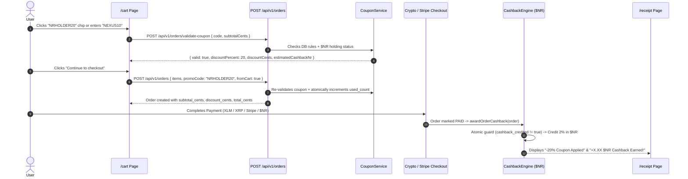

# Module 7 (`M7`): Tamper-Proof Smart Coupons & Automatic `2% $NR` Cashback Engine

> **Status:** Planned Specification (Ready for Approval)  
> **Dependencies:** `M1` (`$NR` Native Token Balance & Spot Price) and `M3` (Portfolio / Wallet Credit Hooks)  
> **Critical Bug Fix:** Resolves client-only promo code drop between `/cart` (`cart/page.tsx`) and `/orders` (`orders.ts`)  

---

## 1. Root-Cause Audit: Existing Promo Bug & Missing Cashback

### 1.1 The Cart-to-Order Coupon Bug
Inspecting `apps/web/src/app/cart/page.tsx` (L136–176), `apps/web/src/lib/shop.ts` (L493–511), and `apps/api/src/routes/orders.ts` (L64–115) revealed a real financial discrepancy:
1. In `cart/page.tsx` (L142–158), entering `"NEXUS10"`, `"STELLAR"`, or `"XRPL"` sets local React state `appliedPromo` and visually deducts `10%` (`discountCents`) from the displayed total.
2. However, when the user clicks **"Continue to checkout"** (`handleProceedToCheckout`, L164–176), it calls `createOrderFromCart(items, 'MULTI')`, which **never passes `appliedPromo` to `POST /api/v1/orders`**.
3. Even if passed, `orders.ts` (L97) calculates `totalCents` exclusively from `unit_price_cents * qty` and ignores promo codes completely—meaning the user gets charged **100% full price** at `/checkout` despite seeing a 10% discount in `/cart`!
4. Similarly, `StripeService.createCheckoutFromCart()` (`apps/api/src/services/stripe.ts` L14–90) has no coupon/discount support.

### 1.2 Missing Loyalty Loop
Currently, buyers earn zero loyalty rewards after completing a purchase. By connecting **Server-Side Coupons** with **Automatic `2% $NR` Cashback** upon settlement, every shopper gets instant `$NR` tokens—introducing new users to the `$NR` ecosystem (`M1`) and encouraging repeat purchases (`NRHOLDER20`).

---

## 2. Coupon & Cashback Mathematics

### 2.1 Server-Side Coupon Validation & Pricing Math
For an order with raw item subtotal $S_{\text{cents}} = \sum (\text{unit\_price\_cents}_i \times \text{qty}_i)$ and submitted coupon code $C$:
1. Lookup $C$ (normalized uppercase) in MongoDB `coupons` collection:
   - Verify `active === true`.
   - Verify `expiresAt` (if set) $> \text{now}$.
   - Verify `max_uses` (if set) $> \text{used\_count}$.
   - Verify `S_cents >= min_order_cents`.
   - If `requires_nr_holder === true`: verify user owns $> 0\text{ NR}$ in `wallet_balances` or `user_holdings`.
2. Compute discount (capped safely so `total_cents >= 100` i.e. $\$1.00$ minimum settlement floor, or `>= 0` if `100%` isn't allowed; recommended max cap `50%`):
   $$D_{\text{cents}} = \text{round}\left(S_{\text{cents}} \times \frac{\text{discount\_percent}}{100}\right)$$
   $$\text{FinalTotal}_{\text{cents}} = \max(100, S_{\text{cents}} - D_{\text{cents}})$$
   *(Note: Also ensure Stripe line items in `StripeService.createCheckoutFromCart()` reflect the discounted net amount so Stripe does not overcharge compared to crypto rails!)*

### 2.2 Automatic `2% $NR` Token Cashback Formula
Whenever any order transitions to `status === 'PAID'` (via Stellar, XRPL, Stripe Webhook, `LedgerWatcherWorker`, or AI Agent `/confirm`), guarded by idempotency flag `cashback_credited?: boolean`:
1. Read `cashback_pct` from `TreasuryService.getConfig()` (default `2%`, configurable by Admin in `M4`).
2. Compute cashback USD value:
   $$\text{Cashback}_{\text{USD\_cents}} = \text{round}\left(\text{FinalTotal}_{\text{cents}} \times \frac{\text{cashback\_pct}}{100}\right)$$
3. Convert to `$NR` tokens at live AMM spot price $P_{\text{NR}}(t)$ (`NrTokenService.getSpotPriceCents()`):
   $$\text{Cashback}_{\text{NR}} = \frac{\text{Cashback}_{\text{USD\_cents}}}{P_{\text{NR}}(t)} \quad (\text{in NR units, scale } 10^6 \text{ micro-NR})$$
4. **Credit Source**: Mint/allocate from platform loyalty reserve pool (or `token_pool` loyalty allocation) directly into:
   - User's `'NR'` `wallet_balances` (`WalletService.creditBalance(userId, nrMicro, 'NR', 'cashback:' + orderNumber, session)`).
   - User's `user_holdings` (`PortfolioService` `M3`, recorded with `CASHBACK_REWARD` event at cost basis `0` or live value so P&L shows pure gain!).

---

## 3. Default Seeded Coupons & AI Bargaining Rules

| Coupon Code | Discount % | Eligibility Rule | Managed By |
| :--- | :---: | :--- | :--- |
| **`NEXUS10`** | `10%` | Open to all orders (`$10+` min) | Default Seed |
| **`STELLAR`** / **`XRPL`** | `10%` | Open to all orders (`$10+` min) | Default Seed |
| **`WELCOME15`** | `15%` | User's first order (`paidOrdersCount === 0`) | Default Seed |
| **`NRHOLDER20`** | `20%` | Requires holding `>= 1 $NR` token in Wallet/Portfolio | `$NR` Utility (`M1`) |
| **`AGENT15`** | `15%` | Issued dynamically via AI ChatBot bargain (`M5`) | `CouponService` / AI |

---

## 4. End-to-End Architecture & Sequence Flow



---

## 5. Database Schema & Backend Endpoints

### 5.1 `apps/api/src/services/mongo.ts`
1. **`coupons` Collection (`MongoCouponDoc`)**:
   ```ts
   export interface MongoCouponDoc {
     _id?: any;
     code: string;                  // Uppercase unique code e.g. "NEXUS10"
     discount_percent: number;      // e.g. 10, 15, 20
     min_order_cents: number;       // e.g. 1000 ($10.00)
     requires_nr_holder: boolean;   // True for NRHOLDER20
     first_order_only?: boolean;    // True for WELCOME15
     issued_to_user_id?: string;    // Optional user-scoped AI coupon
     active: boolean;
     max_uses?: number;
     used_count: number;
     expires_at?: string;
     created_at: string;
   }
   ```
   Index: `{ code: 1 }` (`unique: true`).
2. **Extend `MongoOrderDoc`**:
   Add:
   - `subtotal_cents?: number`
   - `discount_cents?: number`
   - `promo_code?: string`
   - `cashback_credited?: boolean`
   - `cashback_usd_cents?: number`
   - `cashback_nr_amount?: number`

### 5.2 New Service: `apps/api/src/services/couponService.ts`
- `ensureDefaultCoupons()` — Seeds `NEXUS10`, `STELLAR`, `XRPL`, `WELCOME15`, `NRHOLDER20`, and `AGENT15`.
- `validateCoupon({ code, userId, subtotalCents })` — Enforces all rules server-side and returns exact `discountCents` & `finalTotalCents`.
- `redeemCoupon(code, userId, subtotalCents, session)` — Atomically increments `used_count` if within `max_uses`.
- `awardOrderCashback(order: MongoOrderDoc, session?: ClientSession)` — Atomically sets `cashback_credited: true` on `orders`, computes `2%` in `$NR` via `NrTokenService`, and credits `WalletService` + `PortfolioService`.

### 5.3 API Endpoints
- `POST /api/v1/orders/validate-coupon` (`requireAuth`) in `apps/api/src/routes/orders.ts`
- Update `POST /api/v1/orders` (`orders.ts`) and `StripeService.createCheckoutFromCart()` (`stripe.ts`) to accept and apply `promoCode` securely.
- `GET /api/v1/admin/coupons` & `POST /api/v1/admin/coupons` (`requireAuth`, `requireAdmin`) in `apps/api/src/routes/admin.ts` so the owner can create custom promo codes (e.g., `FESTIVAL25`) directly from `/admin`.

---

## 6. Frontend UI Updates

1. **`apps/web/src/app/cart/page.tsx` & `apps/web/src/lib/shop.ts`**:
   - Replace hardcoded client check (`cart/page.tsx` L142) with live `POST /api/v1/orders/validate-coupon` call.
   - Add **1-Click Coupon Chips** below the input (`NEXUS10 • 10%`, `WELCOME15 • 15%`, `NRHOLDER20 • 20%`).
   - Show live **"Estimated Cashback"** pill in Order Summary: `✨ Earn +X.XX $NR (2% Cashback)`.
   - Pass `appliedPromo` inside `createOrderFromCart(items, 'MULTI', appliedPromo)` and `startStripeCheckout(appliedPromo)`.
2. **`apps/web/src/app/checkout/page.tsx`**:
   - Fetch exact backend `order` totals (`subtotalCents`, `discountCents`, `promoCode`, `totalCents`) by `orderId` rather than recomputing raw cart prices locally, so the discounted price is honored across Stellar, XRPL, `$NR`, and Stripe!
3. **`apps/web/src/app/receipt/page.tsx`**:
   - Show the **Promo Discount line** (`-$XX.XX`) and a celebratory **"Cashback Credited: +X.XX `$NR`"** reward banner with link to `/profile` portfolio.
4. **`apps/web/src/app/admin/page.tsx`**:
   - Add a **Coupon Manager** panel to create, inspect usage counts, or toggle active promo codes.

---

## 7. Step-by-Step Implementation & Verification Checklist

- [ ] **Step 7.1**: Add `MongoCouponDoc` and order discount/cashback fields in `apps/api/src/services/mongo.ts`.
- [ ] **Step 7.2**: Implement `CouponService` (`apps/api/src/services/couponService.ts`) with server-side validation, atomic redemption, and idempotent `2% $NR` cashback awarding.
- [ ] **Step 7.3**: Wire `POST /api/v1/orders/validate-coupon` and `promoCode` handling into `apps/api/src/routes/orders.ts` and `apps/api/src/services/stripe.ts`.
- [ ] **Step 7.4**: Trigger `CouponService.awardOrderCashback()` across all settlement paths (`checkout.ts`, `stripe.ts`, `ledgerWatcher.ts`, `agent.ts`).
- [ ] **Step 7.5**: Add coupon management endpoints in `apps/api/src/routes/admin.ts`.
- [ ] **Step 7.6**: Update `apps/web/src/lib/shop.ts`, `/cart`, `/checkout`, `/receipt`, and `/admin`.
- [ ] **Step 7.7 (Tests)**: Create `apps/api/test/coupons-cashback.test.ts` verifying:
  - `NEXUS10` persists exact 10% discount into `MongoOrderDoc.total_cents` (no price revert at checkout).
  - `NRHOLDER20` fails with `400` if user holds `0 NR`, and succeeds with `20%` discount once user holds `>= 1 NR`.
  - Duplicate settlement calls (`awardOrderCashback` called twice) credit `2% $NR` cashback **exactly once**.
