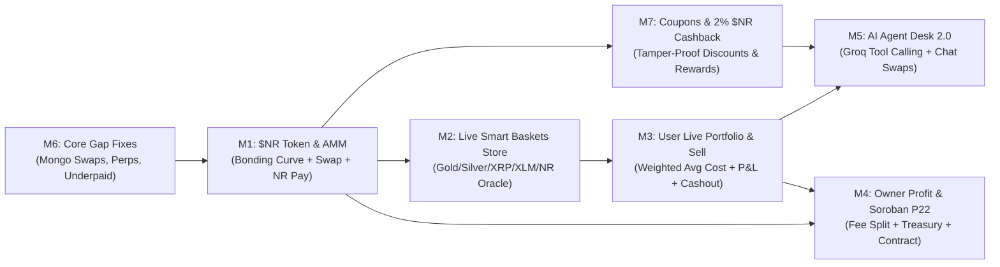

# NexusRail — Module-by-Module Master Architecture & Research Suite (`M1` – `M7`)

> **Version:** 3.0.0 Specification Baseline  
> **Target Repository:** `d:\live\nexus-rail` (`@nexusrail/api`, `@nexusrail/web`, `@nexusrail/shared`)  
> **Research Baseline:** November 2026 Official Protocol & SDK Standards  

---

## 1. Executive Overview

NexusRail currently operates a multi-rail commerce platform connecting **Stellar Horizon Testnet**, **XRPL Altnet WebSockets**, **Stripe Checkout**, a **MongoDB Atlas double-entry ledger**, and a **Groq-powered AI Agent Desk**. However, a deep codebase audit revealed three foundational limitations:
1. Storefront items (`apps/api/src/services/products.ts`, `apps/web/src/app/store/page.tsx`) rely on static, hardcoded pricing for fictional hardware rather than live market assets or yield-bearing multi-rail baskets.
2. The native `$NR` token (`NR-TOKEN`) is treated as a static `$25.00` SKU without a live Automated Market Maker (AMM) bonding curve, revenue backing, or swap/checkout utility.
3. Several architectural pieces—in-memory `SWAP_ORDERS` maps, HTTP `501` stubs on `/rwa/perps`, unresolved `UNDERPAID` slippage orders, and disconnected Cart promo codes—prevent seamless production evolution.

To address these cleanly without risky big-bang rewrites, NexusRail's next evolution is divided into **7 self-contained, sequentially verifiable modules (`M1` – `M7`)**.

---

## 2. 2026 Official Technology Standards Baseline

Every module specification in this suite is anchored against the **2026 production capabilities** of the SDKs already installed in `apps/api/package.json` and `apps/web/package.json`:

| Ecosystem | Installed Package | 2026 Official Standard & Capabilities Used |
| :--- | :--- | :--- |
| **Stellar & Soroban** | `@stellar/stellar-sdk` (`^13.3.0`) `@stellar/freighter-api` (`^6.0.1`) | • **Protocol 22 (`CAP-0058`)**: Native Soroban contract `__constructor(env, admin, ...)` eliminating uninitialized deployment windows. • **Protocol 22 (`CAP-0059`)**: Native BLS12-381 cryptographic host functions for zk-proof / verifiable receipts. • **Stellar RPC** (rebranded from Soroban RPC): Unified JSON-RPC (`getHealth`, `getLatestLedger`, `simulateTransaction`) for classic + smart contract state. • **Multi-Operation Atomic Transactions**: Simultaneous vault settlement, owner fee split, and `ManageData` proof anchoring in a single atomic transaction envelope. |
| **XRP Ledger (XRPL)** | `xrpl` (`^4.7.0`) `@gemwallet/api` (`^3.8.0`) | • **`MPTokensV1` (`XLS-89`)**: Multi-Purpose Tokens identified by a 192-bit `MPTokenIssuanceID`, on-chain metadata JSON, supply caps, and native protocol-enforced transfer fees. • **Native AMM (`XLS-30`)**: Constant-product $x \cdot y = k$ liquidity pool invariants (`fixAMMClawbackRounding`) used as the mathematical blueprint for the `$NR` AMM. • **Price Oracles (`XLS-47` / `fixPriceOracleOrder`)**: Deterministic asset-pair oracle formatting alongside `delivered_amount` validation against Partial Payment exploits. |
| **Groq LLM & AI Desk** | Groq REST API (`llama-3.3-70b-versatile`, `llama-3.1-8b-instant`) | • **Native Production Tool Calling**: OpenAI-compatible `tools` + `tool_choice: "auto"` schema with parallel tool execution (replacing legacy `tool-use-preview` models). • **Atomic Proposal Locks**: Human-in-the-loop MongoDB single-use proposal locks (`ProposalLockManager`) ensuring no financial mutation executes without explicit user confirmation. |
| **Market & Commodity Oracles** | CoinGecko API + Binance Spot Ticker (`market.ts`) | • Live `PAXG` (Gold), `KAG` (Silver), `XRP`, and `XLM` spot prices in USD and INR with 24h change computation, in-flight request deduplication, and 30-minute TTL caching. |

---

## 3. Recommended Phased Implementation Order & Dependency Graph

Because `M6` stabilizes persistence and payment edge cases and `M1` establishes the `$NR` price engine that `M2`, `M3`, `M4`, `M5`, and `M7` depend on, follow this execution sequence:

---

## 4. Module Specification Index

*(Each active module gets its own structured sub-folder `docs/modules/module-X-.../` with dedicated DB, Backend, Frontend/Admin UI, Research, and Living Change Log files — starting with **Module 1**.)*

| Module | Document Link | Core Scope & Deliverable | Primary Target Files |
| :--- | :--- | :--- | :--- |
| **`M1`** | [**`module-1-nr-token/`**](./module-1-nr-token/README.md) *(Legacy summary: [M1_NR_NATIVE_TOKEN_AMM.md](./M1_NR_NATIVE_TOKEN_AMM.md))* | `$NR` Native Token constant-product AMM ($R_{\text{USD}} \times S_{\text{NR}} = k$), `XLM/XRP/USD <-> NR` swaps, 10%-off `$NR` checkout, & `/admin` pool monitor. | `nrTokenService.ts`, `swap.ts`, `wallet.ts`, `checkout.ts`, `admin.ts`, `swap/page.tsx`, `checkout/page.tsx`, `admin/page.tsx` |
| **`M2`** | [**M2_LIVE_SMART_BASKETS_ORACLE_STORE.md**](./M2_LIVE_SMART_BASKETS_ORACLE_STORE.md) | Live market-hydrated Multi-Rail Smart Baskets (*Inflation Shield*, *Dual-Rail Flash*, *AI Alpha*) and Live RWA Assets on `/store`. | `products.ts`, `market.ts`, `mongo.ts`, `store/page.tsx` |
| **`M3`** | [**M3_USER_PORTFOLIO_PNL_CASHOUT.md**](./M3_USER_PORTFOLIO_PNL_CASHOUT.md) | `user_holdings` collection, weighted-average cost basis, live unrealized P&L tracking, and 1-click asset cashout. | `portfolioService.ts`, `wallet.ts`, `profile/page.tsx`, `activity/page.tsx` |
| **`M4`** | [**M4_OWNER_PROFIT_ENGINE_SOROBAN_P22.md**](./M4_OWNER_PROFIT_ENGINE_SOROBAN_P22.md) | Double-entry 1.0% fee + 0.5% spread split (50% Owner / 50% `$NR` reserve), `/admin` Profit Console, and Stellar Protocol 22 contract + RPC inspector. | `treasuryService.ts`, `soroban.ts`, `admin.ts`, `admin/page.tsx`, `contracts/nexus_vault/src/lib.rs` |
| **`M5`** | [**M5_AI_AGENT_DESK_V2_TOOL_CALLING.md**](./M5_AI_AGENT_DESK_V2_TOOL_CALLING.md) | Groq `llama-3.3-70b-versatile` native tool calling, conversational `$NR` swaps, AI custom basket builder, and portfolio P&L queries. | `aiRouter.ts`, `toolRegistry.ts`, `proposalLock.ts`, `agent.ts`, `AgentDeskPanel.tsx` |
| **`M6`** | [**M6_CORE_INFRASTRUCTURE_GAP_FIXES.md**](./M6_CORE_INFRASTRUCTURE_GAP_FIXES.md) | Persist `SWAP_ORDERS` to MongoDB `swaps`, replace `/rwa-modular/perps/quote` 501 stub with live math, and add `UNDERPAID` top-up/refund flow. | `crossChainSwapService.ts`, `rwaModularRouter.ts`, `checkout.ts`, `checkout/page.tsx` |
| **`M7`** | [**M7_SMART_COUPONS_AND_NR_CASHBACK.md**](./M7_SMART_COUPONS_AND_NR_CASHBACK.md) | Fix Cart-to-Order coupon drop bug, server-side `coupons` collection, AI-negotiated `AGENT15` codes, and automatic `2% $NR` cashback on every paid order. | `couponService.ts`, `orders.ts`, `webhooks.ts`, `cart/page.tsx`, `receipt/page.tsx` |

---

## 5. 3-Layer Module Execution Standard (Backend + User UI + Admin Console)

Every module (`M1` – `M7`) is engineered across **all three application layers simultaneously** so no feature is ever left disconnected from the Operator Admin Console (`/admin`):

| Module | Layer 1: Backend & DB (`apps/api`) | Layer 2: User Frontend UI (`apps/web`) | Layer 3: Operator Admin Dashboard (`apps/web/src/app/admin/page.tsx` & `routes/admin.ts`) |
| :--- | :--- | :--- | :--- |
| **`M6`** | Persist `swaps` in MongoDB, live `/perps/quote` math, `resolve-underpaid` endpoints. | `/swap` & `/activity` history, working `/rwa/perps`, `UNDERPAID` top-up/refund buttons. | `GET /api/v1/admin/swaps` + live Orders/Swaps table replacing mock `liveOrders`, `UNDERPAID` operator actions (`Force Settle` / `Refund`), & XAU/XAG rates in `rates` tab. |
| **`M1`** | `$NR` AMM (`token_pool`, `nrTokenService.ts`), `NR` swaps, `POST /checkout/nr/pay`. | `/swap` `$NR` bonding curve UI + sparkline, `/checkout` `Pay with $NR` (10% off). | `GET /api/v1/admin/nr-pool` & `POST /nr-pool/adjust-reserve` + Live `$NR` AMM Pool & Reserve Backing Card inside `overview` & `rails` tabs. |
| **`M7`** | Server-side `coupons` validation, discounted Stripe/Order totals, `2% $NR` cashback. | `/cart` clickable chips + live cashback preview, `/checkout` discounted total, `/receipt` reward badge. | `GET/POST /api/v1/admin/coupons` + **Coupon Manager** panel in `/admin` to create, toggle, and audit coupon redemptions. |
| **`M2`** | Live CoinGecko/Binance 24h oracle hydration + Smart Basket NAV (`products.ts`). | `/store` Smart Baskets & Live RWA tabs, `LIVE ORACLE` badges, allocation bars. | `POST /api/v1/admin/products` & `PATCH /products/:sku` + Live Oracle Catalog & Smart Basket Manager in `/admin`. |
| **`M3`** | `user_holdings` weighted-avg cost basis, live P&L, `GET /portfolio`, `POST /portfolio/sell`. | `/profile` Live Portfolio P&L + 1-click Cashout modal, `/activity` portfolio trades tab. | `GET /api/v1/admin/portfolios` + activates the currently missing `{activeTab === 'ledger'}` view in `admin/page.tsx` showing total Assets Under Custody vs. Vault Reserves. |
| **`M4`** | `TreasuryService` 50/50 split, Protocol 22 `lib.rs` contract, live Stellar RPC health. | Checkout fee breakdown transparency + Protocol 22 verification badge on `/receipt`. | Live `GET /api/v1/admin/stats` & `PATCH /treasury/config` replacing static `$184,920.40` overview KPIs with real Net Profit, Fee Sliders, & Stellar RPC v22 Vault Health. |
| **`M5`** | Groq `llama-3.3-70b-versatile` `chatWithTools()`, `SWAP_ASSETS` & `CREATE_CUSTOM_BASKET` locks. | `AgentDeskPanel.tsx` interactive Swap, Custom AI Basket, & `AGENT15` coupon cards. | `GET /api/v1/admin/agent-telemetry` replacing mock `AG-0182` & `agentAuditTrace` in `agent` & `audit` tabs with live MongoDB `agent_audit_traces` & `proposals`. |

---

## 6. Cross-Module Invariants (Must Hold at Every Phase)

1. **Double-Entry Zero-Sum Rule**: Every balance change in `wallet_ledger` and `platform_treasury` must preserve $\sum \text{Debits} - \sum \text{Credits} = \$0.00$.
2. **Server-Authoritative Pricing & Discounts**: Client-supplied prices, swap rates, or coupon totals are never trusted; all totals are recalculated server-side against MongoDB and live market feeds.
3. **Atomic Concurrency Safety**: Token swaps, wallet debits, proposal locks, and coupon redemptions must execute inside MongoDB conditional updates (`$gte`) or multi-document `ClientSession` transactions.
4. **Non-Custodial & Human-in-the-Loop**: AI proposals (`PURCHASE_ORDER`, `PAY_ORDER`, `SWAP_ASSETS`, `CREATE_CUSTOM_BASKET`) expire in 5 minutes and never execute without an explicit authenticated `POST /api/v1/agent/confirm`.
