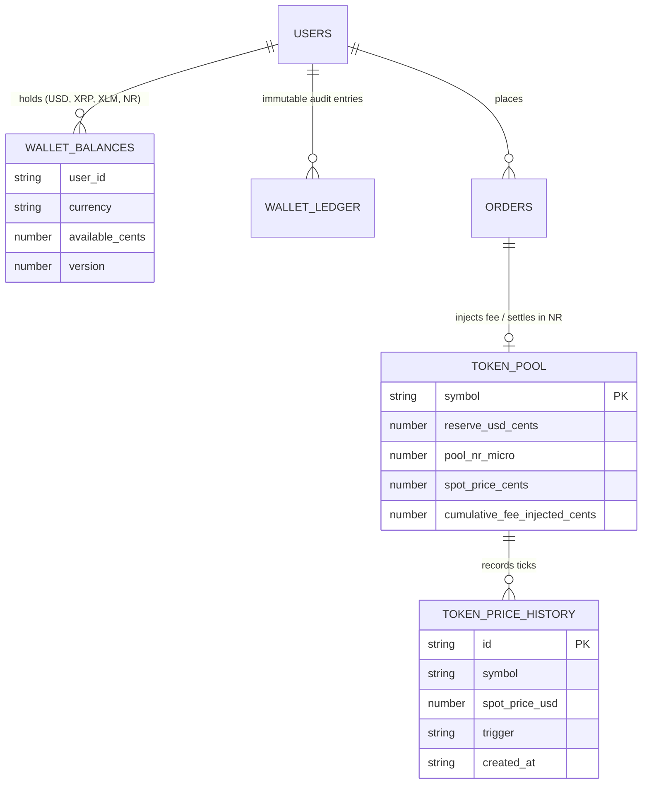

# Module 1 — Database Schema, Precision Scales & Shared TypeScript Contracts

> **Parent Module:** [`module-1-nr-token/README.md`](./README.md)  
> **Primary Files Covered:** `packages/shared/src/types/database.ts`, `apps/api/src/services/mongo.ts`, `apps/api/src/services/wallet.ts`  

---

## 1. Current State vs. Target State Audit

| Artifact | Current Code | Module 1 Target Change |
| :--- | :--- | :--- |
| `packages/shared/src/types/database.ts` (L1, L3) | `PaymentRail = 'STRIPE' | 'WALLET' | 'XRPL' | 'STELLAR'`<br>`WalletCurrency = 'USD' | 'XRP' | 'XLM'` | Add `'NR_TOKEN'` to `PaymentRail` and `'NR'` to `WalletCurrency`. |
| `apps/api/src/services/wallet.ts` (L6, L13) | `const currencies = ['USD', 'XRP', 'XLM'];` | Add `'NR'` to `currencies` and default balance map `{ USD: 0, XRP: 0, XLM: 0, NR: 0 }`. |
| `apps/api/src/services/mongo.ts` | No AMM pool or price history collections. | Add `token_pool` (`MongoTokenPoolDoc`), `token_price_history` (`MongoTokenPriceTickDoc`), plus optional `$NR` checkout fields on `MongoOrderDoc`. |
| `apps/api/src/services/products.ts` (L185–199) | `NR-TOKEN` hardcoded at `price_cents: 2500`. | Hydrate `NR-TOKEN` dynamically from `NrTokenService.getPoolStats().spotPriceCents`. |

---

## 2. Shared TypeScript Definitions (`packages/shared/src/types/database.ts`)

```ts
export type PaymentRail = 'STRIPE' | 'WALLET' | 'XRPL' | 'STELLAR' | 'NR_TOKEN';
export type OrderStatus = 'PENDING' | 'PAID' | 'UNDERPAID' | 'FULFILLING' | 'FULFILLED' | 'CANCELLED' | 'REFUNDED';
export type WalletCurrency = 'USD' | 'XRP' | 'XLM' | 'NR';
export type TransactionType = 'CREDIT' | 'DEBIT';
```

*(Note: After editing `packages/shared/src/types/database.ts`, run `npm run build:shared` so both `@nexusrail/api` and `@nexusrail/web` consume the updated `.d.ts` declarations.)*

---

## 3. Unit Scale & Precision Standard (Crucial Invariant)

Because `WalletService` (`apps/api/src/services/wallet.ts` L82, L113) uses integer `available_cents` (`Math.round(amountCents)`) where formatting divides by `100` (`$1.00 = 100` units):
- **`wallet_balances` & `wallet_ledger` for `'NR'`**: Store **`centi-NR`** (`1.00 NR = 100 units`, i.e., `NR_WALLET_SCALE = 100`), OR store **`micro-NR`** (`1.000000 NR = 1_000_000`) with currency-aware formatting.
- **Decision for Module 1**: Use **`micro-NR` (`NR_SCALE = 1_000_000`) inside `token_pool`** (for exact AMM `BigInt` curve math with 6-decimal token precision) and **`micro-NR` (`1_000_000` per `1 NR`) inside `wallet_balances` where `currency === 'NR'`** with explicit helper methods `WalletService.formatAmount(currency, rawUnits)` and error formatting:
  - For `'USD'`: `$${(units / 100).toFixed(2)}`
  - For `'NR'`: `${(units / 1_000_000).toFixed(4)} NR`
  - Why: `1 NR` can cost `$1.00` or `$5.00`, and fractional swaps (e.g., `$10.00` of XLM $\rightarrow$ `9.940299 NR`) require at least 4–6 decimals so buyers don't lose up to `$0.01–$0.05` on rounding every small swap or `2%` cashback credit!

---

## 4. MongoDB Collections & Schemas (`apps/api/src/services/mongo.ts`)

### 4.1 `token_pool` Collection (`MongoTokenPoolDoc`)
Stores the authoritative single-document AMM state for `$NR`.

| Field | Type | Default / Genesis | Description |
| :--- | :--- | :--- | :--- |
| `symbol` | `'NR'` | `'NR'` | Unique token identifier (Unique Index `{ symbol: 1 }`). |
| `name` | `string` | `'NexusRail Protocol Token'` | Human-readable asset name. |
| `reserve_usd_cents` | `number` | `10_000_000` (`$100,000.00`) | Active USD liquidity reserve backing the pool ($R_{\text{USD}}$). |
| `pool_nr_micro` | `number` | `100_000_000_000` (`100,000 NR`) | `$NR` liquidity currently inside the AMM pool ($S_{\text{NR}}$). |
| `total_supply_nr_micro` | `number` | `1_000_000_000_000` (`1,000,000 NR`) | Maximum supply cap (`S_max`). |
| `circulating_nr_micro` | `number` | `0` | `$NR` distributed to user wallets via swaps/cashback. |
| `spot_price_cents` | `number` | `100` (`$1.00`) | Cached spot price (`Math.round((R_USD * 1e6) / S_NR)`). |
| `price_24h_open_cents` | `number` | `100` | Rolling 24h reference price for `% change` UI display. |
| `total_volume_usd_cents` | `number` | `0` | Cumulative USD value of all `$NR` buys and sells. |
| `cumulative_fee_injected_cents` | `number` | `0` | Cumulative platform revenue injected into $R_{\text{USD}}$. |
| `swap_fee_bps` | `number` | `50` (`0.5%`) | AMM swap fee basis points. |
| `updated_at` | `string` | ISO-8601 | Timestamp of last pool state mutation. |

**Indexes:**
```ts
await db.collection('token_pool').createIndex({ symbol: 1 }, { unique: true });
```

### 4.2 `token_price_history` Collection (`MongoTokenPriceTickDoc`)
Stores historical spot-price snapshots used to draw the live Bonding Curve / 24h Chart on `/swap` and `/admin`.

| Field | Type | Description |
| :--- | :--- | :--- |
| `id` | `string` | UUID primary key. |
| `symbol` | `'NR'` | Token symbol. |
| `spot_price_cents` | `number` | Exact spot price in USD cents after the event (or float cents with 2 decimals, e.g., `102.002`). |
| `spot_price_usd` | `number` | Exact spot price in USD (`1.0200`). |
| `reserve_usd_cents` | `number` | Pool reserve after event. |
| `pool_nr_micro` | `number` | Pool `$NR` supply after event. |
| `trigger` | `'GENESIS' \| 'SWAP_BUY' \| 'SWAP_SELL' \| 'REVENUE_INJECTION' \| 'ADMIN_ADJUST'` | What caused this price tick. |
| `reference_id` | `string` | Swap ID, Order Number, or Admin ID. |
| `created_at` | `string` | ISO-8601 timestamp. |

**Indexes:**
```ts
await db.collection('token_price_history').createIndex({ symbol: 1, created_at: -1 });
```

### 4.3 Extensions to `MongoOrderDoc` & `MongoWalletTxDoc`
- **`MongoWalletTxDoc` & `MongoWalletBalanceDoc`** (`apps/api/src/services/mongo.ts` L92–112):
  Change `currency: 'USD' | 'XRP' | 'XLM'` $\rightarrow$ `currency: 'USD' | 'XRP' | 'XLM' | 'NR'`.
- **`MongoOrderDoc`** (`apps/api/src/services/mongo.ts` L71–90):
  Add optional fields:
  - `nr_discount_cents?: number` — Exact `$10%` discount applied when paid via `$NR_TOKEN`.
  - `paid_nr_micro?: number` — Exact micro-NR debited from buyer's wallet at checkout.
  - `nr_spot_rate_usd?: number` — Spot price of `1 NR` locked at checkout time.

---

## 5. Entity-Relationship Diagram


