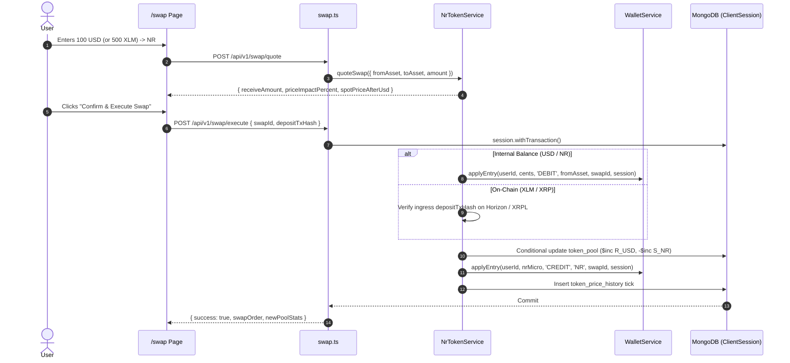
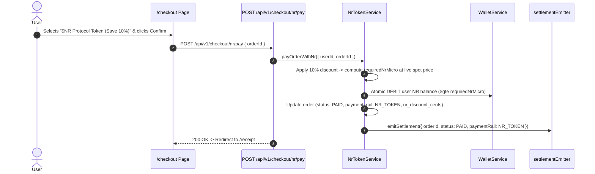

# Module 1 — Backend Service, REST Endpoints & Sequence Flows

> **Parent Module:** [`module-1-nr-token/README.md`](./README.md)  
> **Primary Files Covered:** `apps/api/src/services/nrTokenService.ts`, `wallet.ts`, `products.ts`, `routes/swap.ts`, `routes/checkout.ts`, `routes/admin.ts`  

---

## 1. Backend Service Design: `NrTokenService` (`apps/api/src/services/nrTokenService.ts`)

`NrTokenService` encapsulates all constant-product AMM math, concurrency locks, and MongoDB `ClientSession` transactions.

### 1.1 Method Contracts

| Method | Signature | Behavior & Atomicity |
| :--- | :--- | :--- |
| **`ensureGenesisPool()`** | `Promise<MongoTokenPoolDoc>` | Idempotently upserts `token_pool` (`symbol: 'NR'`) with `$setOnInsert` (`R_USD = 10_000_000`, `S_NR = 100_000_000_000`) and inserts the `'GENESIS'` tick in `token_price_history` if empty. |
| **`getPoolStats()`** | `Promise<NrPoolStats>` | Reads `token_pool` + last 30 ticks from `token_price_history`. Computes exact float `spotPriceUsd`, `marketCapUsd`, `change24hPercent`, `reserveUsd`, `circulatingNr`, and `invariantK`. |
| **`quoteSwap(params)`** | `({ fromAsset, toAsset, amount }) => Promise<NrSwapQuote>` | Pure read-only simulation using `BigInt` $x \cdot y = k$ math + live `getFxQuote()` (when `fromAsset` or `toAsset` is `'XLM'` or `'XRP'`). Returns `receiveAmount`, `effectiveRate`, `spotPriceBeforeUsd`, `spotPriceAfterUsd`, `priceImpactPercent`, and `feeUsd`. |
| **`executeNrSwap(params)`** | `({ userId, fromAsset, toAsset, amount, depositTxHash?, destinationAddress?, session? })` | Runs inside `MongoService.getClient().startSession().withTransaction(...)`:<br>1. Verifies ingress payment (if `fromAsset === 'USD'` or `'NR'`, atomically debits `WalletService` with `$gte` overdraft protection; if `fromAsset === 'XLM'` or `'XRP'`, validates `depositTxHash` / hot-wallet receipt).<br>2. Atomically updates `token_pool` using optimistic concurrency filter `{ symbol: 'NR', pool_nr_micro: pool.pool_nr_micro, reserve_usd_cents: pool.reserve_usd_cents }` (retrying up to 3 times on write conflict).<br>3. Credits output currency (`NR` or `USD` via `WalletService`, or `XLM`/`XRP` payout via `CrossChainSwapService`).<br>4. Logs `token_price_history` tick. |
| **`payOrderWithNr(params)`** | `({ userId, orderId })` | Inside MongoDB transaction:<br>1. Fetches `PENDING` order belonging to `userId`.<br>2. Applies **10% `$NR` holder discount**: `discountedCents = Math.max(100, Math.round(order.total_cents * 0.90))`.<br>3. Converts `discountedCents` to `requiredNrMicro` at current `spotPriceUsd` (`0%` routing fee).<br>4. Atomically debits `requiredNrMicro` from user's `'NR'` `wallet_balances`.<br>5. Marks order `PAID` with `payment_rail: 'NR_TOKEN'`, `nr_discount_cents`, `paid_nr_micro`, emits SSE `settlementEmitter.emitSettlement()`, and pins receipt to IPFS. |
| **`injectRevenueToPool()`** | `(amountUsdCents: number, referenceId: string, session?: ClientSession)` | Atomically `$inc`s `reserve_usd_cents` and `cumulative_fee_injected_cents` on `token_pool`, recomputes `spot_price_cents`, and inserts a `'REVENUE_INJECTION'` price tick. |
| **`adminAdjustReserve()`** | `(deltaUsdCents: number, adminId: string, note?: string)` | Admin-only reserve top-up (or guarded withdrawal respecting `reserve_usd_cents >= 100_000`) with `'ADMIN_ADJUST'` audit tick. |

---

## 2. REST API Endpoints Specification

### 2.1 Public Pool Telemetry: `GET /api/v1/swap/nr-pool`
- **File:** `apps/api/src/routes/swap.ts`
- **Auth:** Public
- **Response (`200 OK`)**:
```json
{
  "success": true,
  "data": {
    "symbol": "NR",
    "name": "NexusRail Protocol Token",
    "spotPriceUsd": 1.02,
    "spotPriceCents": 102,
    "change24hPercent": 2.0,
    "reserveUsd": 100997.5,
    "poolNrSupply": 99014.802713,
    "circulatingNr": 985.197287,
    "totalSupplyNr": 1000000,
    "marketCapUsd": 1004.9,
    "totalVolumeUsd": 1000.0,
    "cumulativeFeeInjectedUsd": 2.5,
    "swapFeePercent": 0.5,
    "history": [
      { "spotPriceUsd": 1.0, "trigger": "GENESIS", "createdAt": "2026-11-16T06:00:00.000Z" },
      { "spotPriceUsd": 1.02, "trigger": "SWAP_BUY", "createdAt": "2026-11-16T06:15:00.000Z" }
    ]
  }
}
```

### 2.2 Extended Quote Endpoint: `POST /api/v1/swap/quote`
- **File:** `apps/api/src/routes/swap.ts`
- **Request Body (Zod)**: `{ fromAsset: 'XRP' | 'XLM' | 'NR' | 'USD', toAsset: 'XRP' | 'XLM' | 'NR' | 'USD', amount: number }`
- **Response (`200 OK`)**:
```json
{
  "success": true,
  "fromAsset": "XLM",
  "toAsset": "NR",
  "amount": 500,
  "exchangeRate": 0.1752,
  "receiveAmount": 87.6142,
  "spotPriceBeforeUsd": 1.0,
  "spotPriceAfterUsd": 1.0018,
  "priceImpactPercent": 0.09,
  "feeUsd": 0.44,
  "xlmUsd": 0.1778,
  "xrpUsd": 1.2972,
  "expiresInSeconds": 45
}
```

### 2.3 Extended Swap Execution (`POST /api/v1/swap/initiate` & `POST /api/v1/swap/execute`)
- **File:** `apps/api/src/routes/swap.ts`
- **Auth:** Required (`requireAuth`) when `fromAsset` or `toAsset` is `'NR'` or `'USD'` (so internal ledger balances are strictly user-scoped); preserves backward-compatible behavior for `'XRP' <-> 'XLM'` bridge.
- **Deposit Modes Supported**:
  1. **Internal Wallet Balance (`fromAsset: 'USD' | 'NR'`)**: Instant atomic execution without needing an external extension popup.
  2. **On-Chain Deposit (`fromAsset: 'XLM' | 'XRP' -> toAsset: 'NR'`)**: Uses existing Freighter/GemWallet/Manual deposit flow (`platformDepositAddress` + Memo/Tag), verifies ingress tx, then credits `$NR` to the user's wallet.

### 2.4 Pay Order with `$NR`: `POST /api/v1/checkout/nr/pay`
- **File:** `apps/api/src/routes/checkout.ts`
- **Auth:** `requireAuth`
- **Request Body:** `{ orderId: string }`
- **Validation & Business Rules:**
  - Rejects `404` if order not found or belongs to another user.
  - Rejects `400` if order `status === 'PAID'` or `'CANCELLED'`.
  - Rejects `402` (or `409`) with helpful balance message if user's `'NR'` balance `< requiredNrMicro`.
- **Response (`200 OK`)**:
```json
{
  "success": true,
  "orderStatus": "PAID",
  "data": {
    "orderId": "...",
    "orderNumber": "NR-1052",
    "originalCents": 12900,
    "nrDiscountCents": 1290,
    "finalPaidCents": 11610,
    "paidNrAmount": 113.823529,
    "spotPriceUsd": 1.02,
    "txHash": "nr_ledger_..."
  }
}
```

### 2.5 Admin Pool Control Endpoints (`apps/api/src/routes/admin.ts`)
- `GET /api/v1/admin/nr-pool` (`requireAuth`, `requireAdmin`) — Full pool state, invariant $k$, reserve backing ratio, and last 50 `token_price_history` events.
- `POST /api/v1/admin/nr-pool/adjust-reserve` (`requireAuth`, `requireAdmin`) — Zod validated `{ deltaUsdCents: number, note?: string }`, adjusts pool reserve atomically and logs an `'ADMIN_ADJUST'` tick.

---

## 3. End-to-End Sequence Diagrams

### Flow A: Swapping `XLM / XRP / USD -> $NR` via Constant-Product AMM



### Flow B: Paying an Order with `$NR` (`10% Off + 0% Fee`)


