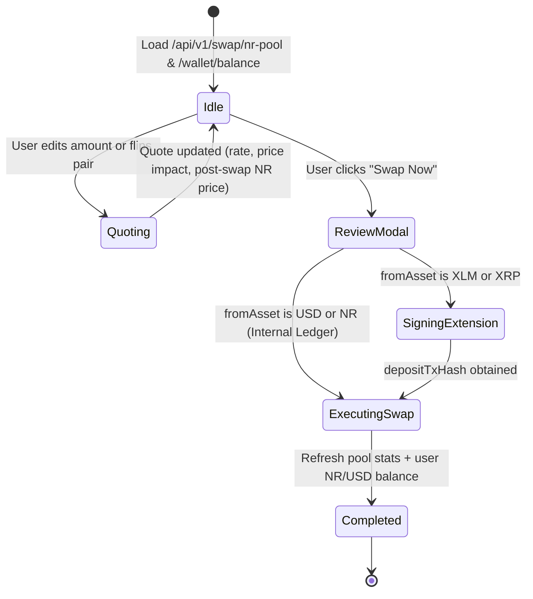

# Module 1 — User Frontend (`/swap`, `/checkout`, `/store`) & Admin Dashboard (`/admin`) Flows

> **Parent Module:** [`module-1-nr-token/README.md`](./README.md)  
> **Primary Files Covered:** `apps/web/src/app/swap/page.tsx`, `apps/web/src/app/checkout/page.tsx`, `apps/web/src/app/store/page.tsx`, `apps/web/src/app/admin/page.tsx`  

---

## 1. Surface 1: `/swap` Page (`apps/web/src/app/swap/page.tsx`)

### 1.1 Existing Code Audit
- Line 38: `type SwapToken = 'XRP' | 'XLM' | 'USDC' | 'RLUSD';`
- Lines 136–141: `liveRate` currently computes purely linear `fromUsd / toUsd` without AMM curve slippage/price impact.
- Lines 184–185: `xrpBalance` and `xlmBalance` use local demo state (`500.0` and `3480.5`) rather than merging live authenticated `USD` / `NR` wallet balances from `/api/v1/wallet/balance`.

### 1.2 UI Additions & State Flow
1. **Extend Token Selector (`SwapToken`)**:
   - Support `'XRP' | 'XLM' | 'NR' | 'USD'` (keeping `'USDC' | 'RLUSD'` display labels compatible if referenced).
   - Style `'NR'` with `text-[var(--gold)]`, badge `'NEXUSRAIL AMM POOL'`, and a quick **"Buy `$NR`"** preset chip.
2. **Live `$NR` Tokenomics Banner (Top of `/swap`)**:
   - Fetches `GET /api/v1/swap/nr-pool` on mount and after every executed swap.
   - Displays 4 live metric pills:
     - **Live `$NR` Spot Price**: `$1.XX` (`+X.XX% 24h`)
     - **Pool Reserve Backing**: `$100,XXX.XX`
     - **Circulating `$NR`**: `XXX.XX NR`
     - **SVG Bonding Curve Sparkline**: Rendered smoothly from `data.history` points without extra chart library dependencies.
3. **AMM Quote Breakdown Inside Swap Card**:
   - Whenever `fromToken === 'NR'` or `toToken === 'NR'`, debounce (`250ms`) a call to `POST /api/v1/swap/quote` to display:
     - **Price Impact**: e.g. `0.09%` (amber warning if `> 2%`)
     - **AMM Fee (`0.5%`)**: `50% LP Reserve / 50% Treasury`
     - **Post-Swap `$NR` Price**: `$1.0000 ➔ $1.0200`
4. **Execution Modes**:
   - If `fromToken === 'USD'` or `fromToken === 'NR'` (internal wallet rails): Skip external extension signing popup and show a single **"Confirm Internal Ledger Swap"** button inside the Review Modal (requiring user login).
   - If `fromToken === 'XLM'` or `'XRP'` and `toToken === 'NR'`: Reuse the existing Freighter / GemWallet / Crossmark / Manual Transfer modal flow cleanly.

---

## 2. Surface 2: `/checkout` Page (`apps/web/src/app/checkout/page.tsx`)

### 2.1 Existing Code Audit
- Lines 60: `const [selectedRail, setSelectedRail] = useState<'STELLAR' | 'XRPL'>('STELLAR');`
- Lines 399–403: Card 3 in the 2x2 grid is currently a disabled **`EVM (COMING SOON)`** placeholder!
- Lines 144–230: `handleConfirmAndPay` only handles `'STELLAR'` and `'XRPL'`.

### 2.2 Module 1 Checkout Upgrades
1. **Replace Disabled `EVM` Card (L399–403) with Active `$NR` Native Token Card**:
   - Update `selectedRail` state type to `'STELLAR' | 'XRPL' | 'NR_TOKEN'`.
   - Card 3 displays:
     - Title: **`$NR Token`** with badge **`SAVE 10% • 0% FEE`**
     - Required `$NR` amount (computed as `(rawSubtotalUsd * 0.90) / nrSpotPriceUsd`)
     - User's live `$NR` balance fetched from `GET /api/v1/wallet/balance`
     - If `userNrBalance < requiredNr`: Show inline link `"Need more $NR? Swap XLM/XRP/USD -> $NR ↗"` pointing to `/swap?to=NR`.
2. **Quote Breakdown & Order Summary Sync**:
   - When `selectedRail === 'NR_TOKEN'`, show `-10% $NR Holder Savings (-$XX.XX)` and `Platform Fee: $0.00 (Waived)` in Step 03 (`Review the quote`) and in the right-hand Order Summary panel.
3. **Payment Handler (`handleConfirmAndPay`)**:
   - When `selectedRail === 'NR_TOKEN'`, send `POST /api/v1/checkout/nr/pay { orderId }` with Bearer token, clear cart, store receipt snapshot (`rail: 'NR_TOKEN'`, `token: 'NR'`, `amountCrypto: paidNrAmount`), and route to `/receipt?orderId=...`.

---

## 3. Surface 3: `/store` Page (`apps/web/src/app/store/page.tsx`)

- In `apps/api/src/services/products.ts` (L185–199), `NR-TOKEN` (`NR Protocol Token`) currently seeds at `price_cents: 2500`.
- When `ProductService.getActiveProducts()` or `getProductBySku('NR-TOKEN')` runs, dynamically update `NR-TOKEN`'s `price_cents` to `NrTokenService.getPoolStats().spotPriceCents` so the `/store` catalog and `/swap` AMM always agree on the live `$NR` price.

---

## 4. Surface 4: Operator Admin Dashboard (`apps/web/src/app/admin/page.tsx`)

### 4.1 Existing Code Audit
- Lines 401–422 (`activeTab === 'overview'`) and lines 546–592 (`activeTab === 'rails'`) currently show static Stellar and XRPL vault cards with zero visibility into the `$NR` token pool.

### 4.2 Admin Console Additions for Module 1
1. **Live `$NR` Protocol AMM & Liquidity Card** (rendered inside `overview` and `rails` tabs):
   - Fetches `GET /api/v1/admin/nr-pool` using the operator's Bearer token (and gracefully falls back to `GET /api/v1/swap/nr-pool` for read-only stats if needed).
   - Displays:
     - **Spot Price**: `$X.XXXX` (`24h: +X.XX%`)
     - **USD Backing Reserve ($R_{\text{USD}}$)**: `$XXX,XXX.XX`
     - **Pool `$NR` Remaining ($S_{\text{NR}}$)**: `XX,XXX.XX NR`
     - **Circulating `$NR`**: `X,XXX.XX NR`
     - **Cumulative Revenue Injected**: `$X,XXX.XX`
     - **Invariant $k$**: Formatted scientific/numeric proof (`R × S`).
2. **Operator Reserve Control Modal / Inline Form**:
   - Input `Reserve Adjustment ($ USD)` + `Reason Note` + button **"Inject Liquidity to `$NR` Pool"** (`POST /api/v1/admin/nr-pool/adjust-reserve`).
   - Immediately refreshes the Admin Pool card and logs an `'ADMIN_ADJUST'` entry in `token_price_history`.
