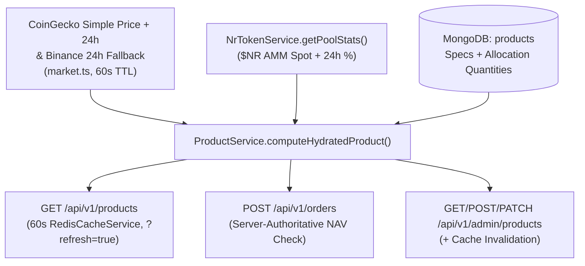

# Module 2 (`M2`) — Backend Oracle Pipeline & API Contracts

## 1. Architecture Flow

---

## 2. Oracle Market Service (`backend/src/services/market.ts`)

- `CACHE_TTL_MS = 60 * 1000` (60s live cache; never returns hardcoded dummy `'fallback'` numbers).
- **`getMetalQuote()`**: Queries Binance `PAXGUSDT` 24hr ticker, Gold-API (`XAU` & `XAG` spot USD/oz), and Coinbase (`USD/INR`) in parallel (`source: 'binance'`), with CoinGecko (`pax-gold,kinesis-silver`) as secondary live oracle (`source: 'coingecko'`).
- **`getFxQuote()`**: Queries Binance `XRPUSDT` & `XLMUSDT` 24hr tickers (`source: 'binance'`), with CoinGecko (`ripple,stellar`) as secondary live exchange (`source: 'coingecko'`).
- **`getExtendedMarketSnapshot(forceRefresh?: boolean)`**: Combines live Metal & FX feeds in parallel into `ExtendedMarketSnapshot` consumed by `ProductService` (`'binance' | 'coingecko' | 'amm'`, zero `'static'` or `'fallback'`).

---

## 3. Public & Admin Endpoints

| Endpoint | Auth | Behavior |
| :--- | :--- | :--- |
| `GET /api/v1/products?refresh=true` | Public | Returns live-hydrated active products. Cache key `products:active` uses a `60s` TTL (`?refresh=true` bypasses cache). |
| `GET /api/v1/products/:sku` | Public | Returns single live-hydrated product. Used by `POST /api/v1/orders` for tamper-proof server pricing. |
| `GET /api/v1/admin/products` | `requireAuth`, `requireAdmin` | Lists **both** active and paused products with live NAV hydration and allocations. |
| `POST /api/v1/admin/products` | `requireAuth`, `requireAdmin` | Creates/updates a Smart Basket or Live Asset and invalidates `products:active`. |
| `PATCH /api/v1/admin/products/:sku` | `requireAuth`, `requireAdmin` | Toggles `active` visibility, updates stock, or modifies allocations and invalidates `products:active`. |
