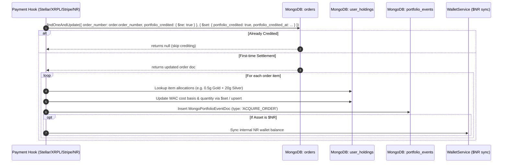

# Module 3 Backend Service & API Specification

> **Service:** `PortfolioService` (`backend/src/services/portfolioService.ts`)  
> **Routes:** `backend/src/routes/portfolio.ts` & `backend/src/routes/admin.ts`  
> **Settlement Hooks:** `checkout.ts`, `stripe.ts`, `ledgerWatcher.ts`, `agent.ts`  

---

## 1. `PortfolioService` Architecture

The `PortfolioService` class encapsulates all custody management, WAC recalculation, and liquidation execution.

```ts
export class PortfolioService {
  /**
   * Decomposes order items and credits user_holdings with strict once-only idempotency
   */
  static async creditOrderAllocations(order: MongoOrderDoc, session?: ClientSession): Promise<boolean>;

  /**
   * Fetches user's holdings, live oracle valuations, and calculates unrealized P&L
   */
  static async getUserPortfolio(userId: string): Promise<UserPortfolioResponse>;

  /**
   * Liquidates user asset position at live oracle price minus 0.5% spread
   */
  static async sellHolding(userId: string, req: SellHoldingRequest): Promise<SellHoldingResponse>;

  /**
   * Aggregates platform-wide Assets Under Custody (AUC) for Admin Console
   */
  static async getPlatformAUC(): Promise<PlatformAUCResponse>;
}
```

---

## 2. Order Settlement Hook Flow & Idempotency Guard

Whenever an order transitions to `PAID`, `creditOrderAllocations(order)` is executed:



### 2.1 The Four Payment Rails Wired to `creditOrderAllocations`
1. **Crypto Direct / SSE (`backend/src/routes/checkout.ts`)**:
   In `verifyPayment()`, when Stellar/XRPL tx is verified and status transitions to `PAID`.
2. **Native $NR Pay (`backend/src/routes/checkout.ts`)**:
   In `POST /api/v1/checkout/nr/pay`, when the atomic $NR debit succeeds and order is marked `PAID`.
3. **Stripe Webhook (`backend/src/services/stripe.ts`)**:
   In `fulfillOrderFromSession()`, when `checkout.session.completed` webhook fires.
4. **Autonomous Ledger Watcher (`backend/src/workers/ledgerWatcher.ts`)**:
   In `reconcilePendingOrders()`, when Horizon or XRPL scans detect an unnotified confirmed transaction.
5. **AI Agent Desk Desk (`backend/src/routes/agent.ts`)**:
   In `POST /confirm`, when an agent proposal lock settles a basket order.

---

## 3. API Route Specifications

### 3.1 `GET /api/v1/portfolio`
- **Authentication:** `requireAuth` (JWT bearer)
- **Response `200 OK`**:
```json
{
  "user_id": "usr_94819",
  "total_cost_cents": 28500,
  "total_current_value_cents": 31250,
  "total_unrealized_pnl_cents": 2750,
  "total_unrealized_pnl_percent": 9.65,
  "total_realized_pnl_cents": 420,
  "inr_total_current_value": 268750,
  "holdings": [
    {
      "symbol": "GOLD_G",
      "label": "Physical 24K Gold (nGOLD)",
      "quantity": 2.50,
      "total_cost_cents": 21500,
      "avg_buy_price_cents": 8600,
      "current_price_cents": 8950,
      "current_value_cents": 22375,
      "unrealized_pnl_cents": 875,
      "unrealized_pnl_percent": 4.07,
      "realized_pnl_cents": 0,
      "change_24h_percent": 1.25,
      "oracle_source": "binance",
      "updated_at": "2026-11-16T13:00:00Z"
    }
  ],
  "recent_events": [ ... ]
}
```

### 3.2 `POST /api/v1/portfolio/sell`
- **Authentication:** `requireAuth` (JWT bearer)
- **Request Body**:
```json
{
  "symbol": "GOLD_G",
  "quantity": 1.0
}
```
- **Validation**:
  - `quantity > 0`
  - User owns at least `quantity` in `user_holdings`.
- **Response `200 OK`**:
```json
{
  "success": true,
  "event_id": "evt_sell_8271",
  "symbol": "GOLD_G",
  "quantity_sold": 1.0,
  "gross_proceeds_cents": 8950,
  "spread_fee_cents": 45,
  "net_payout_cents": 8905,
  "realized_pnl_cents": 305,
  "remaining_quantity": 1.5,
  "new_usd_balance_cents": 14905
}
```

### 3.3 `GET /api/v1/admin/portfolios`
- **Authentication:** `requireAuth` + `requireAdmin`
- **Response `200 OK`**:
  Aggregates total user holdings across all symbols (AUC) and lists the latest 50 portfolio events platform-wide.
