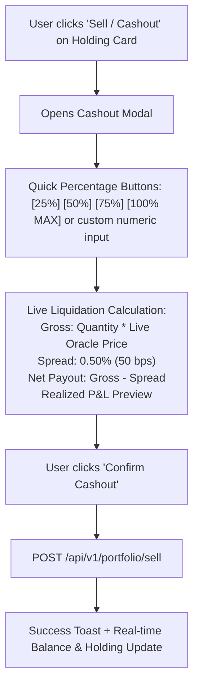

# Module 3 Frontend & Admin UI Flow

> **Scope:** User Portfolio Dashboard, Quick 1-Click Cashout Modal, Activity Event Feed, and Admin Custody AUC Console  
> **Target Files:** `frontend/src/app/profile/page.tsx`, `frontend/src/app/activity/page.tsx`, `frontend/src/app/admin/page.tsx`  

---

## 1. User Profile Experience (`frontend/src/app/profile/page.tsx`)

### 1.1 Live Wealth & P&L Summary Strip
Located at the top of the user profile, rendering real-time aggregated metrics:
- **Invested Capital**: Total USD cents expended across all active asset positions.
- **Current Portfolio Value**: Total live market value hydrated from Binance/Gold-API/AMM feeds.
- **Net Unrealized P&L**: Green/red pill badge displaying `+$XX.XX (+YY.YY%)` or `-$XX.XX (-YY.YY%)`.
- **INR Dual-Currency Display**: Live estimated rupee valuation using the Coinbase INR rate.

### 1.2 Holding Asset Cards
Each constituent asset (`24K Gold`, `Silver`, `$NR Token`, `XRP`, `XLM`, `USDC`) owned by the user displays:
- **Quantity & Label**: e.g., `2.5000 g` Physical 24K Gold (`nGOLD`).
- **Cost Basis vs Live Price**: e.g., Cost Basis: `$86.00/g` vs Current Price: `$89.50/g` (+4.07%).
- **24hr Trend Indicator**: Green or red pill matching the asset's 24-hour market momentum.
- **"1-Click Cashout / Sell" Action Button**: Triggers the quick liquidation modal.

---

## 2. 1-Click Cashout Liquidation Modal

---

## 3. User Activity Feed (`frontend/src/app/activity/page.tsx`)

A dedicated **"Portfolio & Custody Events"** tab displaying:
- Event Timestamp.
- Event Type pill: `ACQUIRE_ORDER` (green), `CASHBACK_REWARD` (purple), `SELL_CASHOUT` (amber).
- Asset symbol & quantity delta (e.g. `+0.50 g GOLD_G` or `-1.00 g GOLD_G`).
- Unit Price & Gross USD valuation.
- Spread fee & Net Realized P&L.

---

## 4. Admin Console: Assets Under Custody (AUC) & Reconciliation Ledger

### 4.1 Filling the Empty `{activeTab === 'ledger'}` Tab
Audit of `frontend/src/app/admin/page.tsx` revealed the sidebar had `{ id: 'ledger', label: 'Reconciliation Ledger' }` but lacked a rendered view. Module 3 fully activates this tab:

1. **System-wide Assets Under Custody (AUC) vs Master Reserves**:
   - Table showing platform-wide user liability for each asset:
     - `Physical Gold (g)`: Total user grams held vs Vault collateral.
     - `Physical Silver (g)`: Total user grams held vs Vault collateral.
     - `XRP`: Total user tokens held vs Hot Wallet balance.
     - `XLM`: Total user tokens held vs Hot Wallet balance.
     - `USDC`: Total user tokens held vs Hot Wallet balance.
     - `$NR`: Total user tokens held vs AMM pool reserves.
   - Total Platform Liability (USD).
2. **Recent User Liquidations & Spread Revenue Feed**:
   - Live stream of recent `SELL_CASHOUT` events showing the 0.50% fee captured for the platform treasury.
