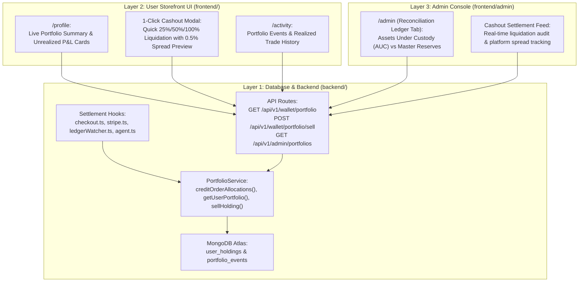

# Module 3 (`M3`): User Live Portfolio, Cost Basis, Real-Time P&L & 1-Click Multi-Rail Cashout

> **Status:** Implementation Phase  
> **Target Monorepo:** `backend/` (`@nexusrail/backend`), `frontend/` (`@nexusrail/frontend`)  
> **Prerequisites:** `M1` (`$NR` AMM & Spot Curve) & `M2` (`ProductAllocation` Smart Baskets & Real-Time Oracle Store)  
> **Standard:** Production Double-Entry Weighted-Average Cost Basis (`WAC`) with 0.5% Platform Spread Cashout  

---

## 1. Executive Summary

In traditional Web3 storefronts, completing checkout marks an order as `PAID`, after which purchased items remain static order receipt records. If a customer purchases **Gold (nGOLD)**, **Silver (nSILVER)**, **$NR Native Tokens**, or a **Smart Basket** (*Inflation Shield*, *Dual-Rail Flash*, *AI Alpha*), they have no mechanism to track whether their asset value appreciated, view cost basis, or liquidate back to cash or crypto without complex external DEX interactions.

**Module 3 (`M3`)** transforms NexusRail from a simple e-commerce checkout into a full **Asset Custody & Real-Time Wealth Management Platform**:
1. **Automated Decomposed Order Crediting**: When any order settles (`Stellar`, `XRPL`, `Stripe`, or `$NR Pay`), the underlying asset allocations (grams of Gold/Silver, XRP, XLM, USDC, NR) are decomposed and atomically credited to the user's `user_holdings` portfolio with strict once-only idempotency (`portfolio_credited: true`).
2. **Weighted-Average Cost Basis (WAC) & Unrealized P&L**: As live oracle rates fluctuate via Binance 24hr tickers, Gold-API, and the `$NR` AMM curve, each user's portfolio dynamically computes real-time Valuation, Average Cost Basis, Net Unrealized P&L ($ and %), and 24hr momentum.
3. **1-Click Multi-Rail Cashout / Sell**: Users can liquidate any holding (or fraction thereof: 25%, 50%, 100%) at live market rates minus a transparent 0.50% (50 bps) platform spread, crediting funds instantly to their internal USD balance (or initiating on-chain payout).
4. **Admin Custody & AUC Ledger Console**: Resolves the unrendered `{activeTab === 'ledger'}` placeholder in `/admin` by delivering a platform-wide **Assets Under Custody (AUC)** dashboard comparing user liabilities against hot vault balances and logging real-time cashout spreads.

---

## 2. Three-Layer Architectural Deliverables

---

## 3. Module 3 Documentation Suite Index

| Document | Purpose & Key Topics |
| :--- | :--- |
| [**`01_RESEARCH_AND_PNL_MATH.md`**](./01_RESEARCH_AND_PNL_MATH.md) | Weighted-Average Cost Basis ($WAC$), live valuation NAV, Unrealized P&L, 0.5% spread liquidation mechanics, and rounding safeguards. |
| [**`02_DATABASE_SCHEMA_AND_TYPES.md`**](./02_DATABASE_SCHEMA_AND_TYPES.md) | `MongoUserHoldingDoc`, `MongoPortfolioEventDoc`, idempotency guards on `MongoOrderDoc`, and shared TypeScript types. |
| [**`03_BACKEND_API_AND_FLOW.md`**](./03_BACKEND_API_AND_FLOW.md) | `PortfolioService` methods, settlement hooks across 4 payment rails, API contracts, and error handling. |
| [**`04_FRONTEND_AND_ADMIN_UI_FLOW.md`**](./04_FRONTEND_AND_ADMIN_UI_FLOW.md) | `/profile` Live Portfolio UX, 1-Click Cashout slider modal, `/activity` event feed, and `/admin` Reconciliation Ledger AUC dashboard. |
| [**`05_IMPLEMENTATION_PLAN_AND_CHANGELOG.md`**](./05_IMPLEMENTATION_PLAN_AND_CHANGELOG.md) | Step-by-step checklist (`Step 3.1`–`3.7`), test matrix (`portfolio-pnl.test.ts`), and Living Change Log. |
