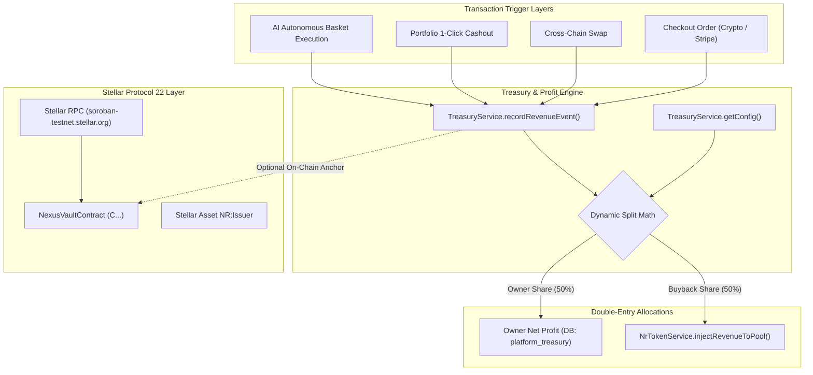

# Module 4 — Backend API & Service Flow Architecture

> **Module:** `M4` Platform Owner Profit Engine, Database Ledger & Stellar Protocol 22 Smart Contract  
> **Backend Framework:** Node.js 22 LTS, Express 4.21, TypeScript 5.7  
> **Key Services:** `TreasuryService`, `SorobanService`, `NrTokenService`, `StellarProvider`

---

## 1. Services Architecture



---

## 2. API Endpoints Specification

### 2.1 Admin Treasury Endpoints

#### `GET /api/v1/admin/treasury/summary`
- **Auth:** Required (`role: 'admin'`)
- **Response:**
  ```json
  {
    "success": true,
    "data": {
      "totalGrossVolumeCents": 12500000,
      "totalRevenueCents": 125000,
      "netOwnerProfitCents": 62500,
      "netOwnerProfitUsd": 625.00,
      "nrPoolInjectedCents": 62500,
      "nrPoolInjectedUsd": 625.00,
      "revenue24hCents": 14200,
      "ownerProfit24hCents": 7100,
      "breakdown": {
        "orderFeesCents": 65000,
        "swapSpreadsCents": 30000,
        "cashoutSpreadsCents": 20000,
        "aiFeesCents": 5000,
        "gasSurplusCents": 5000
      },
      "zeroSumDifferenceCents": 0,
      "isBalanced": true,
      "updatedAt": "2026-11-16T15:00:00Z"
    }
  }
  ```

#### `GET /api/v1/admin/treasury/entries`
- **Auth:** Required (`role: 'admin'`)
- **Query:** `limit=50&offset=0&sourceType=ORDER`
- **Response:** Paginated list of `MongoTreasuryEntryDoc` items.

#### `GET /api/v1/admin/treasury/config`
- **Auth:** Required (`role: 'admin'`)
- **Response:** Active `MongoPlatformConfigDoc`.

#### `PATCH /api/v1/admin/treasury/config`
- **Auth:** Required (`role: 'admin'`)
- **Request Body:** Partial update fields (`order_fee_bps`, `swap_spread_bps`, `nr_buyback_share_pct`, etc.) with strict Zod bounds checking.

---

### 2.2 Smart Contract & Stellar Protocol 22 Endpoints

#### `GET /api/v1/admin/contracts/nexus-vault`
- **Auth:** Required (`role: 'admin'`)
- **Response:**
  ```json
  {
    "success": true,
    "data": {
      "contract": {
        "contractId": "CCB2V...TESTNET",
        "name": "NexusVault",
        "protocolVersion": 22,
        "currentWasmHash": "4f9a...",
        "adminAddress": "GBZ...",
        "treasuryAddress": "GDN...",
        "nrReserveAddress": "GCL...",
        "feeBps": 100,
        "ownerSplitPct": 50,
        "status": "ACTIVE",
        "explorerUrl": "https://stellar.expert/explorer/testnet/contract/CCB2V..."
      },
      "rpcHealth": {
        "status": "HEALTHY",
        "protocolVersion": 22,
        "latestLedger": 482910,
        "latencyMs": 145
      },
      "masterVaultBalances": {
        "stellarXlm": 12450.45,
        "xrplXrp": 4892.12
      }
    }
  }
  ```

#### `POST /api/v1/admin/contracts/nexus-vault/upgrade`
- **Auth:** Required (`role: 'admin'`)
- **Request Body:** `{ "newWasmHash": string, "notes": string }`
- **Action:** Submits in-place upgrade transaction via `env.deployer().update_current_contract_wasm` and records audit entry in `platform_contracts.upgrades`.

---

### 2.3 On-Chain `$NR` Withdrawal Endpoint

#### `POST /api/v1/crypto/nr/withdraw`
- **Auth:** Required (User session)
- **Request Body:** `{ "amount": number, "destinationStellarAddress": string }`
- **Action:**
  1. Validates destination address via `StrKey.isValidEd25519PublicKey`.
  2. Verifies user has sufficient available `$NR`.
  3. Executes atomic debit on user wallet.
  4. Broadcasts Stellar payment of `NR` asset from distribution account.
  5. Records in `token_withdrawals` collection.
